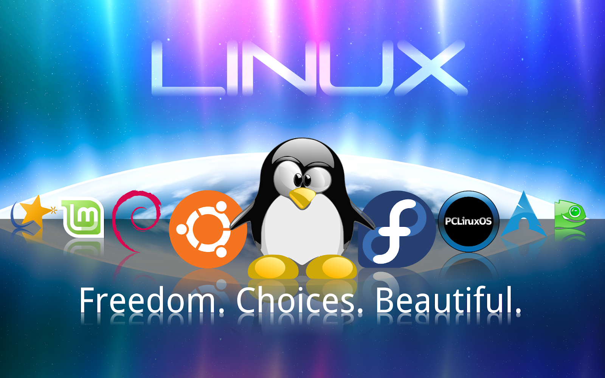
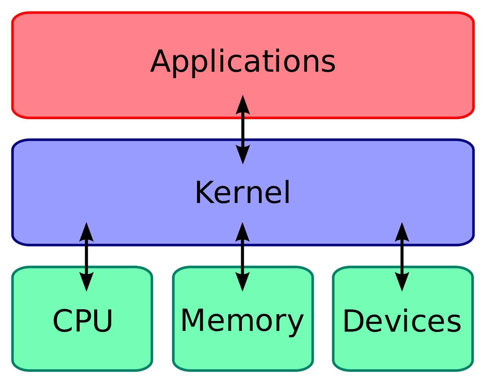
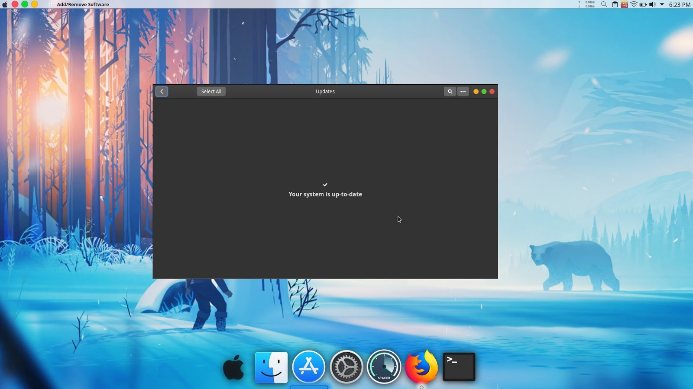
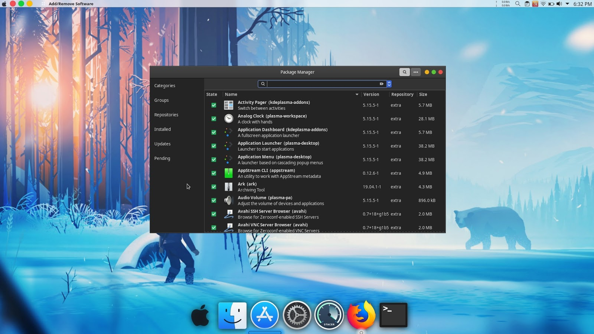
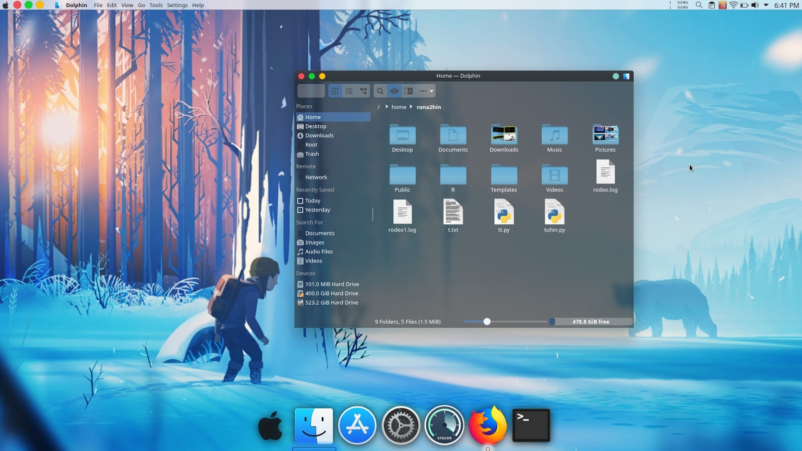
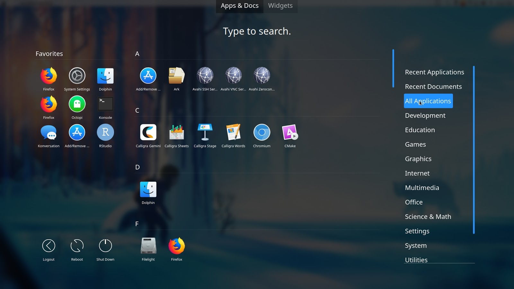
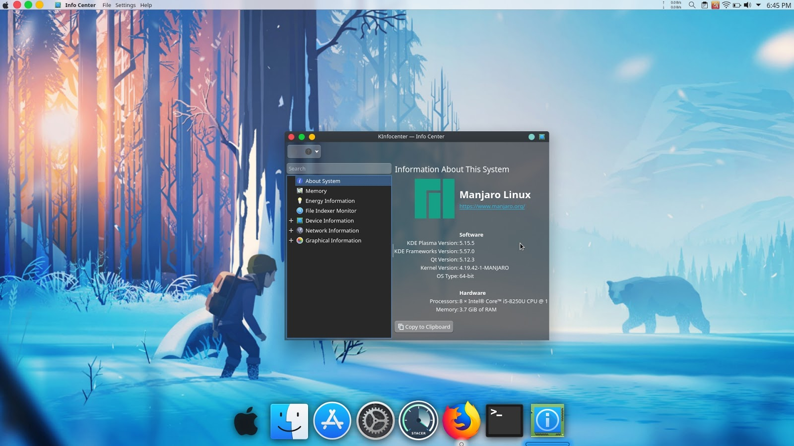
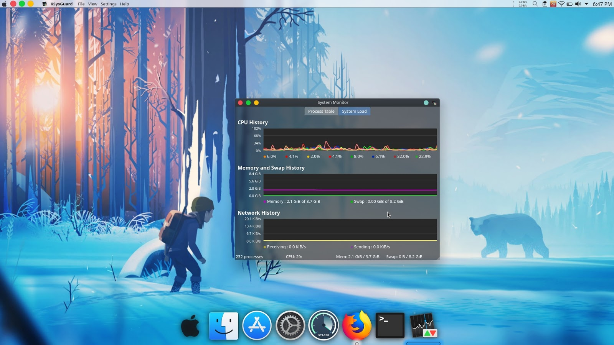
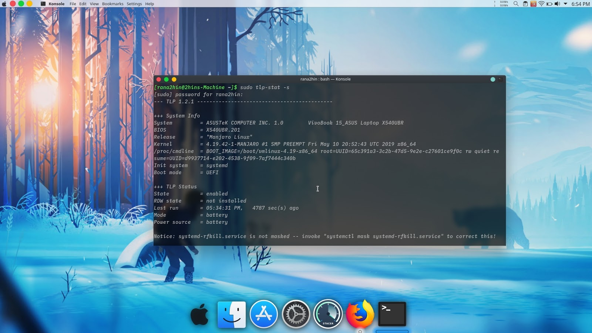
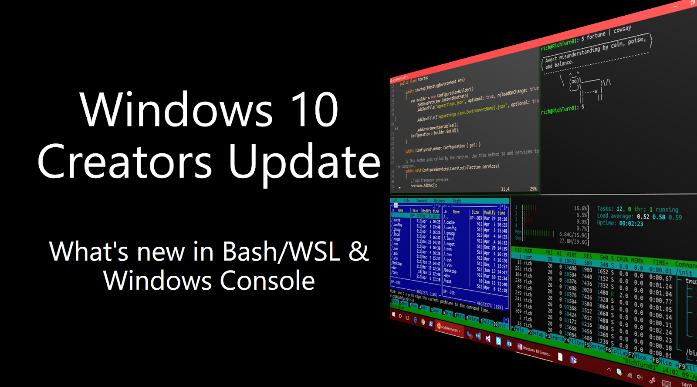

::: {dir="ltr" style="text-align: left;" trbidi="on"}
কম্পিউটার, মোবাইলফোন, স্মার্টওয়াচ বা এই ধরনের ডিভাইসগুলো আমরা হরহামেশাই ইউজ করে থাকি। কিন্তু কখনো কি খেয়াল করেছেন এগুলো চলে কীভাবে? আসলে আমাদের এই নিত্যপ্রয়োজনীয় ডিভাইসগুলো নিতান্তই জড়বস্তু। যখন এই জড়বস্তুগুলোর মাঝে প্রাণের সঞ্চার করা হয় তখনি এই ডিভাইসগুলো আমাদের নিত্যদিনের সঙ্গী হয়ে দাড়ায়। "প্রাণের সঞ্চার" কথাটা আপনাদের কাছে অদ্ভুত লাগতে পারে, আমি আসলে অপারেটিং সিস্টেমের কথাই বলছি।

::: {.separator style="clear: both; text-align: center;"}

:::

অপারেটিং সিস্টেম হচ্ছে এমন একটি জিনিস যা এই জড়বস্তুগুলোকে ব্যাবহারযোগ্য করে তোলে। আমাদের দেশের অধিকাংশ মানুষই তাদের কম্পিউটারে 'উইন্ডোজ' ব্যাবহার করেন অপারেটিং সিস্টেম হিসেবে। উইন্ডজের বিকল্প কিছুর অস্তিত্ব যে আছে, তা অনেকেই জানেন না। হ্যা, বলছি লিনাক্সের কথা।

কম্পিউটার ব্যাবহারকারীগণের মধ্যে বিরাট একটা অংশ, 'লিনাক্স' শব্দটাই হয়তো শোনেননি। কেউ কেউ শুনেছেন কিন্তু ইহা আসলে কি জিনিস তা জানেন না। কেউ কেউ লিনাক্স শুনলেই মনে করেন 'উবুন্টু'র কথা। আসলে লিনাক্স মানে উবুন্টু না, উবুন্টু লিনাক্সের একটা অপারেটিং সিস্টেম মাত্র! (এরকম আরও অন্তত ৫৫০ টি অপারেটিং সিস্টেম আছে)। আবার অনেকেই মনে করেন, লিনাক্স বোধহয় ব্যাপক কঠিন একটা জিনিস! এটা ব্যাবহার করতে গেলে বিশাল বড় প্রোগ্রামার হতে হবে, কিবোর্ডে খটাখট শব্দ করে কোড লিখা জানতে হবে! আসলে এসবই ভুল ধারণা। লিনাক্স ইউজ করার জন্যে আপনাকে কম্পিউটার সায়েন্টিস্ট হতে হবে না। সাধারণ কম্পিউটার ব্যাবহার কারী হিসেবে কেন আপনারও লিনাক্স ব্যাবহার করা উচিৎ, সেটাই লিখতে বসলাম আজকে।

আজ থেকে প্রায় ২৮ বছর আগে লিনাস টরভাল্ডস নামের ফিনল্যান্ডের একজন উদাসমনা ভদ্রলোক এই 'লিনাক্স' জিনিসটা তৈরী করেছিলেন তার ইউনিভার্সিটির প্রজেক্টটা ঠিকঠাকমতো শেষ করবার জন্যে। যাই হোক, সেই কাহিনি আমরা অন্যদিন শুনবো! সেসময় কম্পিউটারগুলো চলত 'UNIX' অপারেটিং সিস্টেম ব্যাবহার করে। এই ইউনিক্সের সোর্সকোড জনসাধারণের জন্যে উন্মুক্ত ছিল না। মানে ডেভেলপাররা কীভাবে এই জিনিসটি বানিয়েছেন তার কোড কেউ জানত না, জানার সুযোগও ছিল না!

কিন্তু বেচারা লিনাস টরভাল্ডসের ইউনিভার্সিটির প্রজেক্টটার জন্যে সেই কোডের প্রয়োজন ছিল। যেহেতু ইউনিক্সের সোর্সকোড জানার কোনো উপায়ই ছিল না তখন এই আধাপাগল লোকটা নিজের মতকরে একটা অপারেটিং সিস্টেম বানাতে বসে গেলেন! জন্ম হলো লিনাক্সের। নিজের অজান্তেই বানিয়ে ফেললেন দুনিয়া কাঁপানো অপারেটিং সিস্টেম। আরেকটু ক্লিয়ার করে বলি, তিনি মূলত বানিয়েছিলেন লিনাক্স কার্নেল। যা হচ্ছে একটা অপারেটিং সিস্টেমের মূল অংশ যার কাজ হচ্ছে কম্পিউটার নামক জড়বস্তুটির সাথে অপারেটিং সিস্টেম এবং সফটওয়্যারের সংযোগ ঘটানো। আপনি নীচের ছবিটার দিকে তাকালেই বিষয়টা বুঝতে পারবেন আশা করি।

  ---------------------------------------------------------------
                 
   কার্নেলের কাজ হলো সফটওয়্যার ও হার্ডওয়্যারের মাঝে সংযোগ ঘটানো 
  ---------------------------------------------------------------

তিনি লিনাক্স কার্নেল বানানোর পর সেটাকে ওপেনসোর্স করে দিলেন। যাতে যেকেউ চাইলেই সেই লিনাক্স কার্নেলকে মোডিফাই করতে পারে নিজেদের প্রয়োজনে (তার জন্যে অবশ্যই প্রোগামিং জানতে হবে, এমনি এমনি না!)। সেই যে খেলা শুরু হলো, আজ অবধি সে খেলা চলছে তো চলছেই! সবাই নিজেদের প্রয়োজনে নিজের মত করে লিনাক্সকে গড়ে নিচ্ছে! ঠিক এই কারণেই ওপেন সোর্সকোড ব্যাপারটা আমার খুবই প্রিয়! এই ওপেনসোর্স শব্দটার পিছনেও আছে লম্বা ইতিহাস! সেই ইতিহাস এখানে বলাটা ভীষণ অপ্রাসঙ্গিক একটি ব্যাপার হয়ে যাবে! তাই এড়িয়ে যাচ্ছি, পারলে অন্য কোনো লেখায় তুলে ধরার চেষ্টা করবো!

যাইহোক, আবারো লিনাক্স কার্নেলের কথায় ফেরত আসি। লিনাক্স কার্নেলটাকে বেজ হিসেবে ধরে বানানো শুরু হলো নানা রকম অপারেটিং সিস্টেম। এই লিনাক্স বেজড অপারেটিং সিস্টেমগুলোকে আমরা আদর করে ডাকি "ডিস্ট্রিবিউশন" বা "ডিস্ট্রো"। এখন পর্যন্ত বাজারে অন্তত পাঁচশ অপারেটিং সিস্টেম আছে লিনাক্সের। যার যেমনটা দরকার সে তেমন করেই বানিয়ে নিয়েছে। যেমন হ্যাকার বা সিকিউরিটি বিশেষজ্ঞরা ব্যাবহার করেন "Kali Linux", "Parrot Os", "Black Arch"। আবার শিক্ষার্থীদের জন্যে আছে Edubuntu, Endless OS। বিজ্ঞানীরা ব্যবহার করেন 'Scientific Linux', 'Fedora Scientific' ইঞ্জিনিয়াররা ব্যবহার করেন 'LinuxCNC', 'CAELinux', জেনেটিক ইঞ্জিনিয়ার কেমিক্যাল ইঞ্জিনিয়াররা ব্যবহার করেন 'Bio Linux', 'Poseidon Linux' ইত্যাদি!

আর আমার প্রায় পাঁচ বছরের লিনাক্স অভিজ্ঞতায় প্রায় চল্লিশটির মত অপারেটিং সিস্টেম ব্যাবহার করার সুযোগ হয়েছে। আমার কাছে মনে হয়েছে লিনাক্স মোটেও কঠিন কিছু নয়। এটি সার্বজনীন!

**কেন উইন্ডোজ ছেড়ে লিনাক্স ব্যাবহার করবেন? **

-   **সিকিউরিটি: **নাসা, সার্ন, গুগল, ফেসবুক সার্ভার সহ পৃথিবীর সমস্ত গুরুত্বপূর্ণ জায়গাগুলোতে লিনাক্স অপারেটিং সিস্টেম ব্যাবহার করা হয়। ইন্টারনেট দুনিয়ার প্রায় ৯০% সার্ভারে লিনাক্স ব্যাবহার করা হয় এর সিকিউরিটি সুনামের কারণে। লিনাক্স সার্ভারে অ্যাটাক করা প্রায় অসম্ভব একটি কাজ হ্যাকারদের জন্যে। একজন সাধারণ ইউজার হিসেবে সার্ভার সিকিউরিটি নিয়ে হয়ত আপনার মাথাব্যথা নাও থাকতে পারে, কিন্তু আপনি যদি পার্সোনাল কম্পিউটারের সিকিউরিটির কথা চিন্তা করেন সেক্ষেত্রেও লিনাক্স সবার আগে। উইন্ডোজ কম্পিউটারে হরেক রকম অ্যান্টিভাইরাস ইউজ করেন আপনারা ভাইরাস বা ম্যালওয়্যার থেকে বাঁচার জন্যে। অনেক অ্যান্টিভাইরাস কোম্পানি বাজারে তাদের ব্যাবসা টিকিয়ে রাখতে নিজেরাই ভাইরাস আপলোড করে থাকে। অনেক দাম দিয়ে এসব অ্যান্টিভাইরাস কিনতে হয়। সিরিয়াল কী আপডেট করতে হয়। উইন্ডোযে যেখানে এত ঝামেলা সেখানে লিনাক্স একদম দুর্ভেদ্য একটা অপারেটিং সিস্টেম। কোনোরকম অ্যান্টিভাইরাস প্রয়োজন নেই। আমি আজ পর্যন্ত কাউকে বলতে শুনিনি যে তার লিনাক্স কম্পিউটার এ ভাইরাস এ্যটাক হয়েছে!
-   **দাম:** উইন্ডোজ এর জেনুইন ভার্সন যদি আপনি ব্যাবহার চান তাহলে আপনাকে প্রায় ১০০ থেকে ২৫০ ডলার গুণতে হবে। কিন্তু লিনাক্স আজীবনের জন্য ফ্রি! হ্যা আপনি ঠিকই পড়েছেন! একটি টাকাও খরচ করতে হবে না আপনাকে।
-   **পারফরম্যান্স: **নতুন কম্পিউটার কেনার দুই-তিন মাস পরেই ভীষণ স্লো হয়ে যায় উইন্ডোজ কম্পিউটার। একটা ক্লিক দিয়ে ঘুমিয়ে যাচ্ছেন, ঘুম থেকে উঠে দেখবেন তখনো কাজ হয়নি! মাঝেমধ্যেই আছাড় মেরে ল্যাপটপ ভেঙ্গে ফেলার ইচ্ছে করে হয়ত। বছরের পর বছর লিনাক্স ইউজ করবেন, একটা দিনও স্লো হবে না! কম্পিউটার বন্ধও করে রাখতে হবে না। দিনের পর দিন কম্পিউটার চালু রাখতে পারবেন। আমি যখন এই লিখাটা লিখছি তখনো আমার কম্পিউটার একটানা ২২ দিন ধরে চলছে, এরমধ্যে একবারও শাট ডাউন করার দরকার হয়নি। বাইরে যাবার সময় ঘুম পাড়িয়ে রেখে গেছি (মানে স্লিপ মুডের কথা বলছি)। 
-   **আপডেট: **উইন্ডোজের বিরক্তিকর আপডেটের সম্মুখীন হননি এরকম মানুষ হারিকেন দিয়েও খুঁজে একটা পাওয়া যাবে বলে আমার মনে হয় না! ভীষণ রকম স্লো আর ল্যাগি আপডেট, সাথে রিস্টার্ট করার প্যারা তো আছেই! রিস্টার্ট করতে গেলেও চার পাচ মিনিট সময় চলে যায়! জীবনটাই তামাতামা হয়ে যায়! 😀লিনাক্সের যেকোনো অপারেটিং সিস্টেমে এই আপডেটের কাজটা সেরে ফেলতে পারবেন মাত্র একটা ক্লিক দিয়েই। সেইসাথে ইনস্টল থাকা প্রত্যেকটা অ্যাপ আপডেট হয়ে যাবে কোনো ঝামেলা ছাড়াই। উইন্ডোজের মত শুধুমাত্র সিস্টেম আপডেট হবে না। খুঁজে খুঁজে আলাদাভাবে আর কোনো অ্যাপ আপডেট করতে হবে না।
      --------------------------------------
         
       মাত্র এক ক্লিক এ আপডেটের ঝামেলা শেষ!
      --------------------------------------
-   **অ্যাপ ইনস্টলেশন: **উইন্ডোজে নতুন কোনো অ্যাপ ইনস্টল করাও ঝামেলা! গুগল থেকে খুজে খুজে ডাউনলোড করো, তারপর ইনস্টল করো, দুদিন যেতে না যেতেই আবার রেজিস্ট্রেশন কী দিতে হবে নাইলে অ্যাপ কাজ করবে না! মহা মুশকিল! লিনাক্সে এত খোঁজাখুঁজি করতে হবে না। সফটওয়্যার ম্যানেজারে সার্চ করবেন আপনার প্রয়োজনীয় অ্যাপ, একটা ক্লিক করবেন, কিচ্ছা খতম! কোনো সিরিয়াল কী, রেজিট্রেশন ফী হ্যানত্যান ঝামেলা নেই! সফটওয়্যার ম্যানেজার জিনিসটা প্লেস্টোরের মত, সার্চ করবেন আর ডাউনলোড করবেন। এই ফাঁকে একটি তথ্য জানিয়ে দেই, আপনার হাতে থাকা অ্যান্ড্রয়েড ফোনটিও কিন্তু লিনাক্স অপারেটিং সিস্টেম!
      ----------------------------------
       
            Software Manager/Store
      ----------------------------------
-   **প্রাইভেসি: **উইন্ডোজ আপনার অগোচর আপনার প্রত্যেকটি কর্মকাণ্ডই নজরদারী করে, আপনার প্রত্যেকটি ডেটা তাদের সার্ভারে জমা হতে থাকে। লিনাক্স আপনার কোনো ডেটাই তাদের সার্ভারে পাঠায় না, যদি প্রয়োজন বশত কোনো ডেটা বা সিস্টেম লগ তারা নিতে চায়, তার আগে অবশ্যই আপনাকে নোটিফাই করবে।
-   **ইউজার ইন্টারফেস: **এবার আসি ইউজার এনভায়রনমেন্ট এর ব্যাপারটায়। সারাটা জীবন ধরে উইন্ডোজের চেহারা দেখতে দেখতে বিরক্ত হয়েছেন? মাঝেমধ্যেই একটু সুন্দর করে সাজাতে চেয়েছেন নিজের কম্পিউটার? কিন্তু কালার ছাড়া আর কোনোকিছু চেঞ্জ করতে পারেননি? তাহলে আপনি চোখ বন্ধ করে লিনাক্স ব্যাবহার শুরু করুন। কালার, ফন্ট, আইকন থেকে শুরু করে কার্নেল পর্যন্ত চেঞ্জ করতে পারবেন দুই একটা ক্লিক করেই! আমি নিজেই তো Asus ল্যাপটপ এ MacBook এর স্বাদ নিচ্ছি! ও আচ্ছা! ম্যাক অপারেটিং সিস্টেমও কিন্তু লিনাক্স কার্নেলেই বানানো! মোদ্দাকথা, আপনি চাইলেই আপনার মনের মাধুরী মিশিয়ে আপনার কম্পিউটার কাস্টমাইজ করতে পারবেন। টাকা দিয়ে কিনেছেন, আপনার কম্পিউটার থাকবে আপনার ইচ্ছামত, তাহলে কেন উইন্ডোজ এর কাছে বন্দী হয়ে থাকবেন? আমার ল্যাপটপের স্ক্রিনশটগুলো দেখুন, ম্যাকবুক ভেবে ভুল করবেন না!
    
    +:---------------------------------------------------------------------:+
    |                                       |
    +-----------------------------------------------------------------------+
    | ফাইল ম্যানেজার\                                                       |
    | \                                                                     |
    |   ----------------------------------                                  |
    |                                       |
    |           Application Drawer                                          |
    |   ----------------------------------                                  |
    +-----------------------------------------------------------------------+

      ----------------------------------
       
                 System Info
      ----------------------------------

      ----------------------------------
       
                System Monitor
      ----------------------------------
-   **টার্মিনাল: **আপনি যদি অ্যাডভান্স ইউজার হয়ে থাকেন তাহলে উইন্ডোজ কমান্ড লাইনের সাথে নিশ্চয় পরিচিত। উইন্ডোজ কমান্ড লাইন অথবা পাওয়ারশেল জিনিসটাকে আমার কাছে নিছক খেলনা মনে হয়েছে লিনাক্স টার্মিনালের তুলনায়। টার্মিনাল দিয়ে আপনি চাইলে আপনার কম্পিউটার কেন মহাকাশ পর্যন্ত কাঁপিয়ে দিতে পারবেন। আমি একটুও বাড়িয়ে বলছি না, টার্মিনাল এতটাই শক্তিশালী! 
      ----------------------------------
       
                   Terminal
      ----------------------------------

যাই হোক, উইন্ডোজ এ কুয়োর ব্যাঙ হয়ে না থেকে লিনাক্সে আসুন, কম্পিউটিং বিস্ময়কর জগৎটা দেখুন! তবে আশার কথা হলো, দেরীতে হলেও মাইক্রোসফট এতদিনে বুঝতে শুরু করেছে ওপেন সোর্সের গুরুত্ব, লিনাক্সের গুরুত্ব। এবছরই তারা উইন্ডোজের ভিতরেই লিনাক্স ব্যাবহার করার জন্যে WSL (Windows Subsystem for Linux) রিলিজ করেছে। আগে এই কাজটিই করতে হতো বিভিন্নরকম ভার্চুয়াল মেশিন সফটওয়্যার ব্যাবহার করে। এছাড়াও তারা উইন্ডোজের জন্যে নতুন টার্মিনাল ডেভেলপ করা শুরু করেছে।

  ----------------------------------
   
               New cmd
  ----------------------------------

এতক্ষণ ধরে বকবক করেও আমি শুধুমাত্র লিনাক্সের বাহ্যিক দিকটাই একটুখানি তুলে ধরেছি। ভেতরের কথাবার্তা নিয়ে, একজন বিগিনার হিসেবে লিনাক্সের কোন অপারেটিং সিস্টেমটি ব্যাবহার করতে পারেন, কীভাবে ইনস্টল করবেন, সেসব বিস্তারিত লিখবো অন্য একটি লিখায়। ভালো থাকুন। Happy Computing!

ডেটা সায়েন্সে লিনাক্স কীভাবে কাজে লাগতে পারে জানতে চোখ রাখুন [এখানে](../tags.html#tag=linux)।
**আরও পড়ুন**

::: {style="background-color: white; line-height: 1.2; margin: 0px 0px 3px; padding: 0px; text-align: left; transition: all 0.2s ease-in-out 0s;"}
☛ [লিনাক্স ও ডেটা সায়েন্স: একটি সরল টেক্সট মাইনিং](2019-05-linux-text-mining.html)
:::

☛ [লিনাক্স ও ডেটা সায়েন্স: tr কমান্ডের কারিশমা](2019-05-linux-tr.html)

:::
