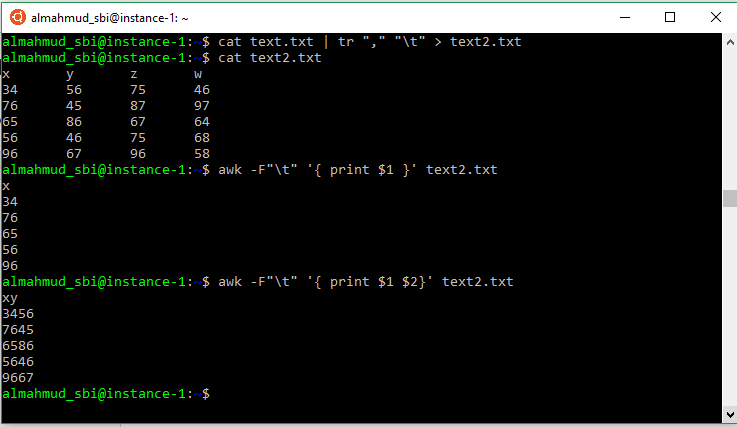
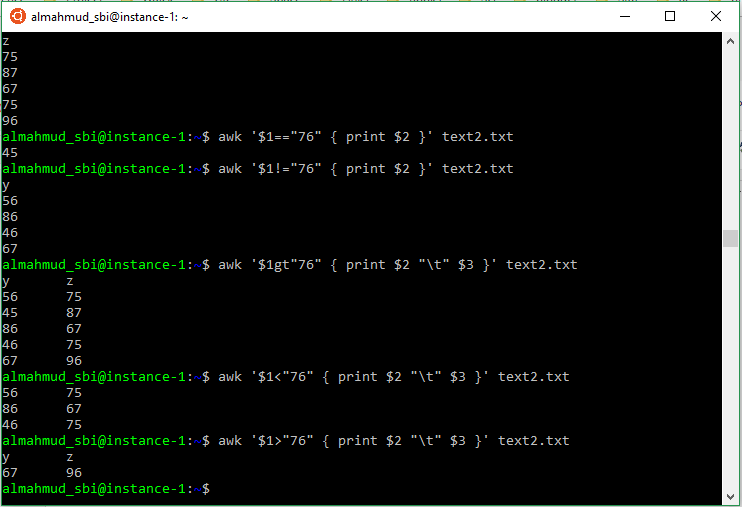

::: {dir="ltr" style="text-align: left;" trbidi="on"}
ডেটা সায়েন্সের বেসিক থেকে অ্যাডভান্সড অনেক কাজের জন্যেই লিনাক্স টার্মিনাল খুব পাওয়ারফুল ভূমিকা রাখে। ডেটা সায়েন্সের কাজে কয়েকটি শক্তিশালী কমান্ডের মধ্যে একটি হলো awk। আজ আমরা সংক্ষেপে এর কারিশমা দেখব।

এটা করার জন্য আমরা আপাতত text.txt নামে একটি ফাইল ব্যবহার করব। তাহলে ফাইলটি বানিয়ে নিন।

nano text.txt

এবার এতে নীচের তথ্যগুলো রাখুন
x,y,z,w
34,56,75,46
76,45,87,97
65,86,67,64
56,46,75,68
96,67,96,58

এবার একে একে দেখা যাক, awk কমান্ড কী করতে পারে।

১। নির্দিষ্ট কোনো কলাম এক্সট্রাক্ট করতে

ধরুন, আমরা শুধু ১ নং কলাম দেখতে চাই। তাহলে-
awk -F, '{ print \\\$1 }' text.txt

এখানে "-F," দিয়ে বোঝানো হচ্ছে আমাদের ফাইলের কলামগুলো কমা (",") দ্বারা আলাদা করা আছে। এখানে কমার বদলে স্পেস, ট্যাব বা অন্য কোনো ফিল্ড সেপারেটরও থাকতে পারে। যেমন ট্যাব থাকলে কী হবে একটু দেখা যাক। তাহলে আগে কলামগুলোকে আমরা কমার বদলে ট্যাব দিয়ে সেপারেট করে দেখি। এজন্য ব্যবহার করব শক্তিশালী [tr কমান্ড](2019-05-linux-tr.html)।

cat text.txt \| tr "," "\\t" \> text2.txt

এখানে আমরা কমাকে ট্যাব দ্বারা রিপ্লেস করে আউটপুটকে সেভ করলাম text2.txt ফাইলে।

এবার আবার এক নং কলাম দেখা যাক-
awk -F"\\t" '{ print \\\$1 }' text2.txt
আর দুটি কলামকেই আলাদা কলাম আকারে দেখতে-
awk -F"\\t" '{ print \\$1 "\t" \$2}' text2.txt
এখানে আমরা ট্যাবের জন্য -F"\\t" বসালেও আসলে ট্যাব বা স্পেসের ক্ষেত্রে -F"\\t" অংশটুকু দরকারই নেই। কমা বা অন্য কোনো সেপারেটর থাকলে সেটা উল্লেখ করে দিতে হয়। তার মানে
awk '{ print \$3 }' text2.txt
কোড থেকেই পাওয়া যাবে এই আউটপুট-
z
75
87
67
75
96

কলামকে কমা বা অন্য কোনো কিছু দিয়েও আলাদা করতে পারেন। সেজন্যে "\\t" এর কোটেশনের ভেতরে "," বা নির্দিষ্ট সেপারেটর বসাতে হবে। যেমন-
awk -F"\\t" '{ print $1 ": " $2 ": " \$4}' text2.txt
পাওয়া যাবে
x: y: w
34: 56: 46
76: 45: 97
65: 86: 64
56: 46: 68
96: 67: 58

বাস্তবে ডেটা ফরম্যাট অবশ্য এমন হয় না। তবুও শিখে রাখলে মন্দ কী?

২। দুটি কলাম জোড়া দিয়ে একটি কলাম বানাতে
awk '{ print \\$1 \$2}' text2.txt
এখানে আমরা ১ ও ২ নং কলাম জোড়া দিলাম।

::: {.separator style="clear: both; text-align: center;"}

:::

৩। এক কলামের ভিত্তিতে অন্য কলাম এক্সট্রাক্ট করতে

উপরের ছবিতে আমাদের text2.txt ফাইলটা আবার একটু দেখে নিন। এবার এখান থেকে আমরা ২য় কলাম সিলেক্ট করব। তবে সবগুলো row বা সারি নিতে চাচ্ছি না। শুধু সেই rowগুলো নেব যাতে ১ম কলামের মান ৭৬ নয়।
awk '\\$1!="76" { print \$2 }' text2.txt
পাব
y
56
86
46
67
এখানে \\\$1 মানে ১ম কলাম। আর != মানে সমান নয়। যদি শুধু ৭৬ এর সমান হলে নিতাম তাহলে দিতাম-
awk '$1=="76" { print $2 }' text2.txt

একইভাবে ১ম কলাম ৩৫ এর বড় হলে অন্য কলামের সেই row নিতে পারি। আবার ছোট হলেও নিতে পারি। এজন্য \<, \> বা যথাক্রমে lt ও gt ব্যবহার করা যাবে।
awk '$1gt"76" { print $2 "\\t" \$3 }' text2.txt
পাব
y       z
56      75
45      87
86      67
46      75
67      96

::: {.separator style="clear: both; text-align: center;"}

:::

এবার আমরা নেব এমন সারিগুলো যেখানে কোনো একটা কলাম ৩৪ আছে।
awk '/34/ { print \\$2 "\t" \$3 "\\t" \\\$4 }' text2.txt

লিনাক্স সংখ্যাকে সংখ্যা হিসেবে চিনতে ভুল করে না। তবে প্রয়োজনে সংখ্যাকে টেক্সট হিসেবেও ধরে নিতে পারে। ফলে আমরা চাইলে এমন কলামগুলোও বের করতে পারব যেখানে ৪, ৬ ইত্যাদি কোনো ডিজিট আছে। যেমন যে সারিগুলোতে ৪ আছে এমন সব সারির ২, ৩ ও ৪ নং কলাম পেতে-
 awk '/4/ { print \\$2 "\t" \$3 "\\t" \\\$4 }' text2.txt
খেয়াল করলে দেখবেন, এখানে প্রতিটি কলামেই কোনো না কোনো সারিতে ৪ আছে।

৪। হিসাব-নিকাশ
কলামের মানগুলো যদি সংখ্যা হয় তবে অবশ্যই হিসাব-নিকাশও করা যাবে। ধরুন, আমরা ১ ও ২ নং কলাম গুণ করে ৩ নং কলামের সাথে যোগ করব। আপাতত আমরা যেটা করছি তাতে শুধু পূর্ণ সংখ্যা দিয়েই কাজ চলবে।
awk '{ print ($1 * $3) + \$3 }' text2.txt
চাইলে শুধু দুটি কলামও যোগ-বিয়োগ করা যাবে।
awk '{ print $3 + $3 }' text2.txt

আউটপুটের শুরুতে একটা শূন্য (০) দেখছেন, তাই না। কারণ লিনাক্সে ডেটার হেডার ডিফাইন করা নেই। তাই আমাদের জোর করে চাপিয়ে দেওয়া নাম x, yকেও হিসাবের আওতায় রাখা হয়েছে। এদেরকে তো গুণ করা যায় না।

৫। সব কলামের যোগফল
এবার আমরা আরেকটু অ্যাডভান্সড ধাপে প্রবেশ করব। প্রতিটি সারিতে সবগুলো কলামের যোগফল দেখব। এটার জন্যে কোড হলো-
awk '{ sum=0; for (col=1; col\<=NF; col++) sum += \$col; print sum; }' text2.txt

তবে এই কোড আমাদের বারবার দরকার হতে পারে। তাই, বারবার এটা টাইপ না করে আমরা একটা ফাংশন বানিয়ে রাখতে পারি।
colsum ()
{
    awk '{ sum=0; for (col=1; col\<=NF; col++) sum += $col; print sum; }' $1
}

এবার এই ফাংশন ব্যবহার করেই আমরা কলামের যোগফল বের করতে পারি।
colsum text2.txt
মানে ফাংশনের নাম লিখে ফাইলের নাম লিখে দিলেই হয়ে যাবে।

আবার সব কলামের বদলে হয়ত শুধু ২ ও ৩ নং কলামের যোগফল চাই। তাও সোজা। পাইপ অপারেটরের পর আমাদের তৈরি করা colsum ফাংশন বসিয়ে দিলেই হলো-
awk '{ print $2 "\t" $3 }' xaa.dat \| colsum

সূত্রঃ <https://www.lifewire.com/write-awk-commands-and-scripts-2200573>
:::
