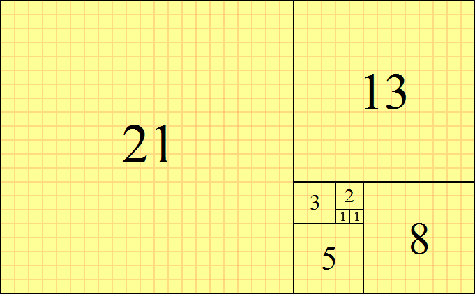
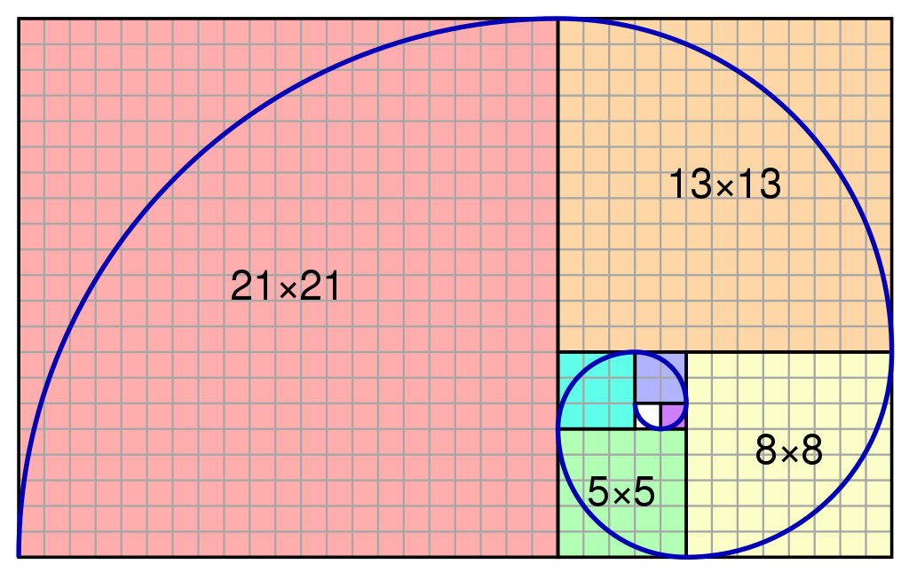
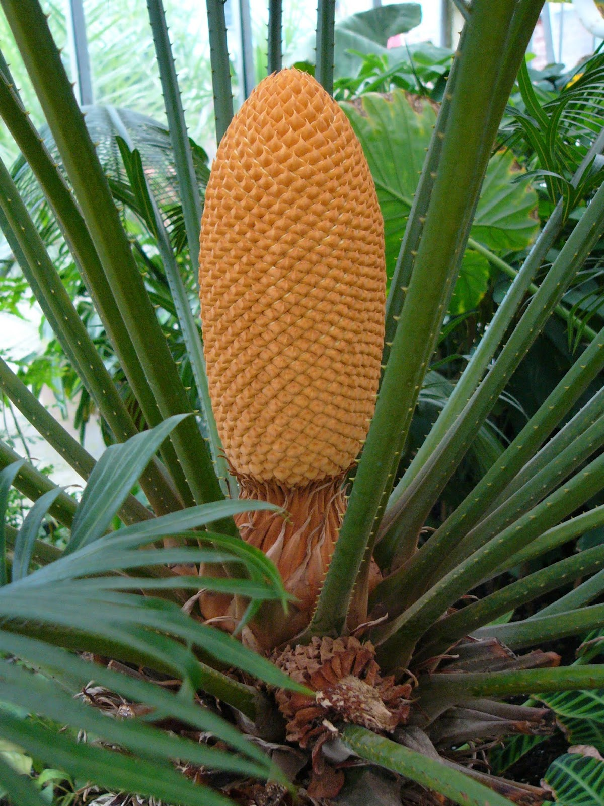

::: {dir="ltr" style="text-align: left;" trbidi="on"}
১ ১ ২ ৩ ৫ ৮ ১৩ ...

দেখতে মনে হবে সাদামাটা কতগুলো সংখ্যা। অথচ কত অসাধারণ!

বুঝতেই পারছেন, পরপর দুটো সংখ্যা যোগ করে পাওয়া যায় পরের সংখ্যা। তো? এর মধ্যে আর এমন কী ই বা আছে?

::: {.separator style="clear: both; text-align: center;"}

:::

আসলে গণিত যে সুন্দর হতে পারে তার অন্যতম ভাল উদাহরণ হলো এই সংখ্যাগুলো। নাম ফিবোনাচি সংখ্যা (Fibonacci number)।

কী সূর্যমুখী ফুল, কী শামুকের খোলস, কোথায় নেই এই ধারার কারিশমা। কিন্তু কীভাবে এই ধারা লুকিয়ে আছে প্রকৃতিতে? সংক্ষেপে এটা দেখেই আমরা দেখব কীভাবে আমরা সংখ্যাগুলো জেনেরেট করব।

আগেই দেখেছি, ফিবোনাচি সংখ্যাগুলো হলো যথাক্রমে  ১ ১ ২ ৩ ৫ ৮ ১৩ ২১ \-\--। অনেক সময় অবশ্য শুরুতে ০ কে রাখা হয়। মানে এভাবে- ০ ১ ১ ২ ৩ \-\--।

এবার একটা কাগজে ১ একক বাহু নিয়ে একটি বর্গ আঁকুন। পরের ফিবোনাচি সংখ্যাও ১। আগের বর্গের পাশে আরেকটি এক একক বাহুর বর্গ আঁকুন। এবার এ দুটি বর্গের ওপরে (নীচে আঁকলেও দুনিয়া ধ্বংস হবে না!) ২ এককের একটি বর্গ আঁকুন। এই তিনটি বর্গের পাশে আঁকুন ৩ এককের আরেকটি বর্গ। এভাবে এগিয়ে চলুন।

এভাবে যেতে থাকলে আমরা পাব নীচের আয়তক্ষেত্রটি।

  -------------------------------------------------
          
   ফিবোনাচি সংখ্যা নিয়ে আঁকা বর্গ থেকে পাওয়া আয়ত। 
  -------------------------------------------------

এবার ক্রমান্বয়ে ছোট থেকে বড় বর্গের দিকে বর্গের কর্ণ বরাবর সর্পিল বাহু এঁকে যেতে থাকলেই আমরা পাব দারুণ একটি সর্পিল রেখা। আর হ্যাঁ, শামুকের খোলসে এমন সর্পিল নকশাই তো দেখি আমরা।

  -----------------------------------
   
   ফিবোনাচির মধ্যে লুকিয়ে থাকা নকশা 
  -----------------------------------

  ------------------------------------------------------------------------------------------------
  
  ছবি: [মাইক্রোসফট](https://www.microsoft.com/en-us/p/fibonacci-sequence-in-nature/9pck43kq0ghw)
  ------------------------------------------------------------------------------------------------

সংখ্যাগুলোর হাজারো মজার মজার অ্যাপ্লিকেশন আছে। এর মধ্যে কিছু দেখতে পাবেন এই [ভিডিওতে](https://www.youtube.com/watch?v=SjSHVDfXHQ4&t=7s)।

একটি মজার সম্পর্কের কথা না বললেই নয়। ফিবোনাচি সংখ্যার সাথে সম্পর্ক আছে আরেক মজার ধ্রুবক সোনালী অনুপাতের (Golden ratio)। অনুপাতটির মান হলো ১.৬১৮...। মজার ব্যাপার হলো ফিবোনাচি সংখ্যা থেকে এটি পাওয়া যায়।

ফিবোনাচি সংখ্যাগুলোতে আবার একটু চোখ বুলিয়ে নেই।

১ ১ ২ ৩ ৫ ৮ ১৩ ২১ ৩৪ ৫৫ ৮৯ ১৪৪ ২৩৩ ৩৭৭ \-\--। ফিবোনাচি ধারার প্রতিটি সংখ্যাকে পরের সংখ্যা দিয়ে ভাগ দিতে থাকলে আমরা সোনালী অনুপাতের কাছাকাছি সংখ্যা পেতে থাকব।

\\begin{array}{\|c\|c\|}
\\hline
Fibonacci \\space number (x)& \\frac{x\[i+1\]}{x\[i\]} \\\\ \\hline
1 & 1.000 \\\\ \\hline
1 & 2.000 \\\\ \\hline
2 & 1.500 \\\\ \\hline
5 & 1.667 \\\\ \\hline
8 & 1.600 \\\\ \\hline
13 & 1.625 \\\\ \\hline
21 & 1.615 \\\\ \\hline
34 & 1.619 \\\\ \\hline
55 & 1.617 \\\\ \\hline
89 & 1.618 \\\\ \\hline
\\end{array}

বুঝতেই পারছেন, যত বড় সংখ্যা নিতে থাকব, এই ভাগফল সোনালী অনুপাতের তত কাছে যাবে। দারুণ সংখ্যা সোনালী অনুপাত সম্পর্কে আরও জানতে [উইকিপডিয়ার আর্টিকেলটা পড়ে নিন](https://en.wikipedia.org/wiki/Golden_ratio)।

এবার আমরা দেখবো, নান্দনিক এই সংখ্যাগুলো কীভাবে R প্রোগ্রামিং দিয়ে তৈরি করা যায়। কোডখানা নীচে দেওয়া হলো। ব্যবহারের সুবিদার্থে আমরা *fibo* নামে একটি ফাংশন বানিয়ে নিচ্ছি। আর ভেতরে থাকছে একটি for loop। প্রথমে একটি ফাঁকা ভেক্টর বানিয়ে নেওয়া হলো। এরপর ধারার প্রথম দুটি সংখ্যা ১ হওয়ায় আমরা আগেই সেটা বসিয়ে দিলাম। বাকি সংখ্যাগুলো ক্রমান্বয়ে যোগ করে তৈরি করা হলো।

```r
fibo <- function(n)
 {
 fibvals <- c()
 fibvals[1] <- 1
 fibvals[2] <- 1
 for (i in 3:n) 
  { 
    fibvals[i] <- fibvals[i-1]+fibvals[i-2]
  }
 fibvals
 }
```

এবার চাইলে আপনি *fibo* ফাংশন দিয়ে ইচ্ছেমতো সাইজের ফিবোনাচি ধারা তৈরি করে নিতে পারেন।যেমন প্রথম ২০টি সংখ্যা পেতে চাইলে-

```r
x <- fibo(20)
```

ওপরের সোনালী অনুপাতগুলো R দিয়েই বের করেছি। চাইলে কোডটা দেখে রাখতে পারেন।

```r
x <- fibo(20)
x_cum_div <- c()
for (j in 1:length(x)-1)
 {
 x_cum_div[j] <- x[j+1]/x[j]
 }
x_cum_div
```

বিদায় নেবার আগে ফিবোনাচি ধারার আরও কিছু বাস্তব নমুনা দেখে নেওয়া যাক।

  -------------------------------------------------------------
                
   Cycas circinalis উদ্ভিদে। উদ্ভিদটি পাওয়া যায় দক্ষিণ ভারতে। 
  -------------------------------------------------------------

  -----------------------------------------------------------------------------------------
                              
   ছবি: [phillipsnaturalworld](http://www.phillipsnaturalworld.com/home/fibonacci-numbers)
  -----------------------------------------------------------------------------------------

+:-------------------------------------------------------------------------------------------:+
|                                                             |
+---------------------------------------------------------------------------------------------+
|   ----------------------------------------------------------------------------------------- |
|   ছবি: [phillipsnaturalworld](http://www.phillipsnaturalworld.com/home/fibonacci-numbers)   |
|   ----------------------------------------------------------------------------------------- |
+---------------------------------------------------------------------------------------------+

**
আরও পড়ুন**
☛ [R প্রোগ্রামিং: বাহারি ফুলের ডিজাইন](2018-06-floweR.html)
☛ [গণিতের সবচেয়ে সুন্দর সমীকরণ ](2016-09-5-numbers-relation.html)

**সূত্র**
১। [R-bloggers](https://www.r-bloggers.com/example-7-1-create-a-fibonacci-sequence/)
২। উইকপিডিয়া: [Fibonacci number](https://en.wikipedia.org/wiki/Fibonacci_number)
৩। ইউটিউব: [টেড টকের একটি সিগমেন্ট](https://www.youtube.com/watch?v=SjSHVDfXHQ4&t=7s) 
:::
