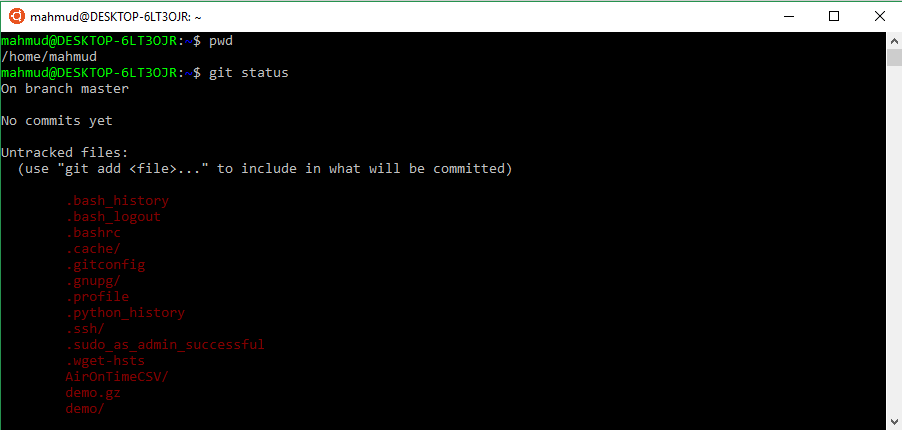

::: {dir="ltr" style="text-align: left;" trbidi="on"}
পরিপূর্ণ একজন গবেষক হতে হলে আপনাকে গিট ও গিটহাব জানতেই হবে। ডেটা সায়েন্টিস্ট হতে হলে তো কথাই নেই। কিন্তু কেন? সেটাই বলব। জানব কীভাবে ব্যবহার করব সেটাও।

**কেন Git ব্যবহার করবেন?**
আমি দুটো গুরুত্বপূর্ণ কারণ বলব। একটি ব্যক্তিগত কারণ। আরেকটি সামষ্টিক। কোলাবোরেটিভ কাজের জন্য।

-   কম্পিউটারে আমরা নানান ফাইল নিয়ে কাজ করি। এর মধ্যে আছে নোটপ্যাডে txt ফাইল নিয়ে কাজ, ওয়ার্ড ফাইল, R প্রোগ্রামিং ব্যবহার করলে R script, পাইথন বা অন্য প্রোগ্রামিং ল্যাঙ্গুয়েজের স্ক্রিপ্ট, পিডিএফ--- ফাইলের তো আর শেষ নেই। এই ফাইলগুলোতে নতুন কিছু যোগ করতে গিয়ে ভুল হয়ে যাওয়া খুবই স্বাভাবিক। দেখা গেল নতুন করে সেভ করার পর বুঝতে পারলেন নতুন কাজে ভুল ছিল। আগের কাজে ফিরতে চাই। কাজটা খুব কঠিন। হ্যাঁ, অনেক সময় আমরা নতুন নতুন নাম দিয়ে ফাইল সেভ করি। file1.1, file1.2, ... ইত্যাদি। কিন্তু এই কাজটা একেবারেই আনাড়ির মতো। এটাই আরও গুছিয়ে করার জন্যেই তো Git। এই যে নিত্য-নতুন কাজের ইতিহাস সংরক্ষণ, এর নাম হলো ভার্সন কন্ট্রোল। ভার্সন কন্ট্রোল করার জন্য গিট ছাড়াও অনেকগুলো সফটওয়্যার আছে। তবে গিটই সেরা। 
-   গিটের আরেকটি গুরুত্বপূর্ণ ব্যবহার হলো সমন্বয়মূলক কাজে। ধরুন, আপনার ৫ জন অথর মিলে একটা পেপার লিখছেন। সবাই সমানে কন্ট্রিবিউট করছেন। একজন আবার সবার কন্ট্রিবিউশনগুলো একত্র করে জোড়া দিচ্ছেন। এই একজনের কিন্তু মাথার ঘাম পা ভেদ করে কয়েক কিলোমিটার মাটির গভীরে চলে যাচ্ছে। এর বদলে গিট ও গিটহাব ব্যবহার করুন। অযথা সময় নষ্ট থেকে বাঁচুন। 

**কীভাবে গিট ব্যবহার করবেন?**

এখানে আপাতত আমরা খুব সংক্ষেপে বেসিক কিছু বিষয় দেখব। 

::: {style="text-align: left;"}

:::

::: {style="text-align: left;"}
**ইনস্টল**: Git নিয়ে কাজ করার জন্যে লিনাক্সই ভাল। তবে উইন্ডোজ ব্যবহারকারীদের ভয়ের কিছু নেই। আপনি যদি লিনাক্সের উবুন্টু বা ডেবিয়ান ভিত্তিক কোনো ডিস্ট্রো ব্যবহার করে থাকেন, তাহলে টার্মিনালে লিখুন 
:::

::: {style="text-align: left;"}
sudo dnf install git-all
:::

::: {style="text-align: left;"}

:::

::: {style="text-align: left;"}
অন্য ভার্সনের জন্য ইনস্টল করতে চাইলে [এখানে দেখুন](https://git-scm.com/download/linux)।
:::

::: {style="text-align: left;"}

:::

::: {style="text-align: left;"}
আর উইন্ডোজের জন্যেও কাজটা কঠিন কিছু নয়। এই লিঙ্কে গেলেই ডাউনলোড শুরু হয়ে যাবে। হয়ে গেলে ইনস্টল করে নিন। ম্যাকে ইনস্টল [করার উপায় দেখুন এখানে](https://git-scm.com/book/en/v2/Getting-Started-Installing-Git)।
:::

::: {style="text-align: left;"}

:::

::: {style="text-align: left;"}
**শুরু**

গিট নিয়ে কাজ করতে হলে লিনাক্স টার্মিনালের সাথে এক-আধটু পরিচয় থাকলে সুবিধা। বিশেষ করে ফাইল ম্যানেজিং সিস্টেম। এই বিষয়ে পরিচিত হবার জন্যে [এই আর্টিকেলটি পড়ে আসলে](2019-06-linux-intro.html) মন্দ হয় না। 
:::

::: {style="text-align: left;"}

:::

::: {style="text-align: left;"}
তাহলে এখন আপনাকে cd কমান্ড দিয়ে যে ফোল্ডারে কাজ করছেন সেখানে আসতে হবে। দরকার হলে mkdir কমান্ড দিয়ে নতুন ফোল্ডার বা ডিরেক্টিরি (গিটের ভাষায় রিপোজিটরি) তৈরিও করে নিতে পারেন। এই ফোল্ডারে আপনি ভার্সন কন্ট্রোল করতে চান এটা গিটকে জানাতে হবে। এজন্য লিখুন 
:::

> git init

::: {style="text-align: left;"}
**ফাইল যোগ করুন**: একটু আগে গিট জানল কোন ফোল্ডারে তাকে নজর রাখতে হবে। কিন্তু কোন কোন ফাইল তাকে চোখে চোখে রাখতে হবে সে বিষয়ে সে কোনো নির্দেশ পায়নি। In the mean time, আপনি ls কমান্ড দিয়ে দেখে নিতে পারেন এই ফোল্ডারে কী কী ফাইল আছে। 
:::

::: {style="text-align: left;"}

:::

::: {style="text-align: left;"}
আগে থেকে থাকা কোনো ফাইল বা নতুন ফাইলকে গিটের নজরবন্দী করা যাবে। নতুন ফাইল তৈরি করতে touch কমান্ড ব্যবহার করতে পারেন। আপনি চাইলে এখন git status কমান্ড দিয়ে দেখতে পারেন কী কী ফাইল আছে এবং কোনোটা গিটের নজরে আছে কিনা। সব ফাইল লাল রং হলে বুঝতে হবে গিট কাউকেই ট্র্যাক করছে না। 
:::

::: {style="text-align: left;"}

:::

  ----------------------------------
   
   গিট কোন কোন ফাইলকে ট্র্যাক করছে 
  ----------------------------------

::: {style="text-align: left;"}
নির্দিষ্ট কোনো ফাইলকে গিটের ট্র্যাকিং এর আওতায় আনতে লিখুন 
:::

> git add filename

এখানে filename এর জায়গায় ফাইলটার নাম দিন। এক্সটেনসহ। এমন R ফাইল হলে হবে something.r। 

যেমন এখানে আমরা session\_info.R ফাইলকে যুক্ত করলাম। এবার দেখা যাচ্ছে এই ফাইলটা উপরে সবুজ রং দিয়ে দেখানো আছে। এই ফাইলকে গিট এখন দেখে রাখছে। 

তবে ফাইল সবুজ হয়ে গেলেই কিন্তু সেকেন্ডে সেকেন্ডে ফাইলের নতুন ভার্সন গিট মনে রাখবে না। সেজন্য আপনাকে কামিট করতে হবে। 

commit -m "message"

এখানে message এর জায়গায় নতুন আপডেটের সাথে প্রাসঙ্গিক কোনো কথা লিখুন। 

ব্যস! মূল কাজ শেষ। প্রতি গুরুত্বপূর্ণ ধাপের শেষে commit করতে থাকুন। 

**ব্রাঞ্চ**: অনেক সময় হতে পারে আপনি মূল ফাইল নিয়ে কাজ করতে চাচ্ছেন না। টিম-ওয়ার্ক করতে গেলেও এটা হতে পারে। সেক্ষেত্রেও গিট সহায়তা করতে হাজির। এজন্য ব্যবহার করতে হবে গিট ব্রাঞ্চ। 

git checkout -b \<branch name\>

এতে করে কাজের জন্যে নতুন একটি ব্রাঞ্চ তৈরি হবে। চেক করে নিন। 

git branch

তারকা চিহ্নিত ব্রাঞ্চ মানে আপনি বর্তমানে এই ব্রাঞ্চে আছেন। ব্রাঞ্চের কাজে সন্তুষ্ট হলে আপনি মাস্টার ব্রাঞ্চের সাথে মার্জ করে নিতে পারেন। মার্জ করবেন কীভাবে দেখুন [এখানে](https://git-scm.com/docs/git-merge)। 

**গিটহাব**: শুধু লোকাল পিসিতে কাজ করলে আপনার Github এর দরকার নেই। কিন্তু সবার সাথে শেয়ার করা ও অনলাইনে ব্যাকআপ রাখাসহ নানান কারণে গিটহাব ব্যবহার করা উচিৎ। অ্যাকাউন্ট না থাকলে [করে নিন এখান থেকে](https://github.com/join)।

সূত্র

১। [Why Git](https://www.git-tower.com/learn/git/ebook/en/command-line/appendix/why-git)

২। [Intro to Git](https://product.hubspot.com/blog/git-and-github-tutorial-for-beginners)

৩। [How to Install Git](https://git-scm.com/book/en/v2/Getting-Started-Installing-Git)
:::
