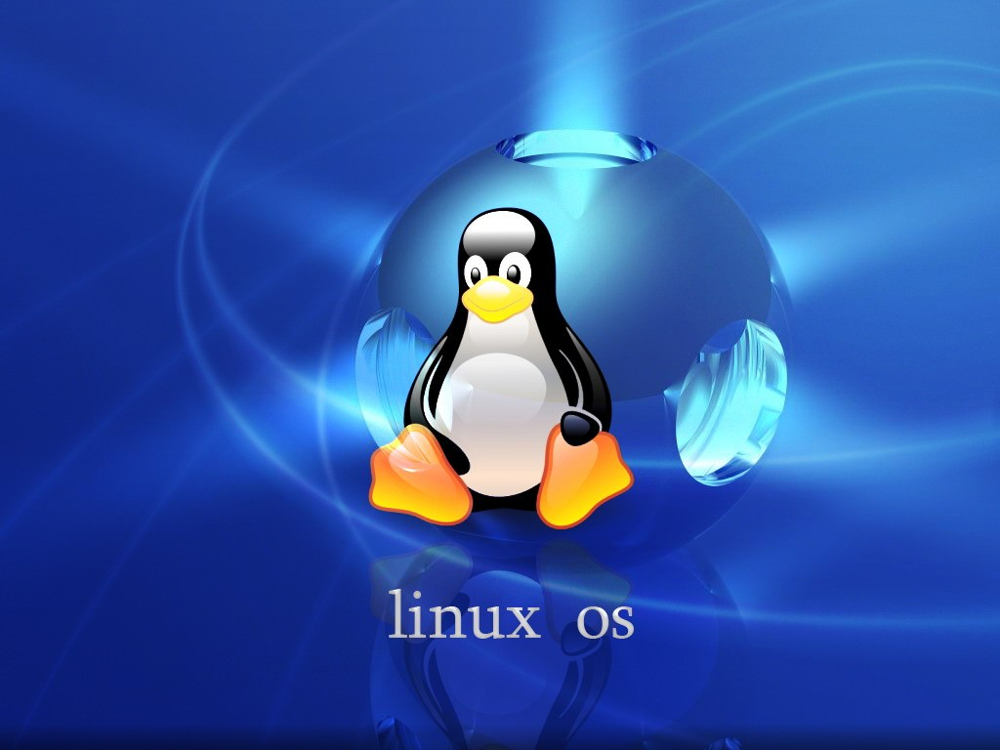
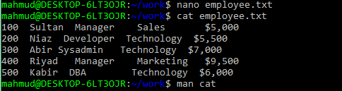
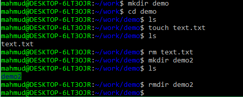

::: {dir="ltr" style="text-align: left;" trbidi="on"}
কমান্ড লাইন ব্যবহার করলে আপনার ডিভাইসের নিয়ন্ত্রণ থাকবে আপনার হাতে। ছোটভাই তুহিনের মতে তো কমান্ড লাইন দিয়ে কম্পিউটার কেন, মহাকাশ পর্যন্ত কাঁপিয়ে দেওয়া যাবে।

ডেটা সায়েন্সের কাজ করার জন্য কমান্ড লাইনে অনেকগুলো দারুণ টুল আছে। এছাড়া ভার্সন কন্ট্রোল ব্যবহার করতে গেলেও কমান্ড লাইনের কিছু প্রাথমিক কোড জানতে হয়। এমন কিছু কমান্ড জেনে নেওয়া যাক।

::: {.separator style="clear: both; text-align: center;"}

:::

**আরও পড়ুন**
☛ [কেন লিনাক্স ব্যবহার করবেন?](https://www.statmania.info/2019/05/why-linux-is-great.html)

১। **pwd**

এই কমান্ড আপনাকে বলবে, এই মূহূর্তে আপনি কোন ডিরেক্টরিতে আছেন। [R](https://www.statmania.info/search/label/Linux?max-results=9)-এ আমরা এটা জানি getwd() কমান্ড দিয়ে। pwd হলো present working directory এর সংক্ষিপ্ত রূপ।

২। **ls**

এই কমান্ড আপনাকে জানিয়ে দেবে, আপনার বর্তমান ওয়ার্কিং ডিরেক্টরিতে কী কী কন্টেন্ট আছে। হোক সেটা ফাইল, বা অন্য ফোল্ডার বা ডিরেক্টরি।

৩। **man**

মনে করুন, আপনার একটা কমান্ডের নাম মনে আছে। কিন্তু ভুলে গেছেন কীভাবে ব্যবহার করবেন । লিনাক্স কমান্ড লাইনে প্রায় প্রতিটি টুলের সাথেই নানান অপশন আছে। অপশনগুলো বসাতে হয় সাধারণত কমান্ডের পর একটি হাইফেন (-) দিয়ে। যেমন ওপরের ls কমান্ডের সাথে -c, -h, -m বা -t ইত্যাদি নানান অপশন ব্যবহার করা যায়। নীচের কমান্ড আপনাকে ফাইল ও ডিরেক্টরির লিস্ট দেবে। তবে সর্বশেষ যে ফাইল বা ফোল্ডার নিয়ে কাজ করেছেন সেটার নাম আগে থাকবে।

```bash
ls -t
```

এখন, এই অপশনগুলো আপনি কীভাবে জানবেন? ভয় নেই। এর জন্য গুগোল করতে হবে না। জাস্ট টাইপ করুন man ls। অথবা যে টুল সম্পর্কে জানতে চান man লিখে সেই কমান্ড লিখে এন্টার চাপুন। চাইলে জেনে রাখুন, man আসলে ম্যানুয়াল (manual) এর সংক্ষিপ্ত রূপ।

৪। **cd**

মনে করুন, আপনি এখন যে ডিরেক্টরিতে আছেন, সেটা থেকে অন্য কোথাও যেতে চান। তাহলেই আপনার লাগবে cd কমান্ড। শুধু cd লিখে এন্টার চাপলে আপনি চলে যাবেন হোম ডিরেক্টরিতে। আবার cd .. আপনাকে নিয়ে যাবে আগের ডিরেক্টরিতে। cd মানে change directory।

আবার ধরুন এখন যে ফোল্ডারে আছেন তাতে work নামে আরেকটি ফোল্ডার আছে। এতে যেতে চাইলে কমান্ড হবে-

```bash
cd work
```

আবার work ডিরেক্টরিতে যদি আবার recent নামে আরেকটি ফোল্ডার থাকে, আর আপনি সেখানেই যেতে চান, তবে-

```bash
cd work/recent
```

৫। **touch**

কমান্ডটাকে চাইলে জটিল করেও বলা যায়। তবে একেবারে সহজ করে বললে এটার কাজ হলো ফাঁকা ফাইল তৈরি করা। ফাইল তৈরির সময় আপনার হাতে কোনো ডেটা না থাকলে এই কমান্ড দিয়ে ফাইল বানিয়ে রেখে দিতে পারেন। নীচের কমান্ড mytext.txt নামে একটি ফাইল তৈরি করবে।

```bash
touch mytext.txt
```

ফাইলটা অবশ্যই আপনার ওয়ার্কিং ডিরেক্টরিতে তৈরি হবে। ধরুন linux ফোল্ডারের ভেতরে ne.txt নামে ফাইল তৈরি করবেন। তাহলে এই কমান্ড-

```bash
touch mytext.txt
```

এখন চাইলে আপনি  ls কমান্ড দিয়ে চেক করে নিতে পারেন এই নামে ফাইল আছে কি না।

৬। **nano**

শুধু ফাইল তৈরি করে বসে থাকলে তো হবে না। ফাইলে কিছু তথ্যও তো রাখা চাই। nano কমান্ড আপনাকে ফাইল ইডিট করার সুযোগ দেবে। ঠিক touch কমান্ডের মতোই nano লিখে ফাইলের নাম path লিখুন।

ধরুন, আমাদের ওয়ার্কিং ডিরেক্টরিতে employee.txt নামে একটি ফাইল আছে। তাহলে একে ইডিট করতে-

```bash
nano employee.txt
```

ফাইলটা যদি আগে থেকে না থাকে, তবে এই কমান্ডের মাধ্যমে একই সাথে ফাইলটা তৈরিও হবে আবার সাথে সাথে ইডিট মুডে চলে যাবে। ধরুন, আমরা ফাইলটাতে নীচের তথ্যগুলো রাখব। মাউসে রাইট ক্লিক করলেই তথ্যগুলো পেস্ট হয়ে যাবে।

100  Sultan  Manager    Sales       5,000
200  Niaz  Developer  Technology  5,500
300  Abir Sysadmin   Technology  7,000
400  Riyad   Manager    Marketing   9,500
500  Kabir  DBA        Technology  6,000

কিছু লিখে বা পেস্ট করে সেভ করতে চাপুন: ctrl + o। এবার এন্টার চেপে কনফার্ম করুন। ইডিট মুড থেকে বের হয়ে আসতে চাপুন ctrl + x।

৭। **cat**

এবার আমাদের কাছে employee.txt নামে ফাইল আছে। আমরা এর সব কন্টেন্ট দেখতে চাই। অথবা অন্য কন্টেন্ট জোড়া দিতে চাই। তাহলেই আপনার লাগবে cat কমান্ড।

```bash
cat employee.txt
```

::: {.separator style="clear: both; text-align: center;"}

:::

আরও বিস্তারিত জানতে লিখুন man cat।

৮। **echo**

এটার সাধারণ ব্যবহার হলো টার্মিনাল কিছু প্রিন্ট করতে। যেমন Hello world প্রিন্ট করতে-

```bash
echo "Hello World"
```

তবে এটা দিয়ে আরও দারুণ দারুণ কাজও করা যায়। যেমন nano ব্যবহার না করেই কোনো ফাইলে টেক্সট যুক্ত করতে চাইলে echo ব্যবহার করতে পারেন।

```bash
echo "300 Miraz Officer Technology 6500" >> employee.txt
```

এই কমান্ড echo এর ভেতরের লাইনটি employee.txt ফাইলের শেষে যুক্ত করবে। এখানে শুধু '\>' চিহ্ন ব্যবহার করলে আগের কন্টেন্ট মুছে যাবে। এটা ব্যবহার করতে হবে সাবধানে। আসলে এটা কাজে লাগে আগে থেকে ঐ নামে কোনো ফাইল না থাকলে। আগে থেকে ফাইল থাকলে তার শেষে নতুন তথ্য যুক্ত করতে সবসময় '\>\>' ব্যবহার করুন।

এই কমান্ডকে অন্য কমান্ডের ইনপুট হিসেবেও ব্যবহার করা যায়। যেমন, bc কমান্ড দিয়ে আমরা হিসাব-নিকাশ করি। দুটো সংখ্যা যোগ করা যায় এভাবে-

```bash
echo "17.9+9.67" | bc
```

এখানে '\|' কে বলা হয় পাইপ অপারেটর। এই কমান্ড দিয়ে এক কমান্ডের রেজাল্টকে আরেক কমান্ডের ইনপুট হিসেবে ব্যবহার করা যায়।

৯। **mkdir**

এটা আসলে make directory এর সংক্ষিপ্ত রূপ। বুঝতেই পারছেন, নতুন ডিরেক্টরি বানাতে এটা ব্যবহার করবেন। নীচের কোড ওয়ার্কিং ডিরেক্টরিতে linux নামে ফোল্ডার বানাবে।

```bash
mkdir linux
```

বানানো হয়ে গেলে অবশ্যই ls কমান্ড দিয়ে চেক করে নিতে পারেন।

১০। **rm**

ফাইল বানালে ডিলিট করাও দরকার হবেই। এইজন্যেই remove এর সংক্ষিপ্ত রূপ rm। তবে directory ডিলিট করতে হলে কমান্ড হবে rmdir। নীচে আমরা এই প্রসেসটা বিস্তারিত দেখাচ্ছি-

```bash
mkdir demo
cd demo
ls
touch text.txt
ls
rm text.txt
mkdir demo2
ls
rmdir demo2
```

বোঝার জন্যে এক লাইন করে করে রান করুন।

::: {.separator style="clear: both; text-align: center;"}

:::

১১। **passwd**

পাসওয়ার্ড চেঞ্জ করতে ও নতুন পাসওয়ার্ড সেট-আপ করতে।

১২। **mv**

এটা ব্যবহার করবেন ফাইল স্থানান্তর করতে। আবার মজার ব্যাপার হলো, ফাইল রিনেইম করতেও এই কমান্ড ব্যবহার করা যায়। মনে করি, আমাদের ওয়ার্কিং ডিরেক্টরিতে sum.txt নামে একটি ফাইল আছে। একে হোম ডিরেক্টরিতে নেব এভাবে-

```bash
mv sum.txt ~
```

ফাইল রিনেইম করা তো আরও সহজ।

```bash
mv sum.txt sum.docx
```

আপাতত আমরা এখানেই থামছি। আরও অ্যাডভান্সড লেভেলে যাবার আগে নীচের নিবন্ধগুলো পড়ে নিতে পারেন।

 ☛ [লিনাক্স ও ডেটা সায়েন্স: একটি সরল টেক্সট মাইনিং](https://www.statmania.info/2019/05/linux-text-mining.html)
 ☛ [লিনাক্স ও ডেটা সায়েন্স: tr কমান্ডের কারিশমা](https://www.statmania.info/2019/05/linux-tr.html)
 ☛ [লিনাক্স টেক্সট প্রসেসিং: নির্দিষ্ট প্যাটার্নের পর সব ডিলিট করুন সহজে](https://www.statmania.info/2019/06/linux-text-rm.html)
:::
