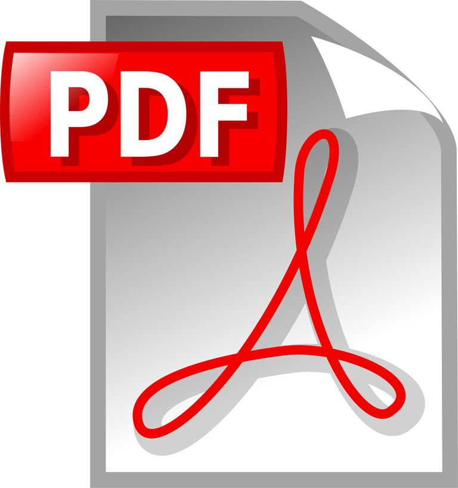

::: {dir="ltr" style="text-align: left;" trbidi="on"}
আগে কাজটা করতাম অনলাইনে। [অনলাইন-কনভার্ট ডট কম](https://www.online-convert.com/)সহ বিভিন্ন ওয়েবসাইটে সহজেই পিডিএফ বা ইমেজ কনভার্ট বা মার্জ করা যায়। তবে অসুবিধা হলো, ফাইলগুলো সেখানে আপলোড করতে হয়। আবার শেষে ডাউনলোড করা। সময় অপচয়ের ভালো রাস্তা।

::: {.separator style="clear: both; text-align: center;"}

:::

অথচ কাজগুলো করা যায় কয়েক শব্দের এক লাইন কোড দিয়েই। এখানে পিডিএফ ও ইমেজ বিষয়ক এমন কয়েকটি কমান্ডই দেখব আমরা।

কাজটা আমরা করব কমান্ড লাইনে। আপনি লিনাক্স ইউজার হলে তো কথাই নেই। না হলেও সমস্যা নেই। WSL ইনস্টল করে নিলেই হলো। [কীভাবে করবেন দেখে নিন এখানে](https://www.wikihow.com/Enable-the-Windows-Subsystem-for-Linux)।

**আরও পড়ুন**
☛ [লিনাক্স কমান্ড লাইন: হাতেখড়ি](https://www.statmania.info/2019/06/linux-intro.html)

এবার তাহলে টার্মিনাল বা WSL ওপেন করুন। এখানের কাজগুলো করতে হলে আমাদের একটি বিখ্যাত প্যাকেজ লাগবে। নাম ImageMagick। এটা [ইনস্টল করে](https://www.tecmint.com/install-imagemagick-on-debian-ubuntu/) নিন তাহলে। লিঙ্কে বিস্তারিত বলা আছে। অত ঝামেলায় যেতে না চাইলে নীচের কোডটা রান করে দেখুন।

```bash
sudo apt-get install imagemagick
```

**১। পিডিএফ জোড়া দিতে**

মনে করুন, আপনার [ওয়ার্কিং ডিরেক্টরিতে](https://www.statmania.info/2019/06/linux-intro.html) অনেকগুলো পিডিএফ ফাইল আছে। এর মধ্যে কয়েক্টিকে আপনি জোড়া দিতে চাচ্ছেন। ধরুন আমরা pdf1.pdf, pdf2.pdf, pdf3.pdf এই তিনটি ফাইলকে জোড়া দিয়ে merged.pdf নামে একটি ফাইল বানাব।

```bash
convert pdf1.pdf pdf2.pdf merged.pdf
```

কাজটা একইরকম সহজ করে করা যায় pdfunite টুল দিয়েও। সেক্ষেত্রে ওপরে convert এর জায়গায় শুধু pdfunite লিখলেই হবে।

অথবা ধরুন, আমার ওয়ার্কিং ডিরেক্টরির সবগুলো পিডিএফ নিয়েই নতুন একটা পিডিএফ বানাব। সেটা আরও সহজ।

```bash
pdfunite *.pdf merged.pdf
```

এখানে \* দিয়ে বোঝানো হচ্ছে .pdf এক্সটেনশনযুক্ত সকল পিডিএফ ফাইল।

অথবা ধরুন, নামে মিল আছে এমন কিছু ফাইলকে আমরা মার্জ করব। ধরা যাক, আমরা যে ফাইলগুলো মার্জ করব সেগুলোর সবার নামের শেষে bd আছে। মানে এমন fruitbd.pdf, fishbd.pdf ইত্যাদি। তাহলে-

```bash
pdfunite *bd.pdf merged.pdf
```

২। **ছবি থেকে পিডিএফ**

ধরুন আমরা image.jpg কে image.pdf বানাব। তাহলে-

```bash
convert image.jpg image.pdf
```

আগের মতোই যদি সব jpg ছবিকে পিডিএফ বানাতে চাই তাও সম্ভব।

```bash
convert *.jpg pictures.pdf
```

একইভাবে png, jpeg ইত্যাদি ছবিকেও সহজেই পিডিএফ বানিয়ে নিতে পারেন।

**৩। পিডিএফ ভাঙতে-**

মনে করুন আমাদের পিডিএফ ফাইলের নাম input.pdf। আমরা এর ১ থেকে ১০ নং পেইজ নিয়ে একটা পিডিএফ ফাইল বানাব। এখানে মাথায় রাখতে হবে, এখানে ইন্ডেক্সিং শুরু হয় ০ থেকে। তাই, ১-১০ না লিখে আমরা লিখব ০-৯।

```bash
convert input.pdf[0-9] out.pdf
```

একেক পেইজ একেক জায়গা থেকে নিতে চাইলেও সমস্যা নেই। ধরুন আমরা ১ থেকে ৫ নং পেইজ নেব। তারপর নেব ৭ নং পেইজ। তারপর ১০ থেকে ১২।

```bash
convert input.pdf[1-5,7,10-12] out.pdf
```

আজ এ পর্যন্তই। ভালো থাকুন।

**সূত্র**
১। [লিনাক্সকমান্ডো](https://linuxcommando.blogspot.com/2015/03/how-to-merge-or-split-pdf-files-using.html)
২। উইকিহাউ
:::
