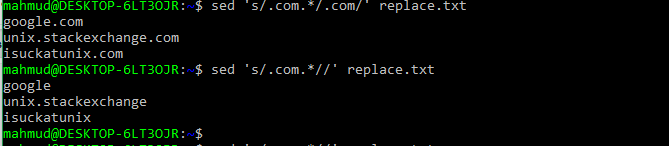

::: {dir="ltr" style="text-align: left;" trbidi="on"}
::: {.separator style="clear: both; text-align: center;"}

:::

ধরুন আমাদের কাছে replace.txt নামে একটি ফাইল আছে। এতে আছে অনেকগুলো ওয়েবপেইজের ঠিকানা (URL)। ধরা যাক, ফাইলের শুরুর অংশ এমন:

google.com/funny
unix.stackexchange.com/questions
isuckatunix.com/ireallydo

আমরা এখান থেকে .com এর পরের অংশটা মুছে ফেলতে চাই। কাজটা করা যায় অনেকভাবেই। তবে আমার মতে সবচেয়ে সহজ হলো sed কমান্ড। এছাড়াও awk কমান্ড দিয়েও করা যায়। করা যায় ex কমান্ড দিয়েও। তবে আমরা আপাতত শুধু sed এবং awk দিয়ে শিখব।

**sed কমান্ড**
**
** কমান্ডটা কীভাবে কাজ করে দেখতে আগে অন্য একটা উদাহরণ দেখা যাক। ধরুন আমরা Go শব্দটার G-কে P বানিয়ে ফেলতে চাইল। তাহলে কোড হবে-

> echo "Go" \| sed 's/G/P/'

**আউটপুট**: Po

বুঝতেই পারছেন s এর পরে স্ল্যাশ ("/") দিয়ে যে মুছতে চাই সেটা লিখব। আবার স্ল্যাশ দিয়ে যেটা বসাতে চাই সেটা।

এবার তাহলে replace.txt ফাইলে ফিরে আসা যাক। আমরা .txt ফাইল নিয়ে দেখাচ্ছি, কিন্তু তার মানে এই নয় যে অন্য ফাইলে এটা কাজ করবে না। কাজ করবে যে-কোনো টেক্সট ফাইলের জন্যেই। সেটা হতে পারে r বা পাইথন স্ক্রিপ্ট।

তাহলে .com এর পরের অংশ মুছতে কমান্ড হবে-

> sed 's/.com.\*/.com/' replace.txt

আর আপনি যদি .com সহ মুছে ফেলতে চান, তাহলে পরের .comটা ফেলে দিলেই হলো। 

> sed 's/.com.\*//' replace.txt

  ----------------------------------
   
        sed কমান্ডের কারিশমা 
  ----------------------------------

তবে এখানে প্রাপ্ত আউটপুট টার্মিনালে প্রিন্ট হবে, কিন্তু কোথাও সেভ হবে না। কোনো ফাইলে সেভ করতে শেষে \> filename.extension বসাতে হবে। অথবা \>\>। যদি বর্তমান কোনো ফাইলের শেষে এটা যোগ করতে চান। যেমন-

> sed 's/.com.\*//' replace.txt \> rep2.txt

এখন নতুন সৃষ্ট rep2.txt ফাইল দেখতে cat কমান্ড ব্যবহার করুন। 

> cat rep2.txt

তবে ফাইল বড় হলে পুরো ফাইল না দেখে উপরের কিছু লাইন দেখতে পারেন। 

> head -4 rep2.txt

**awk কমান্ড**

> cat replace.txt \| awk -F '\\\\.com' '{print \$1".com"}'

এখানে '\\$1' এর কাজ হলো এক নম্বর কলাম প্রিন্ট করা। আর তার আগে -F অংশ দিয়ে লাইনগুলোকে .com পজিশনে আলাদা কলামে ভাগ করা। তার মানে এখন প্রতি লাইন দুই কলামে ভাগ হয়ে গেল। এবার এখান থেকে '\$1' দিয়ে প্রথম কলাম নিয়ে নিলাম। তবে যেহেতু -F দিয়ে .com পজিশনে লাইন বিভক্ত হয়েছে, সে কারণে .com কলাম সেপারেটর হিসেবে কাজ করেছে। সাধারণ csv ফাইলে যেখানে থাকে কমা। এখন .com তো আমরা এখানে মুছতে চাই না। তাই '\\\$1' এর সাথে আবার .com রেখে দিয়েছি।

**সূত্র**
১। [Stackoverflow](https://unix.stackexchange.com/questions/257514/how-to-delete-the-rest-of-each-line-after-a-certain-pattern-or-a-string-in-a-fil/257515#257515)
২। [Lifewire](https://www.lifewire.com/write-awk-commands-and-scripts-2200573)
:::
