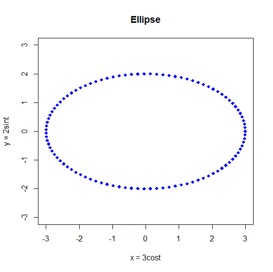
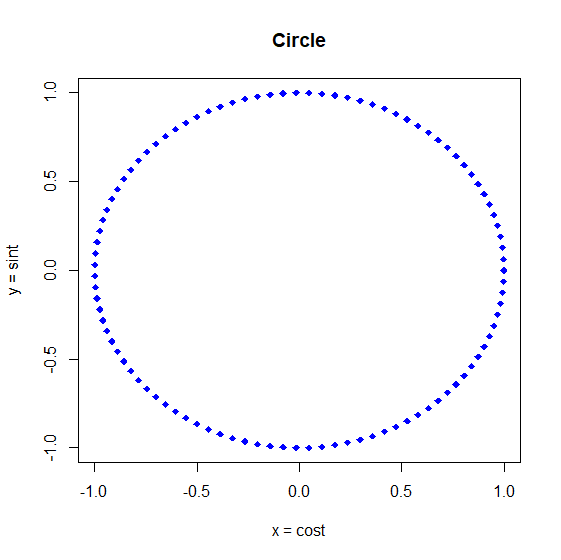

::: {dir="ltr" style="text-align: left;" trbidi="on"}
::: {style="text-align: justify;"}
প্রথমে দেখে মনে হবে এ আর এমন কী? একঘেঁয়ে এক জোড়া সমীকরণ। অথচ চিন্তাটা কত অসাধারণ! কেন অসাধারণ তা দেখার আগে একটা-দুইটা উদাহরণ দেখে নিলে মন্দ হয় না। আপাতত আমরা খুবই সাধারণ একটা উদাহরণ দেখব।
:::

::: {style="text-align: justify;"}
ধরুন, আমাদের কাছে খুবই সরল একটা সমীকরণ আছে। $y = \frac{x}{2}+25 $।
:::

::: {style="text-align: justify;"}
একে প্যারামেট্রিক রূপ দেওয়া যাক। বিস্তারিত বলার আগে আপাতত এটা বলে রাখি, প্যারামেট্রিক সমীকরণে আমরা দুটো চলকের (Variable) সম্পর্ককে তৃতীয় অন্য আরেকটি চলক দিয়ে (সাধারণত যাকে t দিয়ে প্রকাশ করা হয়) প্রকাশ করি।
:::

::: {style="text-align: justify;"}
প্যারামেট্রিক করতে ধরি, $t = \frac{x}{2}$। অবশ্যই আপনি অন্য কিছুও ধরতে পারতেন। এখানে থেকে, $x =2 \times t$।
:::

::: {style="text-align: justify;"}

:::

তাহলে, $y = \frac{2t}{2}+25 = t+25 $

অতএব, $y = \frac{x}{2}+25 $ সমীকরণকে প্যারামেট্রিক করে আমরা দুটো সমীকরণ পেলাম।

-   $x=2t $
-   $y = t +25 $

আমরা আরও কিছু উদাহরণ দেখব। তবে তার আগে একটু চিন্তা করি, কী লাভ হয় প্যারামেট্রিক সমীকরণ দিয়ে? 

::: {style="text-align: justify;"}
$y = \frac{x}{2}+ 25 $ সমীকরণটা নিয়ে আবার চিন্তা করি। এটা দিয়ে $x$ ও $y$ এর সম্পর্ক বোঝানো হয়েছে। যেখানে $y$ নির্ভর করছে $x$ এর ওপর। এই সম্পর্ক নানান রকমের হতে পারে। আপাতত আমরা ধরে নিচ্ছি এখানে $x$ দ্বারা বোঝাচ্ছে একটি অফিসের জন্যে প্রতিদিন কয়টি কলম কেনা হচ্ছে। আর $y$ দ্বারা বোঝাচ্ছে কত পেইজ কাগজ লাগছে।
:::

::: {style="text-align: justify;"}
তাহলে, ১০টা কলম কিনলে কাগজ কেনা হবে $y=\frac{10}{2} + 25$। মানে ৩০ পেইজ।
:::

আপাত দৃষ্টিতে দেখা যাচ্ছে, কাগজের সংখ্যা কলমের সংখ্যার ওপর নির্ভর করছে। অথচ বাস্তবে সেটা নাও হতে পারে।

::: {style="text-align: justify;"}
হতে পারে কোনটা কতটা কেনা হবে সেটা নির্ভর করছে ঐদিন অফিসে কত জন মানুষ লেখালেখি বিষয়ক কাজ করছে তার ওপর। এই সংখ্যাকে আমরা $t$ দিয়ে প্রকাশ করতে পারি। আমরা একটু আগেই $t$ এর সাথে $x$ ও $y$ এর সম্পর্ক বের করেছি। তাহলে ধরা যাক, কোনো একদিন ঐ অফিসে ৩০ জন মানুষ কাগজে লেখালেখি করবে।
:::

::: {style="text-align: justify;"}
তাহলে, মোট কলম লাগবে, $x=2t$  বা $2 \times 30$, মানে ৬০টি।

আর কাগজ লাগবে $y= t +25 = 30 + 25 = 65$। মানে কাগজ লাগবে ৬৫ পেইজ।
:::

::: {style="text-align: justify;"}
তাহলে আমরা দেখলাম, আসলে কয়টি কলম বা কত পেইজ কাগজ কেনা হবে সেটা আসলে নির্ভর করছে তৃতীয় আরেকটি চলকের ওপর। কাগজ ও কলমের সংখ্যা একে অপরের ওপর নির্ভর নাও করতে পারে। এখানেই প্যারামেট্রিক সমীকরণের কারিশমা।
:::

::: {style="text-align: justify;"}
এছাড়াও উচ্চতর নানান অ্যানালাইসিসে সমীকরণকে প্যারামেট্রিক করে নিলে কাজ করতে সুবিধা হয়।
:::

এবার আরেকটা উদাহরণ দেখা যাক।

$$x^2+y^2=16$$

::: {style="text-align: justify;"}
এটাকে আমরা চাইলে $t=x^2$ ধরেও প্যারামেট্রিক করতে পারি। সেক্ষেত্রে সমীকরণ দুটো হবে এমন-
:::

-   $x=\sqrt{t}$
-   $y=\sqrt{16-t}$

এছাড়া আপনি অন্য  যে-কোনো কিছু ধরেও করতে পারেন। তবে কখনও কখনও বিশেষ কিছু উপায়ে করলে সমীকরণের মানে বোঝা সহজ হয়।

ত্রিকোণমিতি থেকে আমরা জানি, $sin^2t+cos^2=1$

::: {style="text-align: justify;"}
এখানে আমরা কোণের জন্যে $\theta$ এর বদলে $t$ ব্যবহার করলাম। যেহেতু প্যারামেট্রিক সমীকরণে সাধারণত $t$ ব্যবহার করা হয়।
:::

::: {style="text-align: justify;"}
এখন আমরা চাইলে $x^2+y^2=16$ কে $sin^2t+cos^2=1$ এর মতো রূপ দিতে পারি। এভাবে-
:::

$$\frac{x^2}{16}+\frac{y^2}{16} = 1 $$
এটা থেকে-
$$(\frac{x}{4})^2 + (\frac{y}{4})^2=1$$

এটাকে এখন $sin^2t+cos^2=1$ এর মতো দেখাচ্ছে। তাহলে আমরা লিখতে পারি,

$\frac{x}{4}=sint$ এবং $\frac{y}{4}=cost$

মানে,

-       $x=4 \space sint$
-       $y=4 \space cost$

::: {style="text-align: justify;"}
দেখেই বোঝা যাচ্ছে, এটা ৪ একক ব্যাসার্ধের একটি বৃত্ত। এখানে ৪ এর জায়গায় ১ থাকলে এটা হত  একক বৃত্ত (unit circle)। মানে ব্যাসার্ধ ১ এককের বৃত্ত।
:::

::: {style="text-align: justify;"}
দুই জায়গায়ই ৪ না হয়ে কম বেশি হলে এটা হয়ে যেত উপবৃত্তের  (ellipse) সমীকরণ। যেমন

-       $x=3 \space cost$
-       $y=2 \space sint$
:::

আমরা দুটি চিত্রই এঁকে দেখতে পারি। আঁকব অবশ্যই [R দিয়ে](2018-02-install-r.html)।

প্রথমে উপবৃত্ত দেখা যাক।

```r
t <- seq(0, 2*pi, length.out = 100)
x <- 3*cos(t)
y <- 2*sin(t)
plot(x,y, pch = 18, col = 'blue', ylim=c(-3,3), main = "Ellipse",
xlab="x = 3cost", ylab = "y = 2sint")
```

  --------------------------------------------------
           
   চিত্র-০১ঃ প্যারামেট্রিক সমীকরণ থেকে আঁকা উপবৃত্ত
  --------------------------------------------------

::: {.separator style="clear: both; text-align: center;"}
:::

এবার তাহলে বৃত্তটাও এঁকে ফেলি।

```r
t <- seq(0, 2*pi, length.out = 100)
x <- cos(t)
y <- sin(t)
plot(x,y, pch = 18, col = 'blue', main = "Circle",
xlab="x = cost", ylab = "y = sint")
```

  -------------------------------------------------
          
   চিত্র-০২ঃ প্যারামেট্রিক সমীকরণ থেকে আঁকা বৃত্ত 
  -------------------------------------------------

::: {style="text-align: justify;"}
বলাই বাহুল্য, এভাবে আঁকাআঁকির জন্যে প্যারামেট্রিক সমীকরণ ব্যবহার না করলে মুশকিলে পড়তে হয় অনেক সময়।
:::

::: {style="text-align: justify;"}
এর [আগে একটি লেখায়](2018-06-floweR.html) আমরা দারুণ দারুণ নকশার ডিজাইন দেখেছিলাম। ওখানেও কিন্তু প্যারামেট্রিক সমীকরণ কাজে লাগানো হয়েছিল।
:::

::: {style="text-align: justify;"}
এভাবেই প্যারামেট্রিক সমীকরণ আমাদের জীবনকে সহজ করে তোলে। নান্দনিকও কি নয়? (কী নান্দনিক, তাই না?)। এমন সুন্দর [সুন্দর ডিজাইন তো সে কথাই বলে](2018-06-floweR.html)। পাশাপাশি আমাদেরকে ভিন্ন দৃষ্টিকোণ থেকে চিন্তা করতে শেখায়।
:::

**সূত্র**
১। [বেটার এক্সপ্লেইন্ড](https://betterexplained.com/articles/a-quick-intuition-for-parametric-equations/)
২। [খান অ্যাকাডেমি](https://www.youtube.com/watch?v=57BiI_iD3-U)
৩। [Straighter Line](https://www.youtube.com/watch?v=ElTOIxxZJ7k&feature=youtu.be)
৪। [MrsDobbsMath](https://www.youtube.com/watch?v=rTf5uXNW7Ys&t=14s)
৫। [উইকিপিডিয়া](https://en.wikipedia.org/wiki/Parametric_equation)
:::
