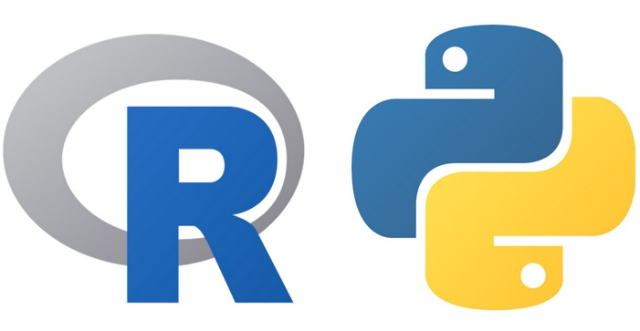

::: {dir="ltr" style="text-align: left;" trbidi="on"}
কে সেরা? পাইথন একটি জেনারেল-পারপাজ ল্যাংগুয়েজ হওয়ায় সার্বিকভাবে অবশ্যই পাইথনই সেরা। কইম্পিউটার প্রোগ্রামিং এর জগতের সবকিছুই পাইথন দিয়ে করা যায়। তাই C, C++, Java প্রোগ্রামিংগুলো ক্রমাগত পাইথনের পেছনে পড়ে যাচ্ছে।

তবে এখানে আমরা কথা বলছি ডেটা সায়েন্স নিয়ে। যেখানে R-কে বলা হয় লিংগুয়া ফ্র্যাংক্যা। মানে সহজাত বা কমন ভাষা। তবে পাইথন এখানেও অন্যতম সেরা ল্যাংগুয়েজ।

::: {.separator style="clear: both; text-align: center;"}

:::

দুটোর মধ্যে কে সেরা তা আলোচনার আগে আরেকটা জিনিস বুঝতে হবে। এই আলোচনা আসলে কতটা গুরুত্বপূর্ণ। ডেটা সায়েন্সে প্রোগ্রামিং হলো একটা অংশ। তারও আগে গুরুত্বপূর্ণ হলো থিওরি জানা, কোন থিওরি অ্যাপ্লাই করতে হবে সেটা জানা ইত্যাদি। তাই জানা থিওরি অ্যাপ্লাই করছেন কাকে দিয়ে সেটা অনেক ক্ষেত্রেই গুরুত্বপূর্ণ কিছু নয়।

ওয়েবে এই দুটো ল্যাংগুয়েজ নিয়ে প্রচুর আলোচনা/তুলনা আছে। যার উল্লেখযোগ্য একটা অংশ অনিরপেক্ষ। দেখা যাক, আমরা কতটা অনিরপেক্ষ থাকতে পারি।

**শেখা**
অনেকেই বলেন পাইথন R এর চেয়ে সহজে শেখা যায়। অথচ পাইথনে ডেটা সায়েন্সের কাজ শুরু করতে গেলেই অনেকগুলো প্যাকেজ শিখতে হবে। এই যেমন NumPy, Pandas, matplotlib। অথচ R-এ একজন সাধারণ মানুষও মুহুর্তের মধ্যেই জটিল জটিল সব কাজ করা শুরু করে দিতে পারবেন। ম্যাট্রিক্স ক্যালকুলেশন, প্লটিং, মডেলিং ইত্যাদি।

**প্যাকেজ**
R প্যাকেজের মূল রিপো হলো CRAN। যার পূর্ণরূপ কম্প্রিহেন্সিভ R আর্কাইভ নেটওয়ার্ক। এই আর্টিকেল লেখার সময় [এখানে প্যাকেজ সংখ্যা](https://cran.r-project.org/web/packages/index.html) ১৪৪৪০। এছাড়াও গিটহাব ও বায়োকন্ডাক্টর (বায়োইনফরমেটিক্স নিয়ে) ওয়েবসাইটে প্রচুর প্যাকেজ আছে।

অন্য দিকে পাইথন প্যাকেজের সংখ্যা প্রায় ১ লাখ ৮৩ হাজার। তবে মনে রাখতে হবে, সব কিন্তু ডেটা সায়েন্সের জন্য নয়। ডেটা সায়েন্সের কথা চিন্তা করলে আসলে পাইথন অনেক পিছিয়ে আছে। বেশিরভাগ কাজ করতে গেলেই আপনি R-এ রেডিমেড প্যাকেজ পেয়ে যাবেন। পাইথনে অনেক সময়ই পাবেন না সেটা।

আর কাঙ্খিত প্যাকেজ খুঁজেও পাওয়াটাও পাইথনে R-এর চেয়ে বেশ কঠিন।

**কোডের পরিচ্ছন্নতা**
এটা অবশ্য একজনের কাছে এক রকম ভাল লাগে। তবে অন্য প্রায় সব ল্যাংগুয়েজের চেয়ে পাইথনের কোডগুলো খুব বেশি পরিচ্ছন। ব্র্যাকেট-ট্যাকেটের ব্যবহার খুব কম বা না করেই কাজ চালিয়ে নেওয়া যায়।

```r
if x > y: 
   z = 5
   w = 8
```

কিন্তু একই রকম কাজ R-এ একটু কঠিন।

```r
if (x > y)
{ 
   z = 5
   w = 8
}
```

তবে সেটা নতুন নতুন কিছুদিনই। শেখা হয়ে গেলে এটা বড় ব্যাপার না। তবে বড় কাজের ক্ষেত্রে এটা অনেক সময় বড় ব্যাপার হয়ে ওঠে আবার।

**পরিসংখ্যানিক নির্ভুলতা**
R তৈরিই হয়েছে পরিসংখ্যানের কাজের জন্যে। অনেককেই দেখা যায়, পরিসংখ্যান পারুন বা না পারুন, মেশিন লার্নিং নিয়ে মেতে থাকেন। পরিসংখ্যানকে অবজ্ঞা করতেও জুড়ি নেই এদের। সেদিন একজনকে বলতে শোনা গেল, ডেটা ট্রান্সফর্ম করে গড় ০ আর ভেদাঙ্ক (Variance) ১ করলে নাকি নরমাল (গাউসিয়ান) ডিস্ট্রিবিউশন হয়। R-এ আপনি দেখতে পাবেন পরিসংখ্যানবিদদের গড়া থিওরির নিজেদের দ্বারাই ইমপ্লিমেন্টেশন। আস্থার জায়গাটা এখানে বেশি।

R-কে বলা হয়,

> R is written *by* statisticians, *for* statisticians 

ফলে R-এর কম্পিউটেশন বেশিরভাগ ক্ষেত্রেই নির্ভরযোগ্য হাত থেকে আসা।

**মেশিন লার্নিং**
এখানে পাইথনকে একটু বেশি কৃতিত্ব দিতে হয়। সাধারণত R বনাম পাইথনের আরেক নাম হলো পরিসংখ্যান বনাম কম্পিউটার সায়েন্স (CS)। মেশিন লার্নিং এর নিউরাল নেটওয়ার্কে (NN) CS-এর বেশি অবদান থাকায় পাইথনে NN সহজে করা যায়। keras নিয়ে RStudio এর কাজের কল্যাণে R-ও পিছিয়ে নেই অবশ্য।

অন্য দিকে মেশিন লার্নিং এর র‍্যান্ডম ফরেস্ট অ্যালগোরিদম নিয়ে পরিসংখ্যানের লোকেরা বেশি কাজ করেছেন। এ ক্ষেত্রে তাই R এগিয়ে। এছাড়া R-এ মেশিন লার্নিং এর অনেকগুলো কাজ বিল্ট-ইন আছে। নতুন কোনো প্যাকেজ লাগে না। ওদিকে caret  প্যাকেজ তো প্রায় ১৫০ মেশিন লার্নিং অ্যালগোরিদমকে দারুণভাবে গেঁথে ফেলছে।

তবে এখানে পাইথন এগিয়ে থাকার একটি কারণ হলো বিভিন্ন প্রতিষ্ঠানে পাইথন সহজ ব্যবহার করা যায়। আগেই বলেছি, পাইথন জেনারেল-পারপাজ ল্যাংগুয়েজ। ফলে মেশিন লার্নিং থেকে প্রাপ্ত ফলাফল সহজেই ইমপ্লিমেন্ট করতে চাইলে পাইথনেই তা করা যায়।

উল্লেখ্য, আমাদের এই সাইটের (সহ এইরকম ও আরও নানান রকম অসংখ্য সাইটের) অরিজিনাল টেমপ্লেট পাইথনে লেখা।

**প্যারালেল কম্পিউটেশন**
R বা পাইথন কারোই মূল ভার্সনে মাল্টিকোর কম্পিউটেশনের ভালো ব্যবস্থা নেই। দুটোর জন্যেই এক্সটারনাল লাইব্রেরি ব্যবহারের ভালো সূযোগ আছে অবশ্য।

**C/C++ ইন্টারফেস**
পাইথনে C/C++ এর ইন্টারফেস হিসেবে swig এর মতো টুল থাকলেও R এর Rcpp এর মতো পাওয়ারপুল টুল নেই। Pybind11 প্রস্তুত হলে পাইথন একটু ভালো হবে অবশ্য। এদিকে R আবার নিয়ে আসছে [ALTREP](https://blog.revolutionanalytics.com/2017/09/altrep-preview.html)। পারফরম্যান্স ও ব্যবহার দারুণ হবে এটি দিয়ে।

**কোডের ধারাবাহিকতা**
এখানেও R পিছিয়ে আছে। বিশেষ করে বেস R ও Tidyverse এর মধ্যে যথেষ্ট পার্থক্য বিদ্যমান। এছাড়াও বিভিন্ন প্যাকেজে একই কাজ নানানভাবে ইমপ্লিমেন্ট করা হয়েছে। এটা খুব বিরক্তিকর।

**অনলাইন হেল্প **
প্রোগ্রামিং এর জগৎ হেল্প ছাড়া অচল। কাজ করতে গেলে হেল্প দরকার হবেই। সমস্যায় পড়বেন। ডকুমেন্টেশন দেখবেন। অন্য কোথাও সমাধান খুঁজবেন। গুগোলে সার্চ দেবেন। সমাধান পেয়ে যাবেন। এটা যত দ্রুত পারবেন ততই ভালো। তবে এক্ষেত্রেও R দারুণ। helP() লিখে কি-ওয়ার্ড লিখলেই চলে আসবে সমাধান। বা ?keyword বা ??keyword।

**সোজাসাপ্টা**
যে কাজগুলো R-এ এক/দুই লাইনের কাজ, বেশিরভাগ ক্ষেত্রেই সেসব কাজ পাইথনে একগাদা কোড লিখতে হবে।

**শেষ কথা**
**কে ভালো? **
**
** কে ভালো জেনে আসলে লাভ আছে? আপনার ভালো লাগাকেই মূল্য দিন। ভাবছেন যেটায় বেশি টাকা সেটা শিখবেন? বেশি টাকা আসলে কোনো প্রযুক্তির কাছে থাকে না। থাকে স্কিলের মধ্যে।

> যেটাই শিখুন, বা যদি দুটোই শিখুন, শিখুন ভালো করে। 

**সূত্র**
১। [নর্ম ম্যাটলফ](https://github.com/matloff/R-vs.-Python-for-Data-Science), প্রফেসর, কম্পিউটার সায়েন্স, ইউনিভার্সিটি অব ক্যালিফোর্নিয়া, ইউসিডেভিস

[আরও](https://www.datacamp.com/community/tutorials/r-or-python-for-data-analysis) জানতে পড়ুন- [Datacamp: R vs Python](http://res.cloudinary.com/dyd911kmh/image/upload/f_auto,q_auto:best/v1523009719/main-qimg-9dcf536c501455f073dfbc4e09798a51_vpijr0.png) 
:::
