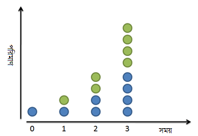
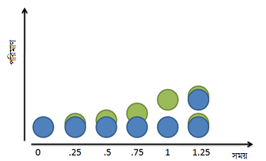
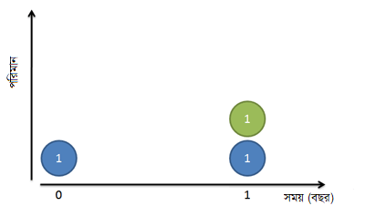
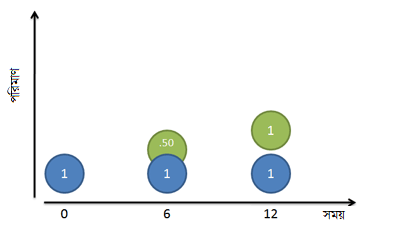
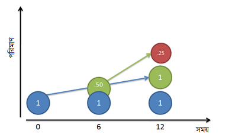
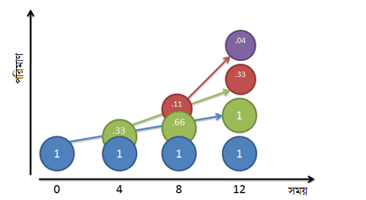

::: {dir="ltr" style="text-align: left;" trbidi="on"}
সবচেয়ে প্রিয় সংখ্যা কোনটি? এর উত্তরে অনেকেই বলবেন 'পাই' এর নাম। যেটি হলো একটি বৃত্তের পরিধি ও ব্যাসের অনুপাত। তবে অনেকেই আবার e কেই প্রিয় সংখ্যা মনে করেন। এটিও পাই এর মতোই একটি ধ্রুবক। সুইস গণিতবিদ অয়লারের নাম অনুসারে একে অয়লার সংখ্যাও বলা হয়। আরেক নাম নেপিয়ার ধ্রুবক। তবে অয়লার ধ্রুবক কিন্তু ভিন্ন আরেকটি সংখ্যা।

যাই হোক, e একটি দারুণ ও বিস্ময়কর সংখ্যা। এর সত্যিকার সৌন্দর্য ও গুরুত্ব 'পাই' এর চেয়েও বেশি বলা চলে। বা অন্তত সমান বলতেই হবে। কিন্তু এর এই লুকানো সৌন্দর্য খুব কমই তুলে ধরা হয়। [উইকিপিডিয়ায়ও](https://en.wikipedia.org/wiki/E_(mathematical_constant)) এর তথাকথিত কিছু সংজ্ঞাই লেখা আছে। যেমন,

> e হলো একটি গাণিতিক ধ্রুবক। **এটা স্বাভাবিক লগারিদমের ভিত্তি।** এর আসন্ন মান ২.৭১৮২৮...। এটি $(1+\frac{1}{n})^n$ ধারার সমষ্টি, যখন $n$ অসীমের দিকে যেতে থাকে। 

কথাগুলো যথেষ্ট তথ্যবহুল এবং প্রয়োজনীয়ও বটে। কিন্তু সংখ্যাটির মাহাত্ম্য তুলে ধরতে ব্যর্থ। আরেকটি মজার বিষয় চোখে পড়ার মতো। বলা আছে e হলো স্বাভাবিক লগারিদমের ভিত্তি। এবার আপনাকে তাহলে স্বাভাবিক লগারিদম সম্পর্কে জানতে হবে। ক্লিক করে সেই পাতায় গেলেন। লেখা আছে,

> স্বাভাবিক লগারিদম (পূর্ব নাম হাইপারবোলিক লগারিদম) হলো e ভিত্তিক লগারিদম, যেখানে e হলো একটি অমূলদ ধ্রুবক সংখ্যা, যার মান প্রায় ২.৭১৮ ২৮১ ৮২৮ ৪৫৯...।

😶
গোলকধাঁধা হিসেবে এর জুড়ি মেলা ভার! এটা অনেকটা হোজ্জার কথার মতো। 'আপনি থাকেন কোথায়?' 'আমার ভাইয়ের সাথে।' 'আপনার ভাই থাকেন কোথায়?' 'আমার সাথে।' 😳

অনেক হয়েছে। এ গোলকধাঁধার খপ্পরে আর নয়।

**e নিছক একটা সংখ্যা-ই নয়**
e কে 'একটি ধ্রুবক, যার মান প্রয় ২.৭১৮...' বলা আর *পাই*কে ৩.১৪১৫... বলা একই কথা। কথা ঠিকই আছে। কিন্তু মূল কথাটা এবং ভেতরের সৌন্দর্যটা ঢাকা পড়ে গেল।

আগেই বলেছি, ***পাই*** হলো যে-কোনো বৃত্তের পরিধি ও ব্যাসের অনুপাতের মান। যেখানেই বৃত্তের মতো কিছু আছে, সেখানেই পাওয়া যাবে একে। পরিধি, ক্ষেত্রফল, আয়তন এবং বৃত্ত, গোলক বা সিলিন্ডারের পৃষ্ট ক্ষেত্রফল সবখানেই এটি উপস্থিত। এটি দেখায়, সবগুলো বৃত্ত একই সূত্রে গাঁথা। ত্রিকোণমিতির ফাংশনগুলোও (সাইন, কোসাইন, ট্যানজেন্ট) *পাই* এর সাথে জড়িত। গাণিতিক বিজ্ঞানের হেন জায়গা নেই, যেখানে এটি নেই।

*পাই* এর মতো e ও একটি জিনিসকে একই সূত্রে গাঁথে। যে-কোনো অবিচ্ছিন্ন (মানে বিরতিহীন) বৃদ্ধির মৌলিক হার হলো e। Growth বা বৃদ্ধি সাধারণত তিনভাবে হতে পারে। সরল বৃদ্ধিতে একটি নির্দিষ্ট সময় পরে একটি পরিমাণ বাড়ে। চক্রবৃদ্ধি প্রক্রিয়ার প্রতিবার বৃদ্ধির পরে যে পরিমাণ দাঁড়াবে তার পুরোটাই পরের বৃদ্ধিতে অবদান রাখবে। ফলে বৃদ্ধির পরিমাণ প্রতিবার আগের চেয়ে বেশি করে হবে। যেমন কোনো এলাকায় ১০০ লোক ছিল। বছরে ১০% করে বেড়ে প্রথম বছর শেষে ১১০ জন লোক হলো। পরের বছর কিন্তু ১০ জন বাড়বে না। বাড়বে ১১ জন (১১০ এর ১০%)। আর অবিচ্ছিন্ন বৃদ্ধিতে প্রতি ন্যানোসেকেন্ডে (বা তার চেয়ে দ্রুত) বৃদ্ধি ঘটে। এটাও এক প্রকার চক্রবৃদ্ধি, যেখানে খুব ক্ষুদ্র সময় পর পর পরিমাণ একটু একটু করে বাড়তে থাকে।

যেখানেই কোনো বিরতিহীন বা সূচকীয় (Exponential) বৃদ্ধি জাতীয় কিছু আছে, সেখানেই দেখা যাবে eকে। সেটা হতে পারে তেজস্ক্রিয় ক্ষয়, জনসংখ্যা বৃদ্ধি, সুদ ইত্যাদি ইত্যাদি। এমনকি যে প্রক্রিয়াগুলোতে বৃদ্ধি নিয়ম মেনে হয় না, সেখানেও e দিয়ে কাজ চালিয়ে নেওয়া যায়।

ঠিক যেভাবে যে-কোনো সংখ্যাকে ১ এর বর্ধিত (Scaled) বা কর্তিত রূপ বলা চলে, যে-কোনো বৃত্তকে একক বৃত্তের (Unit circle, যার ব্যাসার্ধ এক একক) বর্ধিত রূপ বলা চলে, তেমনিভাবে যে-কোনো বৃদ্ধির হারের বর্ধিত রূপ বলা যেতে পারে eকে। এটি হলো একটি একক বৃদ্ধি। এবং একটি নিখুঁত চক্রবৃদ্ধি।

ফলে e আকাশ থেকে পড়া কোনো সংখ্যা নয়। সংখ্যাটি বলতে চাচ্ছে, বিরতিহীনভাবে বাড়া যে-কোনো প্রক্রিয়া আসলে একটি কমন হারের বর্ধিত (বা কর্তিত) রূপ। একটু পরেই আমরা কথাটার গাণিতিক দিক দেখব। হব বিমোহিত 😇

**সূচকীয় বৃদ্ধির সাথে পরিচয়**
মনে করুন, একটি নির্দিষ্ট সময় পর পর কোনো একটি প্রক্রিয়া বেড়ে দ্বিগুণ হচ্ছে। যেমন,

-   ব্যাকটেরিয়া বিভাজন ঘটিয়ে প্রতি ২৪ ঘণ্টায় দ্বিগুণ হয়।
-   ১০০% করে বাড়লে বছর শেষে জনসংখ্যা হবে দ্বিগুণ। 
-   ঈস্ট নামের এককোষী প্রাণীটি অনুকূল পরিবেশে বংশবৃদ্ধি করে ১০০ মিনিটেই দ্বিগুণ হতে পারে। 

ব্যাপারটা অনেকটা এমন:

::: {style="text-align: center;"}

:::

বাস্তবে তিন গুণ বা চার গুণ তো হতে পারেই। তবে দ্বিগুণ আমরা আপাতত কাজ করি। আপাতত এতেই সুবিধা।

আমরা যে পরিমাণ নিয়ে শুরু করব, x ভাগ (বা সময়) পরে পাব তার $2^x$ গুণ। খেয়াল রাখতে হবে, আমরা দ্বিগুণ নিয়ে কাজ করছি। এখানে ২ সেজন্যেই। ১ ভাগ পরে তাই আমরা পাব $2^1$ বা ২ গুণ। ৪ ভাগ পরে পাব $2^4$ বা ১৬ গুণ। তার মানে সাধারণ সূত্র হলো:

::: {style="text-align: center;"}
বৃদ্ধি = $2^x$ 
:::

::: {style="text-align: left;"}

:::

::: {style="text-align: left;"}
অন্য কথায় বললে, দ্বিগুণ করা মানে আসলে ১০০% বাড়ানো। আমরা তাই সূত্রটিকে এভাবেও লিখতে পারি:
:::

::: {style="text-align: center;"}
বৃদ্ধি = $(1+100%)^x$
:::

::: {style="text-align: left;"}

:::

::: {style="text-align: left;"}
এটাও আসলে একই সমীকরণ। আমরা শুধু ২কে ভেঙে নিয়ে এর সঠিক রূপটা দেখালাম। মূল পরিমাণ ১ + ১০০%। ১০০% মানে \$\\frac{১০০}{১০০}। যোগ করলে পাই ২। 
:::

::: {style="text-align: left;"}

:::

::: {style="text-align: left;"}
চাইলে আমরা ১০০% এর বদলে অন্য সংখ্যাও রাখতে পারি। ২৫%, ৫০%, ২০০% ইত্যাদি। সেক্ষেত্রে x পরিমাণ সময়কাল (period) শেষে পরিমাণ হবে 
:::

::: {style="text-align: center;"}
বৃদ্ধি = $(1+প্রাপ্তি)^x$
:::

::: {style="text-align: center;"}

:::

এর মানে হলো, আমরা আমাদের প্রাপ্তির হারের (১+প্রাপ্তি) x গুণ ব্যবহার করলাম। 

আরেকটি গভীরে নজর:

আমাদের সূত্রে ধরে নেওয়া হয়েছে, বৃদ্ধি ঘটছে বিচ্ছিন্নভাবে। ভেঙে ভেঙে। যেন ব্যাকটেরিয়া অপেক্ষা করছে, করছে,... হঠাৎ করে বুম! শেষ মিনিটে হঠাৎ করে ডাবল হয়ে গেল। বছর শেষে এক লাফে জনসংখ্যা দ্বিগুণ হয়ে গেল। ওপরের চিত্র তাই বলছে। হঠাৎ করে সবুজ বলগুলো আকাশ ফুঁড়ে হাজির হচ্ছে। 

দুনিয়া কিন্তু এভাবে চলে না আসলে। আমরা যদি খেয়াল করে দেখি তাহলে দেখব, ব্যাকটেরিয়া বন্ধুরা বাড়ছে আসলে এভাবে:

::: {style="text-align: center;"}

:::

::: {style="text-align: left;"}

:::

::: {style="text-align: left;"}
সবুজ মিয়া হঠাৎ করে উদয় হয় না। ধীরে ধীরে নিল মিয়ার ভেতর থেকে বের হয়ে আসে। এক একক সময় পরে (এক্ষেত্রে ২৪ ঘণ্টা) সবুজ মিয়া পূর্ণাঙ্গ হয়। এখন সে নিজেই আরেকজন নীল মিয়া। নিজেই এবার সবুজদের জন্ম দিতে পারে। 
:::

::: {style="text-align: left;"}

:::

::: {style="text-align: left;"}
এখন কি তাহলে সমীকরণ বদলে যাবে? 
:::

::: {style="text-align: left;"}

:::

::: {style="text-align: left;"}
না। অপূর্ণাঙ্গ ব্যাকটেরিয়া পূর্ণাঙ্গ হবার আগে কিছু করতে পারে না। সমীকরণ তাই সেকেলে হয়নি। 
:::

::: {style="text-align: left;"}

:::

::: {style="text-align: left;"}
**টাকার খেলা:**
:::

::: {style="text-align: left;"}
কিন্তু টাকার কথা আলাদা। এক পয়সা টাকা উপার্জন (সুদ বা ব্যবসা থেকে) করা মাত্রই সেটা নতুন টাকার যোগান দিতে পারে। এমন নয় যে পুরো এক টাকা হওয়া পর্যন্ত ঐ এক পয়সা কোনো কাজে আসবে না। নতুন টাকাকে ব্যাকটেরিয়ার মতো পূর্ণ হতে হয় না। 
:::

::: {style="text-align: left;"}

:::

::: {style="text-align: left;"}
আগের সূত্র অনুসারে টাকার বৃদ্ধি এ রকম:
:::

::: {style="text-align: left;"}

:::

::: {style="text-align: center;"}

:::

::: {style="text-align: left;"}

:::

::: {style="text-align: left;"}
মুনাফা পাওয়া যাচ্ছে বছরের শেষ দিন। এক কাজ করা যাক। বছরকে ভেঙে দুই ভাগ করি। প্রতি বছর সুদ ১০০%। মানে প্রতি ছয় মাসে ৫০% করে। তাহলে প্রথম ছয় মাসে ৫০ পয়সা আর পরের পরের ছয় মাসে ৫০ পয়সা আয় হবে। 
:::

::: {style="text-align: left;"}

:::

::: {style="text-align: center;"}

:::

::: {style="text-align: left;"}

:::

::: {style="text-align: left;"}
কিন্তু এখনও কি আসলে ঠিক হলো? নীল মিয়া বছর শেষে ১ টাকাই বাড়াতে পারল। অথচ ছয় মাস পরেই তো আমাদের কাছে ৫০ পয়সা ছিল। সেটা তো বসে থাকার পাত্র নয়। সেটা নিজেও টাকা বাড়াতে পারত। যেহেতু আমাদের হার হলো প্রতি ছয় মাসে ৫০%, তাহলে বাকি ছয় মাসে সেই ৫০ পয়সা আরও ২৫ পয়সা বানাবে। 
:::

::: {style="text-align: left;"}

:::

::: {.separator style="clear: both; text-align: center;"}

:::

::: {style="text-align: left;"}

:::

::: {style="text-align: left;"}
তার মানে এক বছর পরের সঠিক পরিমাণ হবে:
:::

::: {style="text-align: left;"}
-   মূল এক টাকা (নীল মিয়া) 
-   নীল মিয়ার অর্জিত এক টাকা (সবুজ মিয়া)
-   সবুজ মিয়ার অর্জিত ২৫ পয়সা (লাল মিয়া) 

তার মানে মোট টাকা হবে ৳২.২৫। প্রাথমিক এক টাকা থেকে আমরা ১.২৫ টাকা বাড়াতে সক্ষম হলাম। দ্বিগুণের চেয়ে ভালো 😋 দ্বিগুণে তো বাড়ে মাত্র ১ টাকা। একে সূত্রে রূপ দিলে কী হয় দেখা যাক, 

::: {style="text-align: center;"}
বৃদ্ধি = $(1+\frac{100%}{2})^2 = 2.25$
:::

::: {style="text-align: center;"}

:::

আরও বেশি লাভ করি না কেন!

দুই ভাগ করে ৫০% করার চেয়ে তিন ভাগ করে (প্রায়) ৩৩% করি না কেন? কে বলেছে ছয় মাস বসে থাকতে? এবার তাহলে এই চিত্র পাচ্ছি:

::: {style="text-align: center;"}

:::

প্রত্যেক রং এর বল নিজের সাধ্য মতো ৩৩% হারে টাকা বাড়িয়ে চলেছে। 

-   **প্রথম মাস:** নীল মিয়ার ১ টাকা নিয়ে শুরু
-   **চতুর্থ মাস:** নীল মিয়া ইতোমধ্যে $\frac{১}{৩}$ টাকা, মানে ৩৩ পয়সা বাড়ালেন। সবুজ মিয়ার উদয় ঘটছে। 
-   **অষ্টম মাস:** নীল মিয়া আরও ৩৩ পয়সা বাড়ালেন। এটা সবুজ মিয়াকে দিয়ে তাকে ৬৬ পয়সায় পরিণত করলেন। ওদিকে সবুজ মিয়াও সক্রিয় ছিলেন। তিনিও তাঁর ৩৩ পয়সা থেকে ৩৩% (১১ পয়সা) বাড়ালেন। এতে জন্ম হলো লাল মিয়ার। 
-   বারশ মাস: এবার ঘটল নানান কিছু। নীল মিয়া মূল ১ টাকা থেকে আবারও ৩৩ পয়সা বাড়ালেন। এবার এটা সবুজ মিয়াকে দিলে সবুজ মিয়া পূর্ণ (১ টাকা) হলেন। সবুজ মিয়া তো নিজেই আগে ৬৬ পয়সায় ছিলেন। তিনি নিজেও সেটা থেকে ৩৩% হার দিয়ে ২২ পয়সা (৬৬ এর ৩৩%) আয় করলেন। এই ২২ পয়সা আগের মতোই লাল মিয়াকে দিলে তিনি হলেন ৩৩ টাকা। আবার লাল মিয়া তো ছিলেন ১১ পয়সায়। তিনিও বসে থাকেননি। সেটার ৩৩% বা ৪ পয়সা তিনিও উপার্জন করেছেন। 

আরিব্বাবা! অনেক টাকা-পয়সার ব্যাপার। মোট: ১ + ১ + ০.৩৩ + ০.০৪ বা প্রায় ২.৩৭ টাকা। 

একটু সময় নিয়ে বিষয়টার মাহাত্ম্য বুঝে নেন। 

এই মিয়াদেরকে আরও বাড়তে দিলে সবুজ মিয়াও এক সময় লাল মিয়াকে পূর্ণ করবেন। ঠিক যেভাবে নীল মিয়া তাকে করেছিলেন। লাল মিয়াও একইভাবে আরেক মিয়া তৈরি করতে থাকবে। 

অতএব, সময়কে তিন ভাগে ভাগ করলে সূত্র হয় এ রকম:

::: {style="text-align: center;"}
বৃদ্ধি = $(1+\frac{100%}{3})^3 = 2.37037...$
:::

::: {style="text-align: left;"}

:::

::: {style="text-align: left;"}
মানে এবার আয় হলো ১.৩৭ টাকা। আগেরবারের চেয়েও ভালো। 
:::

::: {style="text-align: left;"}

:::

::: {style="text-align: left;"}
তাহলে তো বিপুল টাকার মালিক হয়ে যাওয়া যাবে! 
:::

::: {style="text-align: left;"}
একটু ভেবে দেখুন। সময়কালগুলোকে (পিরিয়ড) ছোট করে নিলেই লাভের পরিমাণ বেড়ে যাচ্ছে। তাহলে প্রতি মাসে মাসে প্রাপ্য নিয়ে নিলে কেমন হয়? তাই বা কেন? কেন প্রতি দিন, প্রতি ঘণ্টা, প্রতি মিনিট, প্রতি সেকেন্ড বা ন্যানোসেকেন্ড নয়? এখন সেক্ষেত্রে কি টাকা লাফিয়ে লাফিয়ে বাড়বে?
:::

::: {style="text-align: left;"}

:::

::: {style="text-align: left;"}
আমাদের প্রাপ্য ক্রমেই ভালো হবে। তবে তার একটা সীমা আছে বটে। n এর জায়গায় বিভিন্ন মান বসিয়ে দেখুন না কী হয়?

মোট টাকা হিসাব করা হয়েছে $(1+\frac{1}{n})^n$ সূত্র দিয়ে। আগের সূত্রগুলো তো সে রকম ধারণাই দিচ্ছে, তাই না?

:::

  n এর মান    মোট টাকা
  ----------- -----------
  1           2
  2           2.25
  3           2.37
  5           2.488
  10          2.5937
  100         2.7048
  1,000       2.7169
  10,000      2.71814
  100,000     2.718268
  1,000,000   2.7182804
:::

::: {style="text-align: left;"}

নিচের অনলাইন ক্যালকুলেটর দিয়ে আপনি চাইলে নিজের মতো করে যে-কোনো সংখ্যার জন্যে হিসাবটা করে নিতে পারেন।

::: {style="text-align: left;"}
ক্যালকুলেটর সোর্সঃ [ইনস্টাক্যাল্ক ডটকম।](https://instacalc.com/50446) 
:::
:::

::: {style="text-align: left;"}

:::

সংখ্যাটি ক্রমেই বড় হচ্ছে। তবে লক্ষ্যণীয় ব্যাপার হলো এটি ক্রমশ ২.৭১৮ এর কাছে ঘেঁষছে। এক মিনিট, এটা তো e এর মতো! 😛😛

এ জন্যেই তো e এর সেই রহস্যময় সংজ্ঞা। যদি আমরা এক একক পরিমাণকে (ধরুন ১ টাকা) ১০০% চক্রবৃদ্ধি হারে ক্ষুদ্র থেকে ক্ষুদ্রতর সময়কালে ভাগ করে করে বাড়িয়ে চলি, তাহলে e হলো সেই বৃদ্ধির হার:

::: {style="text-align: center;"}
বৃদ্ধি $= e = \lim_{x\to \infty}(1+\frac{1}{n})^n$
:::

::: {style="text-align: left;"}

:::

::: {style="text-align: left;"}
এই লিমিটটা [অভিসারী](2016-08-achilles-vs-tortoise.html) হয়। তার সপক্ষে [প্রমাণও](http://planetmath.org/convergenceofthesequence11nn) আছে। 
:::

::: {style="text-align: left;"}

:::

::: {style="text-align: left;"}
**কিন্তু এসবের মানে কী?**
:::

::: {style="text-align: left;"}
১০০% চক্রবৃদ্ধি হারে এক সময়কালে বৃদ্ধির সর্বোচ্চ সীমা হলো e সংখ্যাটি। আপনি হয়ত ভেবেছিলেন, ১ থেকে শুধুই ২ পাওয়া যাবে। এটাই তো ১০০% বৃদ্ধি, তাই না? কিন্তু প্রতি ধাপে যেটুকু বাড়ছে, সেটা নিজেও বাড়াতে সাহায্য করছে। অতএব, ১ টাকা বিনিয়োগ করে বিরতিহীনভাবে ১০০% চক্রবৃদ্ধি হারে লভ্যাংশ পেতে থাকলে প্রথম সময়কাল শেষে আমরা পাব 1e। ২ টাকা বিনিয়োগ করলে এক্ষেত্রে পাব 2e টাকা। ৮.৯ টাকা বিনিয়োগে পাব 8.9e টাকা। 
:::

::: {style="text-align: left;"}

:::

::: {style="text-align: left;"}
[আলোর বেগের](http://sky.bishwo.com/) মতো e ও যেন গতির একটি সীমা। বৃদ্ধির এই সার্বজনীন ধ্রুবকের মাধ্যমে যে-কোনো বৃদ্ধিকে প্রকাশ করা যেতে পারে। 
:::

::: {style="text-align: left;"}

:::

::: {style="text-align: left;"}
একটা বিষয় খেয়াল করতে হবে। বৃদ্ধি এবং বৃদ্ধির পরের পরিমাণ কিন্তু আলাদা। একটি হলো ১.৭১৮...। আরেকটি হলো ২.৭১৮...। এটাই হলো e, মানে সব রকম বৃদ্ধি যোগ করে পাওয়া পরিমাণ। 
:::

::: {style="text-align: left;"}

:::

::: {style="text-align: left;"}
কিন্তু হার যদি ভিন্ন হয়?
:::

::: {style="text-align: left;"}
আমরা যদি ১০০% এর বদলে বছরে ৫০% করে বাড়াই? e কি তখনও কাজ করবে? 
:::

::: {style="text-align: left;"}

:::

::: {style="text-align: left;"}
দেখাই যাক না! ৫০% চক্রবৃদ্ধির সূত্র হবে:
:::

::: {style="text-align: center;"}
$\lim_{x\to \infty}(1+\frac{0.50}{n})^n$
:::

::: {style="text-align: center;"}

:::

::: {style="text-align: left;"}
মনে রাখতে হবে, ৫০% হলো মোট প্রাপ্তি। আর n হলো যতগুলো সময়কালে ভাগ করা হয়েছিল। n এর মান ৫০ হলে আমরা বৃদ্ধিকে ১% হারের ৫০টি সময়কালে ভাগ করতে পারি:
:::

::: {style="text-align: center;"}
$(1+\frac{0.50}{50})^{50} = (1+0.1)^{50}$ 
:::

::: {style="text-align: center;"}

:::

এটাও অসীম নয়। এবার খেয়াল করুন আমরা যদি আমাদের সাবেক ১০০%কে ১০০টি ভাগে ভাগ করে ১% করে ফেলতাম, তবে কী দাঁড়াত:

::: {style="text-align: center;"}
$e\approx (1+\frac{1.00}{100})^{100} = (1+0.1)^{100}$
:::

::: {style="text-align: center;"}

:::

আহা! ১০০% এর ক্ষেত্রে ১ % এর ১০০টি পরিবর্তন পাচ্ছি। আর ৫০% এর ক্ষেত্রে ১% এর ৫০টি পরিবর্তন পাচ্ছি। পার্থক্য কী? হুম, অর্ধেক পরিমাণ পরিবর্তন। 

$(1+0.1)^{50} = (1+0.1)^{\frac{100}{2}}$

$ = {\bigl(1+0.1)^{100}\bigr}^{\frac{1}{2}}$
:::
