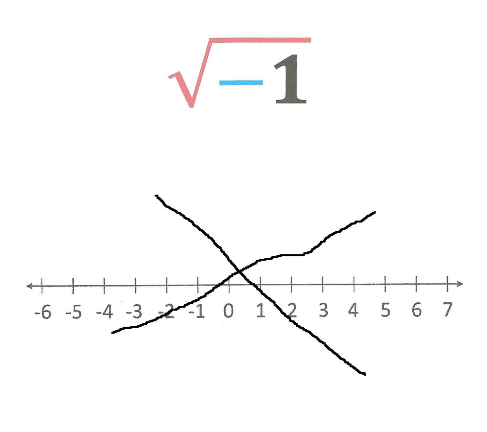
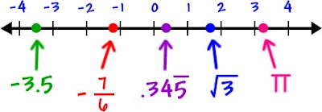
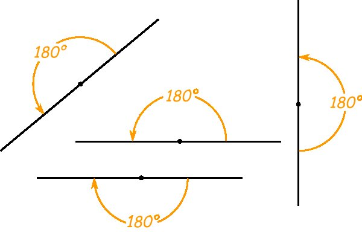
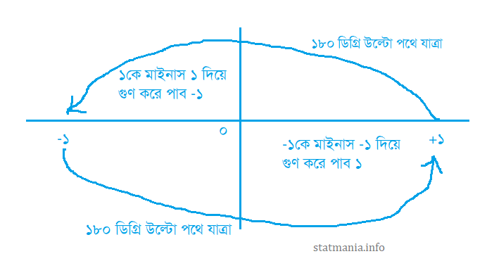
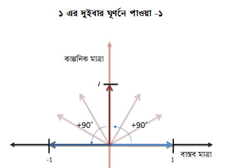
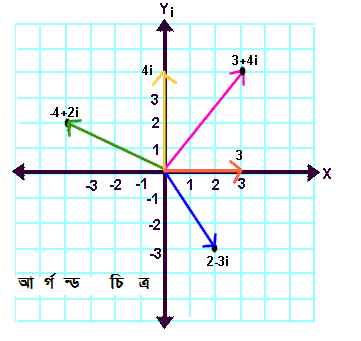

::: {dir="ltr" style="text-align: left;" trbidi="on"}
::: {style="text-align: justify;"}
সংখ্যা পদ্ধতিতে 'অবাস্তব' (বা জটিল) নামে এক ধরনের সংখ্যা আছে। এদের আবার দুটো অংশ। একটি অংশের নাম বাস্তব অংশ, অপরটিকে বলা হয় কাল্পনিক অংশ। বাস্তব দুনিয়ায় নাকি এই কাল্পনিক অংশের কোনো ভূমিকা নেই। এর কারণটাকে প্রথম দৃষ্টিতে খুব যৗেক্তিক বলেই মনে হয়। কিন্তু আমরা একটু যাচাই করতে চাই এই মত কতটা সঠিক। তার আগে দেখে নেই একে অবাস্তব কেন বলা হয়।

::: {.separator style="clear: both; text-align: center;"}

:::
:::

::: {style="text-align: justify;"}
আমরা জানি ৩ × ৩ = ৯, আবার (-৩) × (-৩) ও ৯। তার মানে ৯-কে বর্গমূল করলে আমরা ৩ এবং (-৩) দুটোই পাচ্ছি। (-৩) ও যদি ৯ থেকেই পেয়ে যাই, তাহলে (-৯) থেকে কী পাব? সাধারণ অবস্থায় কিছুই পাব না। কোনো সংখ্যাকে বর্গমূল করলে আমরা কী পাই তা তো সহজ কথা। যে সংখ্যাটিকে নিজের সাথে গুণ করলে বর্গ সংখ্যাটি আসে সে সংখ্যাটি পাব। এখন, এমন কোনো সংখ্যা কি বাস্তব জগতে আছে যাকে নিজের সাথে গুণ করলে ঋণাত্মক কোনো সংখ্যা পাওয়া যাবে? ঋণাত্মক সংখ্যারাও নিজের সাথে গুণ হয়ে ধনাত্মক হয়ে যায় বলেই যত সমস্যা। অতএব যে-কোনো ঋণাত্মক সংখ্যার বর্গমূল অবাস্তব সংখ্যা!
:::

::: {style="text-align: justify;"}

:::

::: {style="text-align: justify;"}
সমস্যাটা বোঝা যায় এই সমীকরণটি সমাধান করতে গেলে: $x^2+1=0$
:::

::: {style="text-align: justify;"}
মানে, $x^2=-1$
:::

::: {style="text-align: justify;"}

:::

::: {style="text-align: justify;"}
মানে $x$ হবে এমন একটি সংখ্যা, যাকে নিজের সাথে গুণ করলে (-১) হবে। ১-কে নিজের সাথে গুণ করলে ১ হয়। আবার (-১) কেও নিজের সাথে গুণ করলে ১ হয়। অতএব, এই সমীকরণের জন্য $x$ কাল্পনিক সংখ্যা! 
:::

::: {style="text-align: justify;"}

:::

::: {style="text-align: justify;"}
এখন দেখা যাক, এই অবাস্তব বা কাল্পনিক সংখ্যা আসলে কতটা অবাস্তব। বাস্তব সংখ্যার মধ্যে বিভিন্ন রকম সংখ্যা আছে। আছে স্বাভাবিক সংখ্যা। এরা (১, ২, ৩, ... এভাবে এক এক করে অসীম বা ∞ পর্যন্ত)। আছে পূর্ণ সংখ্যা (-∞,..,-২, -১, ০, ১, ২,.., +∞)। এছাড়াও আছে সব রকম মূলদ (পূর্ণ সংখ্যার অনুপাত, যেমন $\frac{3}{4}$) ও অমূলদ সংখ্যা (যেমন পাই (π), যার মান ৩.১৪১৫৯...) । এদেরকে আমরা এই সংখ্যারেখার মাধ্যমে প্রকাশ করি।
:::

  ----------------------------------
   
          বাস্তব সংখ্যারেখা 
  ----------------------------------

::: {style="text-align: justify;"}
এক সময় কিন্তু ঋণাত্মক সংখ্যাকেও অস্বাভাবিক ভাবা হতো। মনে করা হতো বাস্তত জগতে এদের কোনো কাজ নেই। যেমন কারও কাছে ৫ টাকা আছ। সে কি এখান থেকে কাউকে ৮ টাকা দিতে পার? ৫ থেকে কি ৮-কে বিয়োগ করা যায়? প্রথমে অসম্ভব মনে হলেও পরে দেখা গেল যে হ্যাঁ, যায়। সে কারও কাছ থেকে ৩ টাকা ধার নিয়ে আরেকজনকে পুরো ৮ টাকা দিতে পারে। তবে সে ৩ টাকা ঋণী থাকল। ফলে এখন তার কাছে থাকল (-৩) টাকা।
:::

::: {style="text-align: justify;"}
ধরুন, আমি ব্যাংকে দশ লাখ টাকা ঋণী। এর মানে ব্যাংকে আমার মাইনাস দশ লাখ টাকা আছে! এভাবে চিন্তা করতে গিয়েই ঋণাত্মক সংখ্যাকে নিয়ে আসা হয় বাস্তব জগতে। এছাড়াও ঋণাত্মক সংখ্যা নিয়ে আসায় কঠিন সমীকরণকে আগের চেয়ে সহজে সমাধান করা সম্ভব হচ্ছিল।
:::

::: {style="text-align: justify;"}
এরপর ভগ্নাংশের সাথেও একই আচরণ করা হয়েছিল। পরে খুঁজে পাওয়া যায় তাদেরও যৌক্তিকতা।
:::

**আরও পড়ুন**
☛ [ঋণাত্মক সম্ভাবনা কি আসলেই অসম্ভব?](2016-01-negative-probability.html)

::: {style="text-align: justify;"}
এখন আমরা দেখতে চাই অবাস্তব বা জটিল সংখ্যাকেও বাস্তব জগতে নিয়ে আসা যায় কি না।ওপরের ছবিতে দেখুন, ঋণাত্মক সংখ্যারা থাকে ধনাত্মক সংখ্যার উল্টো দিকে, গণিতের ভাষায় যাকে বলে ১৮০ ডিগ্রিতে। ১৮০ ডিগ্রিকে আবার সরলকোণও বলে।
:::

::: {style="text-align: justify;"}

:::

::: {style="text-align: justify;"}
ধরুন, কেউ ২ একক বেগে দক্ষিণ দিকে যাচ্ছে। তাহলে উত্তর দিকে তার বেগ কত? আমরা জানি, উত্তর ও দক্ষিণ দিক একে অপরের সাথে ১৮০ ডিগ্রিতে আছে। তাহলে উত্তর দিকে বেগ হবে (-২) একক।
:::

::: {style="text-align: justify;"}

  ---------------------------------------------------------------------------
                       
   'উল্টো' এর গাণিতিক রূপ হলো ১৮০ ডিগ্রি। চাইলে ইউ-টার্নও বলতে পারেন একে। 
  ---------------------------------------------------------------------------

 (-১) এ কথাই ধরুন না। (-১) এর বর্গ করার (-১ × -১) মানে হল ১ কে দুইবার ১৮০ ডিগ্রি ঘুরিয়ে দেওয়া (বিপরীত অবস্থানে আনা)। ফলে একবার ঘুরিয়ে পাব -১। (-১)-কে আবার ঘোরালে আবার ১৮০ ডিগ্রি ঘুরে হয়ে যাবে ১। ফলে ঋণাত্মক সংখ্যা -১ এরও বর্গ হয়ে যাচ্ছে ধনাত্মক ১। এই গোলকধাঁধা থেকে বের হওয়া দরকার।
:::

::: {style="text-align: justify;"}
::: {.separator style="clear: both; text-align: center;"}

:::

:::

::: {style="text-align: justify;"}
ভালো করে খেয়াল করুন। মাইনাস দিয়ে গুণ দিলেই একসাথে ১৮০ ডিগ্রি ঘুরে যাচ্ছে। তাহলে -১ (বা -৯ ইত্যাদি) এর বর্গমূল নিতে হলে এমন একটি সংখ্যা দরকার, যেটি একবার ঘুরেই নয়, বরং দুইবার ঘুরে (-১) হবে। অনেক ভারী একটা কথা। আবার পড়তে পারেন।
:::

::: {style="text-align: justify;"}

:::

::: {style="text-align: justify;"}
তাহলে সেটিকে একবারে ১৮০ ডিগ্রি এর অর্ধেক, মানে ৯০ ডিগ্রি কোণে ঘুরতে হবে। আমরা নতুন একটি সংখ্যা কল্পনা করি। একে নাম দেই i। ধরি i × i = -১। এই i-কে আমরা 1i-ও বলতে পারি। ১-কে 1i প্রথমে ৯০ ডিগ্রি ঘুরিয়ে সংখ্যারেখা থেকে উপরের দিকে উঠিয়ে দেবে। মানে y-অক্ষের দিকে। আরকেটি i ও গুণ হয়ে সেটি পৌঁছাবে -১ অবস্থানে। এইভাবে:
:::

::: {.separator style="clear: both; text-align: center;"}

:::

::: {style="text-align: justify;"}
তার মানে, তথাকথিত জটিল সংখ্যা আসলে দ্বিমাত্রিক সংখ্যা। সংখ্যার একটি অংশ থাকে x-অক্ষের দিকে। আরেকটি অংশ y-অক্ষের দিকে। y-অক্ষের অংশের নামই হলো 'কাল্পনিক'। আমাদের পরিচিত 'বাস্তব' সংখ্যা হলো এক মাত্রার সংখ্যা। শুধু x-অক্ষের দিকে।
:::

::: {style="text-align: justify;"}
নীচের চিত্রে কিছু জটিল সংখ্যা দেখানো হলো:
:::

  ----------------------------------
   
     জটিল সংখ্যার আর্গন্ড চিত্র 
  ----------------------------------

::: {style="text-align: justify;"}
বাস্তব জগতরেই বিভিন্ন ক্ষেত্রে এবং বহু বৈজ্ঞানিক সূত্রে এই কাল্পনিক সংখ্যার উপস্থিতি রয়েছে। কোয়ান্টাম মেকানিক্স কিংবা পরিসংখ্যান-সর্বত্রই এদের ব্যবহার হয়ে চলেছে হরদম। ফলে এদেরকে কাল্পনিক বলা অনেক বড় একটি কল্পনাই বটে। 
:::

:::
