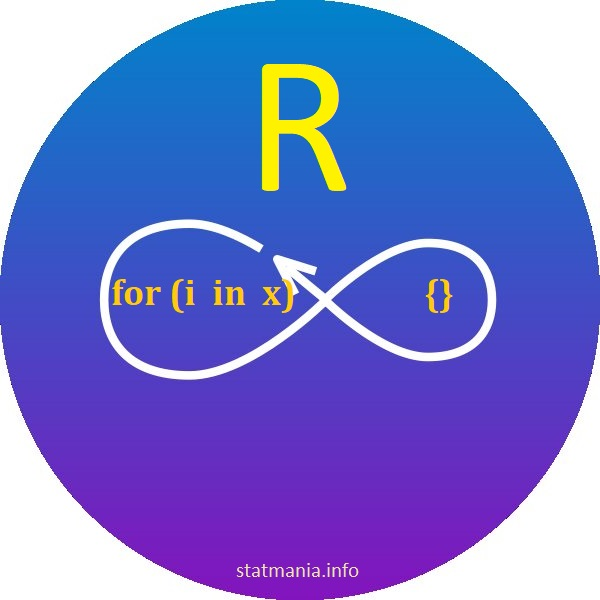

::: {dir="ltr" style="text-align: left;" trbidi="on"}
::: {dir="ltr" style="text-align: left;" trbidi="on"}
::: {dir="ltr" style="text-align: left;" trbidi="on"}
::: {style="text-align: justify;"}
একটা কাজ অসংখ্যবার করতে লুপ (loop) কোডিং-এর জগতে খুব জনপ্রিয় একটি নাম। [R-এও](../tags.html#tag=r) লুপ দারুণভাবে কাজে আসে। অবশ্য R-এ বেশিরভাগ কাজ লুপ ছাড়াই সহজে হয়ে যায়। অন্য প্রোগ্রামিং ল্যাংগুয়েজে যেখানে সাধারণ যোগ বিয়োগেও লুপের দ্বারস্থ হতে হয়, সেখানে R দিয়ে সে কাজ করা যায় এক শব্দের কোড দিয়ে।
:::

::: {.bnote}
**R প্রোগ্রামিং:** দুজন পরিসংখ্যানবিদ রস ইহাকা ও রবার্ট জেন্টেলম্যান R তৈরি করেন। কাজে লাগান আগের S প্রোগ্রামিং ল্যাংগুয়েজ। বর্তমানে স্ট্যাটিস্টিক্যাল কম্পিউটিংয়ের জন্যে সেরা টুল R। প্রাথমিক সংস্করণ প্রস্তুত করা হয় ১৯৯৫ সালে। 
:::

::: {.separator style="clear: both; text-align: center;"}

:::

::: {style="text-align: justify;"}
১ থেকে ১০০ পর্যন্ত যোগ করতে চান? শুধু লিখুন আর এন্টার (Enter) চাপুন।
:::

```r
sum(1:100)
```

::: {style="text-align: justify;"}

:::

::: {style="text-align: justify;"}
তবে চাইলে এ কাজও আমরা লুপ ব্যবহার করে করতে পারি। 
:::
:::

```r
sum <- 0
for (i in 1:100) {
 sum <- sum + i
 }
sum
```

::: {style="text-align: justify;"}
*উল্লেখ্য: R-এ সাধারণত '=' চিহ্নের বদলে \<- ব্যবহার করা হয়। তবে চাইলে '='ও ব্যবহার করা যাবে। *
:::

::: {style="text-align: justify;"}
লুপ ছাড়াও অনেক কাজ করা যায় তা ঠিক আছে। তবে নিজেকে প্রোগ্রামার হিসেবে পরিচয় দিতে হলে লুপ না জানা হবে বড়সড় এক দুর্বলতা। তাছাড়া লুপ না বুঝে R-এরও সঠিক ব্যবহার হবে অসম্ভব একটি কাজ।
:::

লুপের ভেতরের লুপকে বলে নেস্টেড লুপ (Nested loop)। তা দেখার আগে আবার দুয়েকটি সিংগেল লুপ দেখে নেই।

::: {style="text-align: justify;"}

:::

::: {style="text-align: justify;"}
ধরুন, আমরা ১ থেকে ১০ এর বর্গ করব। আগের মতোই কাজটি লুপ ছাড়াও করা যাবে।
:::

```r
(1:10)^2
```

::: {style="text-align: justify;"}
হ্যাঁ। কাজটা অবিশ্বাস্য রকম সহজ। লুপ দিয়ে কেমন হয় দেখা যাক!
:::

```r
values <- c()
for (i in 1:10) {
 values[i] <- i^2
 }
values
```

::: {style="text-align: justify;"}
ফিবোনাচি সংখ্যা নিয়ে লেখায়ও আমরা লুপের ব্যবহার দেখেছি। সেটা আবার দেখে নিলে মন্দ হয় না।
:::

**আরও পড়ুন**
**☛ ** [ফিবোনাচি সংখ্যার বিস্ময়কর জগৎ ](2019-06-fibo-r.html)

:::

```r
fibo <- function(n)
 {
 fibvals <- c()
 fibvals[1] <- 1
 fibvals[2] <- 1
 for (i in 3:n) 
  { 
    fibvals[i] <- fibvals[i-1]+fibvals[i-2]
  }
 fibvals
 }
values
```

::: {style="text-align: justify;"}
আশা করি সিংগেল লুপ নিয়ে আমরা যথেষ্ট জ্ঞান হাসিল করে ফেলেছি। এবার তাহলে নেস্টেড লুপ দেখা যাক।
:::

::: {style="text-align: justify;"}
আগে সরল লুপ দিয়ে শুরু হোক। ধরুন, আমরা দুটি ভেক্টরের প্রতিটি মানকে আরেকটি ভেক্টরের প্রতিটি মানের সাথে গুণ করব। আরেকটু খোলাসা করে বলি। ধরুন, আমরা ১ থেকে ১০ সংখ্যাগুলোর প্রতিটিকে ১১ থেকে ২০ সংখ্যাগুলোর প্রতিটির সাথে গুণ করব। তাহলে আমাদের ১০০টি সংখ্যা পাওয়ার কথা। দেখা যাক লুপ দিয়ে কী করা যায়। 
:::

```r
values <- c()
 for (i in 1:10){
 for (j in 11:20){
  value1 <- i*j
  values <- c(values, value1)
  }
 }
values
```

::: {style="text-align: justify;"}
বাহ! কাজ করছে। এবার আরেকটু সিরিয়াস কাজ করা যাক।
:::

::: {style="text-align: justify;"}

:::

::: {style="text-align: justify;"}
আমরা কোনো সংখ্যা মৌলিক কি না তা চেক করব। এটার জন্য একটা ফাংশন বানানো যাক। যেখানে আপাতত থাকছে একটিমাত্র লুপ।
:::

```r
prime2 <- function(num){
ind = 0
# prime numbers are greater than 1
if(num > 1) {
 ind = 1
 for(i in 2:ceiling(num/2)) {
  if ((num %% i) == 0) {
   ind = 0
   break
   }
  }
 } 
if(num == 2)    ind = 1
if(ind == 1) {
 print(paste(num,"is a prime number"))
 } else {
 print(paste(num,"is not a prime number"))
  }
 }
```

::: {style="text-align: justify;"}

:::

::: {style="text-align: justify;"}
ফাংশনটি কাজ করছে কি না যাচাই করে দেখা উচিত।
:::

```r
prime2(2)
prime2(4)
```

::: {style="text-align: justify;"}

:::

::: {style="text-align: justify;"}
হ্যাঁ, করছে। এবার এটাকে সামান্য জটিল করে একটিমাত্র সংখ্যার বদলে অনেকগুলো সংখ্যা বা ভেক্টরের জন্য কাজে লাগাই। এই কোডে আমরা i দিয়ে লুপ করেছি প্রতিটি সংখ্যাকে। আবার প্রতিটি সংখ্যা মৌলিক কি না তা দেখার জন্য সংখ্যাটির অর্ধেক বা অর্ধেকের বড় সংখ্যাটি পর্যন্ত সংখ্যাগুলো দিয়ে নির্দিষ্ট সংখ্যাটিকে ভাগ করে দেখেছি। এখানে ভাজকগুলোকে আমরা j দিয়ে লুপ করেছি।
:::

```r
prime_count <- function(x){
ind <- rep(1, length(x))
for (i in x){ 
# prime numbers are greater than 1; 2 is dealt with in output section.
if(i > 2) {
# check for factors
for(j in 2:ceiling(i/2)) {
if ((i %% j) == 0) {
ind[i] = 0
break
}
}
} 
}
output <- list(df=data.frame(Number = x, 
 is_prime = ifelse(x==1, 0, ifelse(x==2, 1, ind))),
 nprime=sum(ind)-1)
}
```

::: {style="text-align: justify;"}
এবার এখান থেকে আউটপুট দেখে নেওয়া যাক। আমরা ফাংশনটা এমনভাবে সাজিয়েছি যাতে কোন সংখ্যাগুলো মৌলিক তা দেখা যাবে আবার মোট কতটি মৌলিক তাও চেক করা যাবে।

:::

```r
prime_count(1:20)$nprime
prime_count(1:20)$df
```

::: {style="text-align: justify;"}
লাইন দুটি থেকে আমরা পাব যথাক্রমে একটি স্কেলার ও একটি ডেটাফ্রেইম। স্কেলার বলবে সংখ্যাগুলোর মধ্যে কতটি মৌলিক। ডেটাফ্রেইমে *is\_prime* কলামের ০ মানে সংখ্যাটি মৌলিক নয়। আর ১ মানে মৌলিক।

এই ফাংশনটি দিয়ে আমরা মৌলিক সংখ্যার অনেক দারুণ দারুণ কাজ করতে পারি। এ বিষয়ে আরও জানতে পড়তে পারেই উইকিপিডিয়ার [এই লেখাটি](https://en.wikipedia.org/wiki/Prime-counting_function)।

:::

::: {style="text-align: justify;"}
নেস্টেড লুপের দারুণ কোনো উদাহরণ আপনার কাছে থাকলে শেয়ার করতে ভুলবেন না যেন! 
:::
:::
