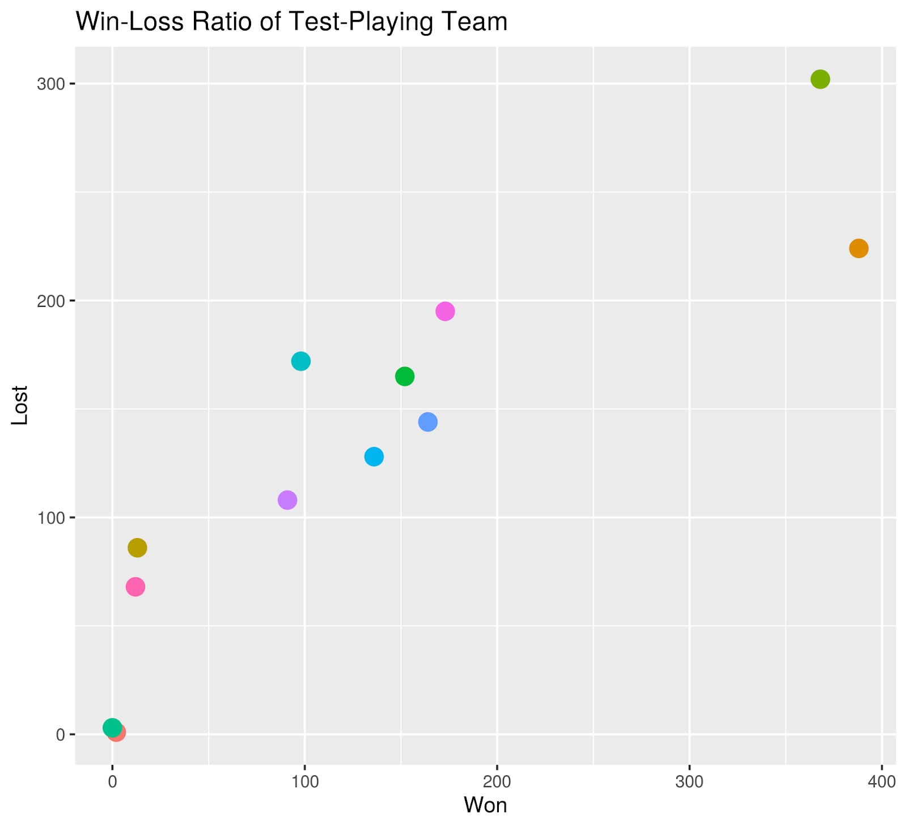
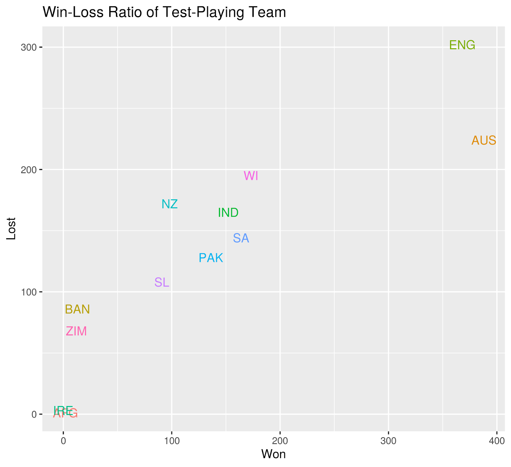
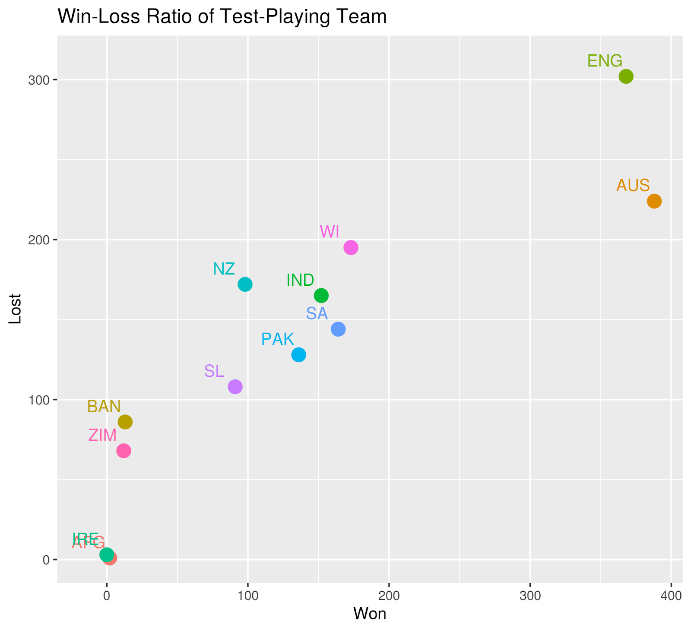
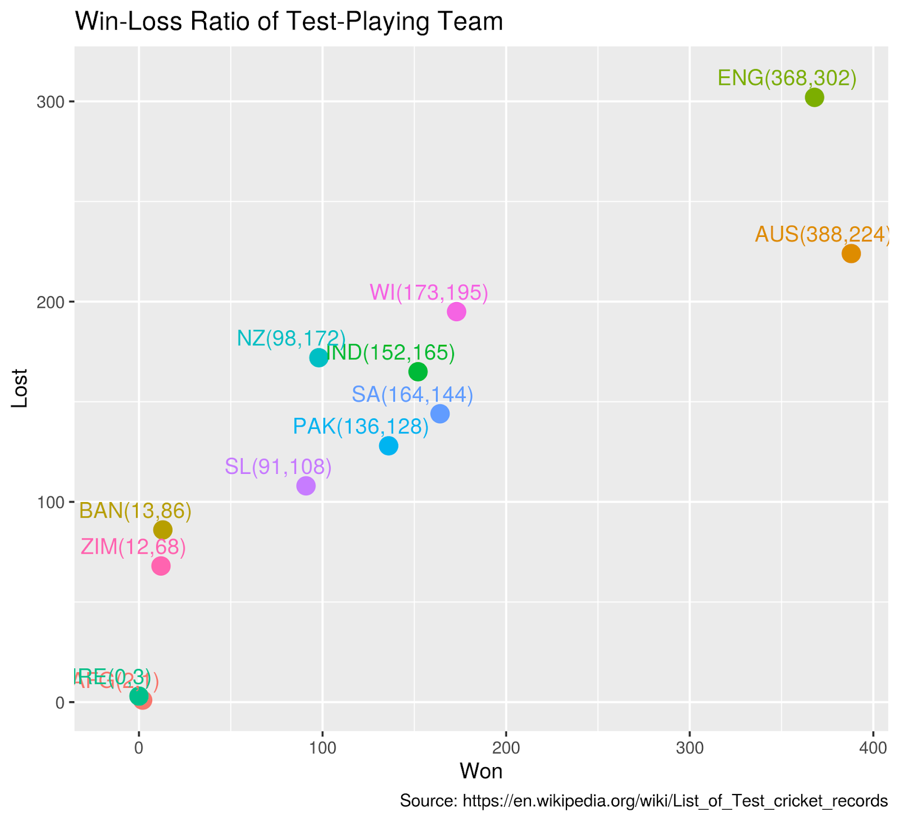

::: {dir="ltr" style="text-align: left;" trbidi="on"}
বিক্ষেপ চিত্র (scatter plot) এমনিতেই দারুণ। নতুন করে একে আবার দারুণ বলার আসলে হয়ত খুব বেশি কারণ নেই। কিন্তু আবার আছে।

বিক্ষেপ চিত্রের মাধ্যমে আমরা দুটো সংখ্যাবাচক চলকের (quantitative variable) মধ্যে সম্পর্ক বুঝতে পারি। যেমন নীচের বিক্ষেপ চিত্রটাই দেখুন, এখানে টেস্ট ক্রিকেট খেলা দলগুলোর জেতা ও হারা ম্যাচের সংখ্যা দেখানো আছে।

  ------------------------------------------------
          
   টেস্ট-খেলুড়ে দলগুলোর হারা-জেতা ম্যাচের সংখ্যা 
  ------------------------------------------------

দেখে বোঝা যাচ্ছে জেতা ম্যাচের সঙ্গে একটি ধনাত্মক সম্পর্ক আছে। যারা বেশি ম্যাচ জিতেছে, তারা আবার হেরেছেও বেশি। তাহলে এর মানে দাঁড়ালটা কী? আসলে এর মানে হলো, প্রায় সব দলের ক্ষেত্রেই হারা ও জেতা ম্যাচের সংখ্যা সমান। তবে দুটি দলের ক্ষেত্রে জেতা ম্যাচ মাত্র কয়েকটি, কিন্তু হারা ম্যাচের সংখ্যা প্রায় ১০০। এরা নিঃসন্দেহে অধারবাহিক দল। আরও রাখটাক করে বললে, খারাপ দল।

কিন্তু এই বিক্ষেপ চিত্র থেকে চাইল আরও বেশি তথ্য পাওয়া যায়। সেটা খুবই দারুণ। তবে আগে এই প্লটের কোডটাই দেখেই নেই।

এই প্লটের কোড খুব সাধারণ। ও আচ্ছা। আমরা আজ বিক্ষেপ চিত্র আঁকব ggplot2 দিয়ে। তাই এটা লোড করতে ভুলবেন না যেন! তবে আগে ডেটা রেডি করে নেই। ডেটা পেয়েছি [উইকপিডিয়ার এই পেইজ](https://en.wikipedia.org/wiki/List_of_Test_cricket_records#Team_records) থেকে। ডেটাফ্রেইম বানাতে আমরা ব্যবহার করেছি *tibble* প্যাকেজ। চাইলে আপনি *tibble* এর জায়গায় *data.frame* ফাংশনও ব্যবহার করতে পারেন।

```r
Team <- c("AFG", "AUS", "BAN", "ENG", "IND", "IRE", "NZ", "PAK", "SA", "SL", "WI", "ZIM")
Lost <- c(1, 224, 86, 302, 165, 3, 172, 128, 144, 108, 195, 68)
Won <- c(2, 388, 13, 368, 152, 0, 98, 136, 164, 91, 173, 12) 
test_win <- tibble(Team, Won, Lost)
```

এবার আমরা আঁকার কাজটা করে ফেলি। মূল কোড কিন্তু প্রথম দুই লাইনই। পরের দুই লাইন দিয়ে লিজেন্ড সরিয়েছি, আর টাইটেল যোগ করেছি।

 

```r
library(ggplot2)
test_win %>% ggplot(aes(Won, Lost, color=Team)) +
  geom_point(size=4, pch= 19)+
  theme(legend.position = "none")+
  labs(title = "Win-Loss Ratio of Test-Playing Team")
```

এখানে %\>% কে বলা হয় পাইপ অপারেটর। চাইল আপনি test\_win %\>% ggplot অংশটুকুকে এভাবেও লিখতে পারেন।

```r
ggplot(data=test_win, aes(...) ...)
```

এবার একই চিত্রটিকে আমরা ভিন্ন দৃষ্টিকোণ থেকে দেখি।

::: {.separator style="clear: both; text-align: center;"}

:::

::: {.separator style="clear: both; text-align: center;"}
:::

::: {.separator style="clear: both; text-align: left;"}

:::

::: {.separator style="clear: both; text-align: left;"}
এবার আমরা খুব সহজে নির্দিষ্ট দেশের হারা ও জেতা ম্যাচের তুলনা করতে পারছি। যেমন জিম্বাবুয়ের পরিসংখ্যান দেখুন। জেতা ম্যাচের সংখ্যা গুটিকয়েক। কিন্তু হারা ম্যাচের সংখ্যা সে তুলনায় অনেক বেশি। প্রায় ৭০। বাংলাদেশের অবস্থা তো আরও খারাপ। পাকিস্তান ও দক্ষিণ আফ্রিকার হারা ও জেতার ম্যাচের সংখ্যা প্রায় সমান। তবে ভারতের কিন্তু জেতার চেয়ে হারার রেকর্ড বেশি। 
:::

::: {.separator style="clear: both; text-align: left;"}

:::

::: {.separator style="clear: both; text-align: left;"}
বলা চলে, অস্ট্রেলিয়ার রেকর্ড সবচেয়ে ভালো। জিতেছে প্রায় ৪০০ ম্যাচে, কিন্তু হেরেছে মাত্র ২২০ এর মতো ম্যাচ (প্লট দেখে বলছি। ডেটা দেখলে তো দেখাই যাবে ২২৪ ম্যাচ)। অস্ট্রেলিয়ার চেয়ে কম ম্যাচ খেলেও বেশি হেরেছে ইংল্যান্ড। কত দারুণ তথ্য দিচ্ছে সাধারণ এক বিক্ষেপ চিত্র! কোডটা তাহলে এবার দেখে নেই। 
:::

::: {.separator style="clear: both; text-align: left;"}

:::

```r
test_win %>% ggplot(aes(Won, Lost, color=Team)) +
  geom_text(ddata = test_win, aes(x=Won, y = Lost, label = Team))+
  theme(legend.position = "none")+
  labs(title = "Win-Loss Ratio of Test-Playing Team")
```

::: {.separator style="clear: both; text-align: left;"}

:::

::: {.separator style="clear: both; text-align: left;"}
কাজ তো শেষ। এবার আমরা চাইলে প্লটখানাকে আরও উন্নত করতে পারি। নামের সাথে পয়েন্টও দেখাতে পারি। তবে সেজন্যে geom\_text কে একটু ইডিট করে পয়েন্ট থেকে একটু পাশে সরিয়ে দিতে হবে। না হলে একটি আরেকটির ওপরে পড়ায় কোনটিই ভাল দেখা যাবে না। 
:::

::: {.separator style="clear: both; text-align: left;"}

:::

```r
test_win %>% ggplot(aes(Won, Lost, color=Team)) +
  geom_point(size=4)+
  geom_text(ddata = test_win, aes(x=Won-15, y = Lost+10,label = Team))+
  theme(legend.position = "none")+
  labs(title = "Win-Loss Ratio of Test-Playing Team")
```

::: {.separator style="clear: both; text-align: left;"}

:::

::: {.separator style="clear: both; text-align: center;"}

:::

::: {.separator style="clear: both; text-align: left;"}
এটা দেখেই অনেক ভালো বোঝা যাচ্ছে। তবে ভালোর তো শেষ নেই। আপনার বস হয়তো বলতে পারি, আমি প্লটেই আসল সংখ্যাও দেখতে চাই। কে কতটা জিতল সেটাও দেখান। কী আর করা! দেখিয়েই দিন। এ সুযোগে আমরা প্লটে ডেটা সোর্সটাও দেখিয়ে দেই। 
:::

::: {.separator style="clear: both; text-align: left;"}

:::

```r
  test_win %>% ggplot(aes(Won, Lost, color=Team)) +
  geom_point(size=4, pch= 19)+
  geom_text(data = test_win, aes(x=Won-15, y = Lost+10 , 
                                  label = paste0(Team,  "(", Won, ",", Lost, ")")))+
  theme(legend.position = "none")+
  labs(title = "Win-Loss Ratio of Test-Playing Team", 
       caption = "Source: https://en.wikipedia.org/wiki/List_of_Test_cricket_records")
```

::: {.separator style="clear: both; text-align: left;"}

:::

::: {.separator style="clear: both; text-align: center;"}

:::

::: {.separator style="clear: both; text-align: left;"}

:::

::: {.separator style="clear: both; text-align: left;"}
তবে এই প্লটটা আসলে বাড়াবাড়ি। তবে বস চাইলে তো আর আসলে কিছু করার নেই। বস ইজ অলওয়েজ রাইট! 
:::

::: {.separator style="clear: both; text-align: left;"}

:::

::: {.separator style="clear: both; text-align: left;"}
\[*লেখাটি উৎসর্গ করলাম সহকর্মী হাসান আহমেদকে।  ও-ই প্রথম এমন একটি গ্রাফের প্রস্তাব দিয়েছিল আমাকে।*\] 
:::
:::
