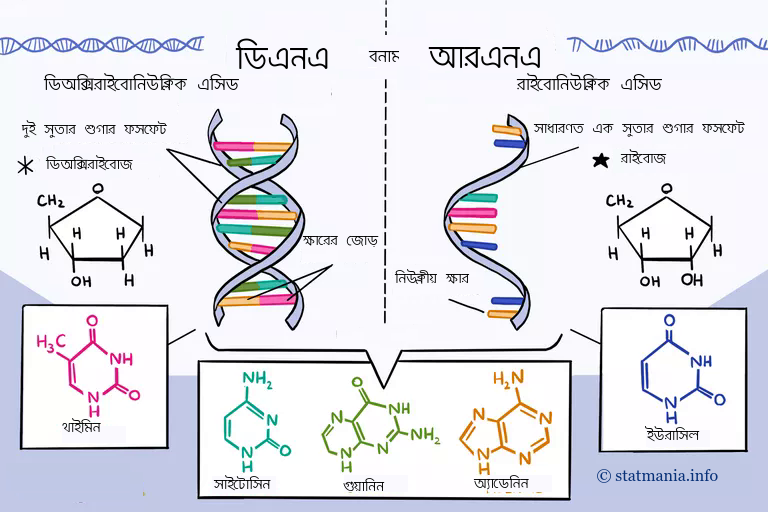

::: {dir="ltr" style="text-align: left;" trbidi="on"}
ডিএনএ ও আরএনএ দুটোতেই জিনগত তথ্য সংরক্ষিত থাকে। তবে দুটোর মধ্যে পার্থক্য আছে। চলুন দেখেই নিই।

  --------------------------------------------------------------------------------------------------------------------------------------------------------------------------------------------------------------------------------------
                                                                                                     
   ডিএনএ বনাম আরএনএ। [সূত্র](https://www.thoughtco.com/thmb/YtZNHuQ8w0mVut52czgf_6PzR3w=/768x0/filters:no_upscale():max_bytes(150000):strip_icc():format(webp)/dna-versus-rna-608191_sketch_Final-54acdd8f8af04c73817e8811c32905fa.png)
  --------------------------------------------------------------------------------------------------------------------------------------------------------------------------------------------------------------------------------------

১। ডিএনএ তে থাকে ডিওক্সিরাইবোজ শুগার। আর আরএনএ-এর শুগারের নাম রাইবোজ। ডিওক্সিরাইবোজ ও রাইবোজের একমাত্র পার্থক্য হলো রাইবোজে একটি বাড়তি -OH গ্রুপ থাকে। যেখানে বলয়ের দ্বিতীয় কার্বনের সাথে -H সংযুক্ত থাকে।

২। ডিএনএ একটি দুই সুতার অণু। অন্য দিকে আরএনএ এর সুতা একটিই।

৩। ডিএনএ ক্ষারীয় পরিবেশে স্থিতিশীল, কিন্তু আরএনএ অস্থিতিশীল।

৪। মানবদেহে ডিএনএ ও আরএনএ এর কাজ আলাদা। জিনগত বৈশিষ্ট্য সংরক্ষণ ও স্থানান্তরের কাজ করে ডিএনএ। আর আরএনএ সরাসরি অ্যামিনো এসিডের জন্য সঙ্কেত তৈরি করে। এছাড়াও এটি প্রোটিন তৈরির জন্যে ডিএনএ ও রাইবোজোমের মধ্যে বার্তাবাহক হিসেবে কাজ করে।

৫। ডিএনএ ও আরএনএ এর ক্ষার জোড়গুলোও একটু আলাদা। ডিএনএ এর ক্ষারগুলো হলো অ্যাডেনিন, থাইমিন, গুয়ানিন ও সাইটোসিন। অন্য দিকে আরএনএ ব্যবহার করে অ্যাডেনিন, ইউরাসিল, সাইটোসিন ও ইউরাসিল। থাইমিনের সাথে ইউরাসিলের পার্থক্য হলো এর বলয়ে একটি মিথাইল গ্রুপ কম থাকে।

সূত্র
\* [থটকো ডট কম ](https://www.thoughtco.com/dna-versus-rna-608191)
:::
