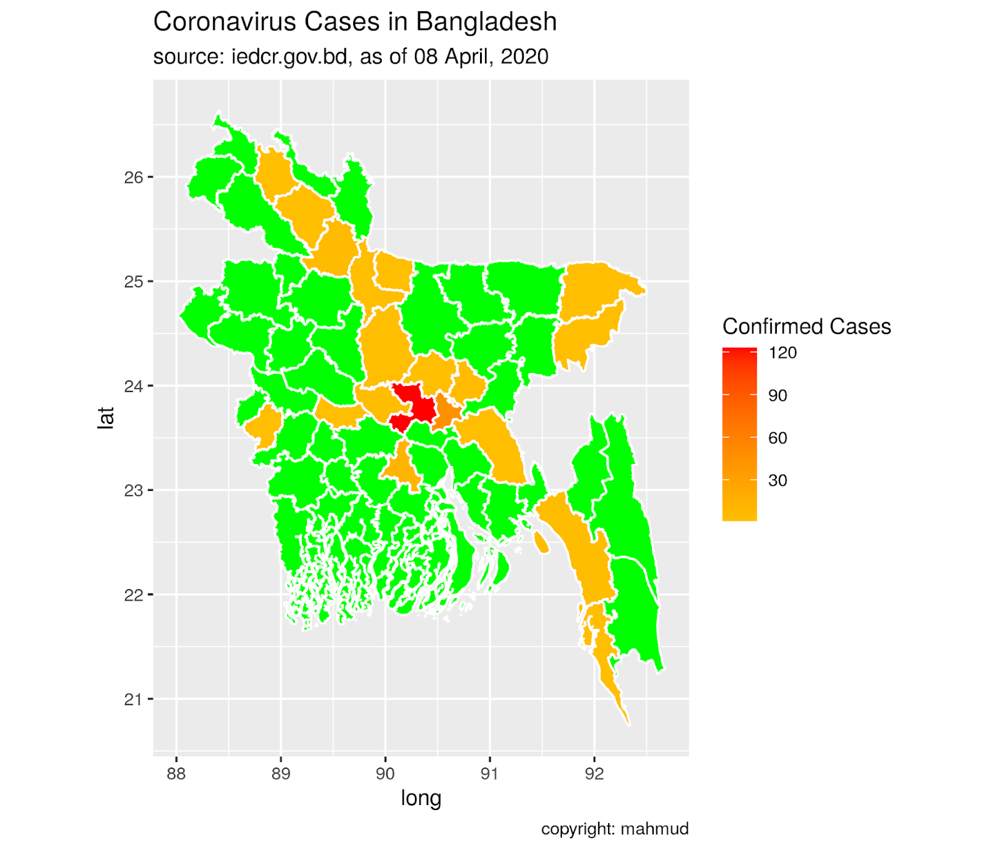
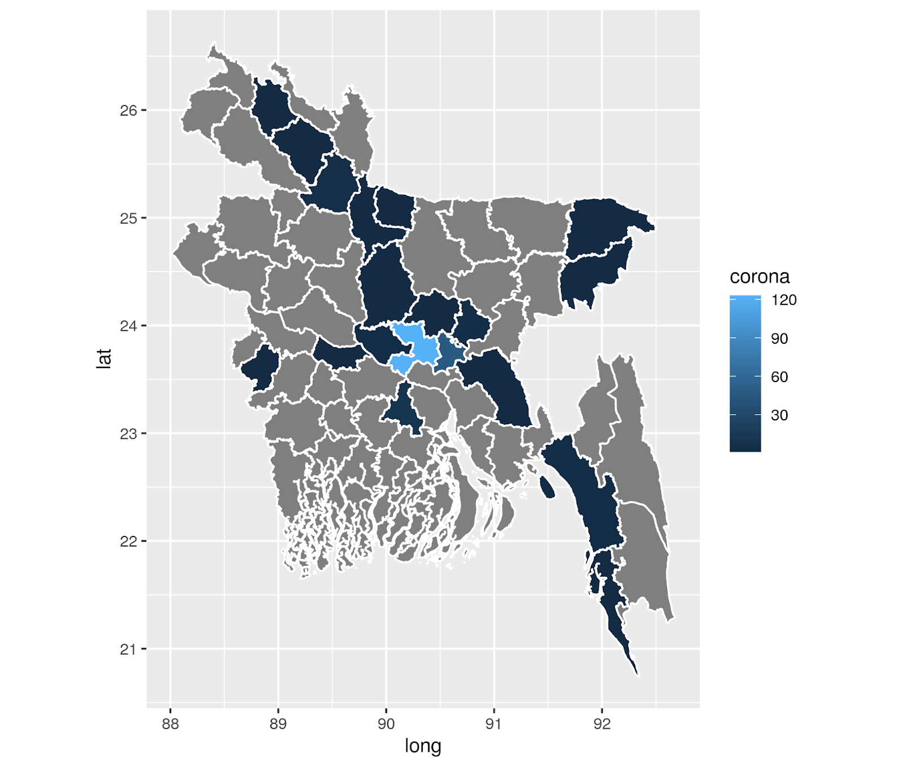

::: {dir="ltr" style="text-align: left;" trbidi="on"}
দিন দিন [R](https://www.statmania.info/2018/09/how-to-learn-R.html)-এ ম্যাপ আঁকা সহজ থেকে সহজতর হচ্ছে। একটু চেষ্টা করেই কোভিড-১৯ মহামারীর চিত্র ওয়ার্ল্ড ও বাংলাদেশের ম্যাপে দেখিয়ে ফেলতে পেরেছি। কীভাবে এত কঠিন কাজ সহজ হলো সেটা বলতেই আজকের লেখা।

  --------------------------------------
     
   বাংলাদেশের কোভিড-১৯ মহামারীর প্রকোপ 
  --------------------------------------

আগে অবশ্যই দরকারি প্যাকেজগুলো লোড করে নিতে হবে।

```r
library(rgdal)
library(tidyverse)
```

এখন প্রশ্ন হলো ম্যাপ আঁকার ডেটা পাব কোথায়? একটুও চিন্তা করবেন না। এসব ডেটা অনেক মহামানুষ কষ্ট করে বানিয়ে রেখেছেন। আপনাকে শুধু খুঁজে নিয়ে ব্যবহার করতে হবে এই যা। ম্যাপ আঁকার জন্য প্রয়োজনীয় শেইপফাইল পাবেন [এখানে](https://gadm.org/download_country_v3.html)।

ডাউনলোড করে নিয়ে আনজিপ করে নিন। এবার কী করবেন সেটা [এই লেখায় আগেই বলা হয়েছে](https://www.statmania.info/2018/07/bd-map-literacy-rate-with-r.html)।

লেখাটির *plot(zilla, col="green")* কোড পর্যন্ত অন্তত অনুশীলন করে আসুন।

এসেছেন তো? এবার সামনে যাওয়া যাক।

আমরা এবারে ম্যাপ আঁকব *ggplot2* দিয়ে। *ggplot2* সব অবজেক্টকে ডেটাফ্রেইম হিসেবে দেখতে চায়। তাই শেইপফাইলকে ডেটাফ্রেইম বানিয়ে নিতে হবে। কিন্তু সেটা এমনভাবে করতে হবে যেন ম্যাপের সবকিছু আবার উলটপালট হয়ে না যায়। সেজন্য ব্যবহার করতে হবে *fortify* ফাংশন।

```r
zilla_gg <- fortify(zilla)
```

এবার আরেকটি বড় কাজ বাকি। করোনার তথ্য এই ডেটাফ্রেইমে নিয়ে আসতে হবে। সেটা আমরা করব। তার আগে আপনি একটু দেখে নিন zilla\_gg ডেটাফ্রেইমে কী আছে। এই কোড রান করতে হলে Rstudio লাগবেই আপনার।

```r
View(zilla_gg)
```

কলামগুলো দেখে নিন একবার। ও আচ্ছা, তার আগে শুধু zilla অবজেক্টটাও দেখে নিন। খেয়াল করলে দেখবেন NAME\_2 কলামে দেশের জেলাগুলোর নাম আছে। তবে fortify করার পর এতকিছু নেই। ম্যাপের তথ্য এখানে long, lat নামে দ্রাঘিমা ও অক্ষাংশ হিসেবে সংরক্ষিত আছে। zilla\_ggতে id নামে একটি কলাম আছে। একটু মিলিয়ে দেখলে বুঝবেন এটা আসলে ৬৪ জেলার জন্য ইউনিক আইডি। শুরু ০ থেকে আর শেষ ৬৩-তে। এখন এই আইডির বিপরীতে আমাদের করোনার তথ্য বসিয়ে নিলেই আমাদের ডেটা প্রস্তুত।

কাজটি একটু বিরক্তিকর। সেটাকে সহজ করার জন্যে আমি সবসময় একটি csv ফাইল রেডি রাখি। আপনি চাইলে [এখান থেকে ফাইলটি ডাউনলোড](https://drive.google.com/file/d/1C6dHtnHM3zsr-VsvIHESLQxQff9KkjRW/view?usp=sharing) করে নিতে পারেন। *corona* নামে এখানে একটি কলাম আছে। এই কলামটি আপডেট তথ্য দিয়ে পূর্ণ করা আপনার দায়িত্ব। এখন কাজ হলো এই তথ্যকে *zilla\_gg* ডেটাফ্রেইমে নিয়ে আসা।

সেটা করার জন্যে আমরা ব্যবহার করব *dplyr* প্যাকেজের *left\_join* ফাংশন। এই ফাংশনগুলো কীভাবে কাজ করে দেখতে হলে [এখানটায় ঢুঁ মেরে](https://www.statmania.info/2019/04/join.html) আসুন। ও, তার আগে csv ফাইলটা পড়ে নিই। আরেকটি কাজ করা লাগবে। zilla\_gg এর id কলামটা character হয়ে আছে। কিন্তু আমাদের csv ফাইলে id কলাম হলো numeric। তাই zilla\_gg কে numeric করে নিতে হবে।
তারপর জয়েন করে ফেলি।

```r
corona_bd <- read_csv("geo/corona.csv")
zilla_gg <- zilla_gg %>% mutate(id = as.numeric(id))
zilla_gg <-  zilla_gg %>% left_join(corona_bd, by = "id")
```

এবার শুধুই আঁকা।

```r
ggplot(zilla_gg) + aes(long, lat, group=group, fill = corona)+
  geom_polygon() +
  geom_path(color= "white")+
  coord_equal()
```

আপাতত আমরা এটা পেলাম।

::: {.separator style="clear: both; text-align: center;"}

:::

কিন্তু নিজের ইচ্ছেমতো রং দেওয়া না গেলে কি আর মনে শান্তি পাওয়া যায়? এজন্যে [RColorBrewer প্যাকেজ](https://www.statmania.info/2019/04/r-ggplot2-rcolorbrewer.html) দারুণ উপকার করে। তবে এখানে আমরা সেটা ছাড়াই রং করে ফেলব। আগের কোডের পরে "+" চিহ্ন দিয়ে এটা যুক্ত করে দিন।

```r
  scale_fill_gradient("Confirmed Cases",
                      low = "yellow",
                      high = "red",
                      space = "Lab",
                      na.value = "green",
                      guide = "colorbar",
                      aesthetics = "fill"
  )
```

এবারে কিন্তু আমরা উপরে দেখানো ম্যাপই পেয়ে গেলাম। এখানে যেহেতু আমরা মৃত্যু দেখাচ্ছি, তাই লাল থেকে হলুদ রংয়ের দিকে গিয়েছি। অন্য ক্ষেত্রে অন্য কালার কম্বিনেশন ব্যবহার করাই ভাল। আরও বেশি কালার কম্বিনেশনের জন্যে আমি এই [লিংকটা](https://www.w3schools.com/colors/colors_picker.asp) কাজে লাগাই। আপনিও লাগাতে পারেন।

**আরও পড়ুন:  **
☛ [R প্রোগ্রামিং: প্লট কালারিং এর ৯ উপায়](https://www.statmania.info/2018/07/r-colors.html)

মূল কাজ তো শেষ। এখন আরও কিছু ফাইন-টিউনিং করে নিলে মন্দ কী!

```r
  labs(title = "Covid-19 Cases in Bangladesh", 
       subtitle = "source: iedcr.gov.bd, as of 08 April, 2020",
       caption = "copyright: mahmud")
```
:::
