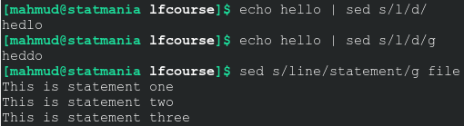

টেক্সট অ্যানালাইসিস আমার খুব প্রিয় জিনিস। প্রিয় ওএস লিনাক্সে আসার পর কাজটা আরও অনেক সহজ হয়ে গেছে। কীভাবে হলো একটু দেখাই যাক। 

 

::: {.separator style="clear: both; text-align: center;"}

:::

 

ধরুন আমাদের কাছে কিছু টেক্সট আছে। এর কিছু শব্দকে অন্য কিছু দিয়ে পাল্টে দিতে চাই। 

```bash
echo hello | sed s/h/t/
```

এই কোড hello শব্দের h-কে t দিয়ে বদলে দেবে। শুরুতেই s দিয়ে বলা হচ্ছে, বদলে দাও। ইংরেজিতে substitution আরকি।

এখানে আমরা যে টেক্সট নিয়ে কাজ করব সেটাকে আগে echo দিয়ে প্রিন্ট করে নিয়েছি। কিন্তু বাস্তবে আমাদেরকে ফাইন্ড ও রিপ্লেসের এই কাজখানি করতে হবে ফাইল দিয়ে। সে কাজটাও পানির মতোই সোজা। ধরুন আমাদের কাছে file নামে একটি ফাইল আছে। চাইলে আপনি এক্সটেনশনসহ ফাইল নিতে পারেন। যেমন file.txt। তাতে কোনোই অসুবিধা হবে না। ধরা যাক file ফাইলটিতে এই তথ্যগুলো আছে।

```bash
This is line one
This is line two
This is line three
```

এবার ধরুন, আমরা এখান থেকে প্রথম line শব্দটাকে statement শব্দ দিয়ে বদলে দিতে চাই।

```bash
sed s/line/statement/ file
```

তবে ফাইলের সবগুলো কাঙ্ক্ষিত শব্দকে চেঞ্জ করা নিশ্চিত করতে চাইলে "g" অংশ যোগ করতে হবে। মানে এ রকম:

```bash
sed s/line/statement/g file
```

এটা কেন দরকার দেখতে হলে নীচের দুই লাইন কোড রান করে দেখুন। দেখবেন দুটো থেকে দুরকম আউটপুট মিলবে।  

 

```bash
sed s/line/statement/
    sed s/line/statement/g/ file
```

 

 

::: {.separator style="clear: both;"}
তবে এখানে যে আউটপুট প্রিন্ট হচ্ছে সেটা কিন্তু এখানেই শেষ। সেভ কিন্তু হচ্ছে না। শেভ করতে হলে "\>" বা "\>\>" দিয়ে সেভ করে নিতে হবে। মনে রাখতে হবে \> দিলে কিন্তু ফাইলে আগের কিছু থাকবে না। 
:::

::: {.separator style="clear: both;"}
 
:::

```bash
sed s/line/statement/g file >file
```

 

 

এ তো গেল শুধু একটা একটা অংশ রিপ্লেস করতে চাইলে। আপনি চাইলে অনেকগুলো অংশকে অনেকগুলো আলাদা আলাদা শব্দ দিয়েও রিপ্লেস করতে পারেন। এক্ষেত্রে প্রতিটি অংশের আগে "-e" দিতে হবে। 

 

```bash
echo hello | sed -e s/l/L/g -e s/h/H/
```
