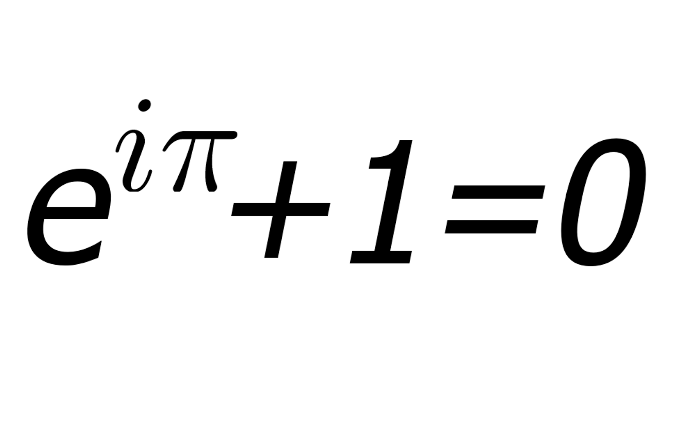
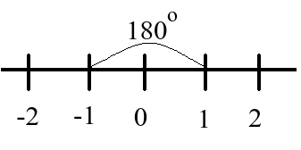

আমরা জানি, $e^{iπ}=-1$। কিন্তু কেন? যারা গণিতকে শুধু বইয়ের অক্ষরের মধ্যেই সীমিত মনে করেন, তাদের মতে এই সূত্রের কোন বাস্তব তাৎপর্য নেই। এটা নিছক সূত্রের মারপ্যাঁচে ঘটে গেছে।

ঠিক যেমনটা বলেছিলেন, আঠারশ শতকের গণিতবিদ বেঞ্জামিন পিয়ার্স
 

> সূত্রটা স্বাভাবিক বুদ্ধির সম্পূর্ণ বিপরীত। একে আমরা না বুঝতে পারি, আর না জানি এটা কী বোঝায়। তবে যেহেতু এর প্রমাণ আছে, তা বাধ্য হয়ে একে মানতে হচ্ছে। 

 

কিন্তু গণিতের সব সূত্রেরই বাস্তব ও মজার তাৎপর্য থাকে। আছে অদ্ভুতদর্শন এই সূত্রেরও। সূত্রটি গণিতের অনেকগুলো শাখাকে একত্রিত করেছে। e এর আবির্ভাব ক্যালকুলাস থেকে, π আসে জ্যামিতি থেকে, i এর পদচারণা জটিল সংখ্যার জগতে। আর ০ ও ১ এর ব্যবহার পাটিগণিতে। 
 

::: {.separator style="clear: both; text-align: center;"}

:::

লিওনার্দ অয়লার ছিলেন সুইস গণিত ও পদার্থবিদ। অবদান রেখেন জ্যোতির্বিদ্যা, ভূগোল, যুক্তিবিদ্যা ও প্রকৌশলেও। গ্রাফ থিওরি ও টপোলজির সূচনা তাঁর হাত ধরেই।

 

১-কে বলা হয় গুণজ অভেদ। যেকোনো গুণের মৌলিক অংশ ১। যেভাবে যোগ-বিয়োগের মৌলিক অংশ শূন্য। যোগ-বিয়োগ করে কিছু না থাকলে থাকে শূন্য। গুণ (ও ভাগে) কাটাকাটি করে কিছু নেই মানে ১ আছে। যেমন, ৩কে ২ দিয়ে গুণ করা মানে আসলে ১কে ৬ দিয়ে গুণ করা। গুণ মানে আসলে ১কে ফুলিয়ে দেওয়া।
 

অন্য গুণের মতোই ধরুন আমরা ১ থেকে শুরু করছি। তারপর একে $e^{iπ}$ দিয়ে গুণ দিচ্ছি। 
 

e দ্বারা বোঝায় সূচকীয় বৃদ্ধি। এক কথায় এর অর্থ হলো ১কে কোনো একটি হারে নির্দিষ্ট সময় ধরে বাড়াতে থাকা। সূচকীয় বৃদ্ধি আসলে জ্যামিতিক বৃদ্ধিরই অন্য একটি রূপ, যেখানে নির্দিষ্ট সময় পরপর বৃদ্ধির বদলে বৃদ্ধি ঘটে প্রতি মুহূর্তে। 
 

এখানে e এর পাওয়ার হিসেবে আছে i, যা কাল্পনিক সংখ্যার প্রতীক। নামে কাল্পনিক হলেও সংখ্যাটা বাস্তব সংখ্যার চেয়ে কোনো অংশে কম বাস্তব নয়। এখানে e এর উপর i দিয়ে বোঝাচ্ছে আমাদের সূচকীয় বৃদ্ধিটা রৈখিক হবে না। হবে বৃত্তাকার। একটি বৃত্তকে বেয়ে ঘড়ির কাঁটার উল্টো দিকে ঘুরে আসার মতো। উল্টো দিকে কেন? কারণ ত্রিকোণমিতিকে বৃত্তাকার চলনকে এভাবেই সংজ্ঞায়িত করা হয়েছে। 
 

এখন কতটুকু চলব? সেটা বলে দিচ্ছে পাই (π)। মানে আমরা পাই রেডিয়ান বা ১৮০ ডিগ্রি ঘুরব।

এখন এটা জানা কথা সংখ্যারেখায় ১ আর (-১) থাকে ১৮০ ডিগ্রি উল্টো দিকে। কত দারুণ ফর্মুলাটা! 
 

::: {.separator style="clear: both; text-align: center;"}

:::

এ কারণেই আমরা ১ থেকে শুরু করে (-১) এ গিয়ে থেমেছি। 
 
**আরও পড়ুন **
[গণিতের সবচেয়ে সুন্দর সমীকরণ](%20https://www.statmania.info/2016/09/5-numbers-relation.html)
[কাল্পনিক সংখ্যা কি কাল্পনিক?](https://www.statmania.info/2019/07/imaginary-number.html)
