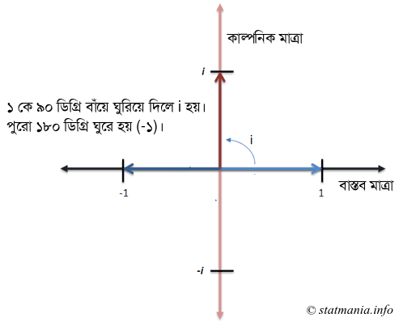

চেনাজানা সংখ্যাগুলোর সূচকের নিয়ম তো আমরা জানি। $3^2$ এর অর্থ হলো $3 \times 3$। মানে ৩ কে নিজের সাথে দুইবার গুণ করা। কিন্তু [কাল্পনিক সংখ্যা](https://www.statmania.info/2019/07/imaginary-number.html)  $i^i$ এর মানে কী? এর মানই বা কী হবে? কেন হবে? সেটার অর্থ কী? 

 

জটিল জিনিসকে সহজ করে চিন্তা করি।  $i^i$কে $1 \cdot i^i$ চিন্তা করি। মানে আমরা ১ থেকে $i^i$ সংখ্যাটিতে যাব। আর ভাবব সেটার মানে আসলে কী। 

[আগেই বলেছি](https://www.statmania.info/2020/09/euler2.html), ১ যেকোনো গুণের মৌলিক অংশ। ১-কে বলা হয় গুণজ অভেদ। যেভাবে যোগ-বিয়োগের মৌলিক অংশ শূন্য। যোগ-বিয়োগ করে কিছু না থাকলে থাকে শূন্য। গুণ (ও ভাগে) কাটাকাটি করে কিছু নেই মানে ১ আছে। যেমন, ৩কে ২ দিয়ে গুণ করা মানে আসলে ১কে ৬ দিয়ে গুণ করা। গুণ মানে আসলে ১কে ফুলিয়ে দেওয়া।

 

 সংখ্যাকে একটু ভিন্নভাবে চিন্তা করতে শুরু করি। ধরুন একটি গ্রামে ৩০০ জন শিক্ষিত মানুষ আছেন। এখন আপনি চাইলেই এই ৩০০ সংখ্যাকে ভিন্নভাবে চিন্তা করতে পারেন। শুরু করি ১ থেকে। শুরুতে গ্রামে একজন শিক্ষিত মানুষ ছিলেন। তিনি এবং ক্রমেই তার ছাত্ররা বাকিদের শিক্ষিত করেছেন। 

 

যেহেতু বৃদ্ধির (growth) কথা চলে এল, তাই কাজে আসবে আসবে সূচকীয় ফাংশন। বৃদ্ধির সাথে সূচকীয় ফাংশনের সম্পর্ক নিয়ে কিঞ্চিত (তবে এ লেখার জন্যে যথেষ্ট) আলোচনা আছে [এখানে](https://www.statmania.info/2016/09/5-numbers-relation.html)। সূচকীয় বৃদ্ধিটা মূলত ব্যবহার করা হয় অবিরাম বা প্রতি মুহূর্তেবৃদ্ধি পাওয়া জিনিসের ক্ষেত্রে। 

 সূচকীয় ফাংশনের ব্যবহারটা দেখে নেই। সূত্রটা এ রকম: $P=P_oe^{rt}$

 

এখানে 

 

P =বৃদ্ধির পরে যা হবে। আমাদের উদাহরণে এটা ৩০০। 

$P_o$= শুরুতে যা ছিল। এটা আমাদের উদাহরণে ১। কারণ আমরা ধরে নিয়েছি ১ জন শিক্ষিত মানুষ আছেন। 

e = অয়লার সংখ্যা (২.৭১৮...)। [এখানে](https://www.statmania.info/2016/09/5-numbers-relation.html) এটা নিয়েও আলোচনা আছে। 

r = বৃদ্ধির হার 

t = $P_o$ থেকে $P$ হতে যতটুকু সময় লাগবে। 

 

সূত্রে মানগুলো বসালে আমরা পাই, 

 

$300=1 \cdot e^{rt}$

 

বা $\ln(300)=rt$

 

বোঝার সুবিধার্থে সময়কে এক একক (যেমন এক মাস) ধরে নিলে এই কথার অর্থ হয়: $\ln(300)$ হারে ১ জন শিক্ষিত মানুষ গ্রামের সবাইকে অবিরাম পড়াতে থাকলে এক মাসেই ৩০০ জন মানুষ শিক্ষিত হয়ে যাবেন। $\ln(300)$ এর মান ৫.৭০২ দেখে ভাববেন না, কীভাবে এটা সম্ভব? মনে রাখতে হবে, তিনি একজনকে শিক্ষিত করা মাত্রই সেই শিক্ষিত মানুষ আরেকজনকে, তিনি আরেকজনকে, ... এভাবে শিক্ষাদান এগিয়ে যেতে থাকবে। 

 

তার মানে, সহজ কথা হলো, ৩০০ মানে আমরা বুঝব, $\ln(300)$ হারে অবিরাম কিছু একটা বৃদ্ধি পেতে থাকলে চূড়ান্ত মান হবে ৩০০। একইভাবে $\ln(5)$ হারে একইভাবে বৃদ্ধি পেলে মান হবে ৫। এটাই হলো সংখ্যাকে অন্য আরেকভাবে চিন্তা করা। সবসময় হয়ত আপনি ৩, ৫ কে এভাবে সূচকীয় বৃদ্ধির মাধ্যমে পাবেন না। তবে এটাও কিন্তু সংখ্যাকে অনুভব করার আরেকটি উপায়। 

দেখা যাক, এই অনুভব দিয়ে কাল্পনিক সংখ্যাকে বোঝা যায় কি না। প্রথমে ১ থেকে i তে যাওয়া যাক। এজন্যে আমাদেরকে ৯০ ডিগ্রি বাঁয়ে ঘুরতে হবে। মানে X অক্ষ থেকে ঘড়ির কাঁটার উল্টো দিকে ঘুরে Y অক্ষে যেতে হবে। কারণ i এর অবস্থান ১ একক সমান দৈর্ঘ্যের Y অক্ষে। 

 

::: {.separator style="clear: both; text-align: center;"}

:::

তাহলে ১ থেকে iতে যেতে হলে আমাদেরকে $\frac {\pi} 2$ পরিমাণ বা ৯০ ডিগ্রি ঘুরতে হবে। তাহলে আমাদের বৃদ্ধির হার হবে $i \cdot \frac{\pi}{2}$। 

 

বৃদ্ধির ফর্মুলাটা হলো, $e^{rt}$। আমাদেরকে এই ফর্মুলা দিয়ে $i$ অবস্থানে যেতে হবে। তাহলে ১ থেকে ১ একক সময়ে i অবস্থানে যেতে হলে আমাদেরকে ঐ সময়ে ৯০ ডিগ্রি ($\frac{\pi}{2}$ রেডিয়ান) ঘুরতে হবে। অতএব, ১ থেকে $i$ পেতে আমরা এই সূত্র ব্যবহার করতে পারি 

  

$i=e^{i \frac{\pi}{2}}$

 

একে আরেকভাবেও চিন্তা করা যায়। ১ থেকে (-১) এ যেতে আমরা ১৮০ ডিগ্রি ঘুরি। আর সেটাকে অয়লারের [অভেদ দিয়ে প্রকাশ করি](https://www.statmania.info/2020/09/euler2.html) $e^{i \pi}$ দিয়ে। তাহলে ১৮০ এর অর্ধেকটা মানে ৯০ ডিগ্রি বা $i$ অবস্থানে যেতে ফর্মুলাটা হবে $e^{i \frac{\pi}{2}}$। 

এ তো গেল i। কিন্তু i এর পাওয়ারও তো i। সেটার কী হবে? এটা বলছে আমাদেরকে $i \frac{\pi}{2}$ হারের বদলে  $i \frac{\pi}{2} \cdot i$ হারে বৃদ্ধি করতে হবে। ঠিক যেমন $3^4$ মানে আমাদেরকে $\ln(3)$ হারে বৃদ্ধি করে তার আবার চারগুণ যেতে হবে। মানে নতুন হার হয়েছিল $\ln(3) \times 4$।

 

তার মানে বৃদ্ধির হার হবে $i \frac{\pi}{2} \cdot i = \frac{\pi}{2} \cdot -1 = - \frac{\pi}{2}$ 

 

 কারণ, আমরা জানি, $i \cdot i $ বা $i^2$ এর মান (-1)। 

 আমাদের বৃদ্ধির হারটা বাস্তব সংখ্যা হয়ে গেল!  কিন্তু নেগেটিভ। এর মানে আসলে বৃদ্ধির বদলে হ্রাস ঘটবে। তার মানে, আমরা শুরু করেছিলাম ১ থেকে। আর এখন যাকে পাব সে হবে ১ এর চেয়ে ছোট। দেখা যাক, সেটা কী? 

### 0.2078796 {#section style="text-align: center;"}

::: {style="text-align: left;"}
আপনি কম্পিউটারের $i^i$ বা $e^{- \frac{\pi}{2}}$ যেটাই দিন, উপরের মানটাই আসবে। যেমন R প্রোগ্রামিং দিয়ে করলে
:::

::: {style="text-align: left;"}
 
:::

::: {style="text-align: left;"}
 

```text
1i^1i
exp(-pi/2)
```

 
:::

::: {style="text-align: left;"}
 
:::

::: {style="text-align: left;"}
তাহলে দেখতে অদ্ভুত হলেও কাল্পনিক সংখ্যার ভিত্তি ও সূচক মিলেও পাওয়া গেল বাস্তব সংখ্যা! 
:::

::: {style="text-align: left;"}
 
:::

::: {style="text-align: left;"}

:::

::: {style="text-align: left;"}
i এর মান যে $e^{i \cdot \frac{\pi}{2}}$ সেটা আমরা অয়লারের ফর্মুলা থেকেও বের করতে পারি। আমরা জানি, $e^{ix}=cos(x)+isin(x)$। এখন, এখানে x এর জায়গায় $\frac{\pi}{2}$ বসালে হয়
:::

::: {style="text-align: left;"}
 
:::

::: {style="text-align: left;"}
 
:::

::: {style="text-align: left;"}
$e^{i \frac{\pi}{2}}=cos(\frac{\pi}{2})+isin(\frac{\pi}{2})=0+i \cdot 1=i$
:::

::: {style="text-align: left;"}
 
:::

::: {style="text-align: left;"}
**সূত্র **
:::

::: {style="text-align: left;"}
১। [ম্যাথসেন্ট্রাল](http://mathcentral.uregina.ca/QQ/database/QQ.09.08/h/randomness1.html)
:::

::: {style="text-align: left;"}
২।  [বেটার এক্সপ্লেইন্ড](https://betterexplained.com/articles/intuitive-understanding-of-eulers-formula/)
:::

::: {style="text-align: left;"}
 
:::

::: {style="text-align: left;"}
**আরও পড়ুন **
:::

::: {style="text-align: left;"}
[অয়লার অভেদ এত মজা](https://www.statmania.info/2020/09/euler2.html)
:::

::: {style="text-align: left;"}
[সবচেয়ে সুন্দর সমীকরণ](https://www.statmania.info/2016/09/5-numbers-relation.html)
[কাল্পনিক সংখ্যা কি কাল্পনিক?](https://www.statmania.info/2019/07/imaginary-number.html)
:::
