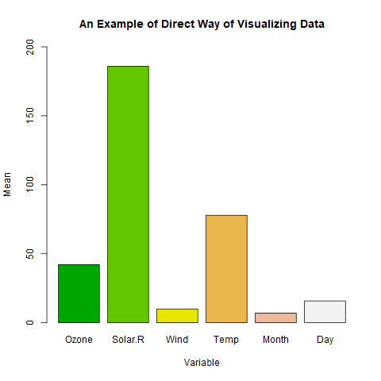

ধরুন আমাদের কাছে একটি ডেটাফ্রেইম আছে যাতে অনেকগুলো কলাম আছে। এগুলোর সবগুলোর গড় , মধ্যমা বা পরিমিত ব্যবধান আমরা এক কমান্ডেই বের করতে চাই। 

আজকের পোস্টে আমরা R-এর বিল্ট-ইন ডেটাসেট *airquality* ব্যবহার করব। এতে ৬টি কলাম বা চলক আছে। ***Rstudio*** ব্যবহার করলে আপনি *View(airquality)* দিয়ে ডেটাকে একনজর দেখে নিতে পারেন। ***Rstudio*** ব্যবহার না করে থাকলে প্রথমে ডেটাকে লোড করে নিতে হবে।  

```r
data(airquality)
```

এবার *str* দিয়ে দেখে নিতে পারেন কলাম বা চলকগুলো কী ধরনের। দেখা যাবে, পাঁচটি কলামই পূর্ণ সংখ্যা দিয়ে তৈরি। একটিতে আছে ভগ্নাংশ। তাহলে সবগুলো কলামই সংখ্যাবাচক। 

তাহলে এবার গড় করে ফেলি। 

স্বাভাবিক উপায়ে গড় বের করতে গেলে হয়ত আমরা এভাবে করব:

```r
mean(airquality$Ozone, na.rm = TRUE)
mean(airquality$Wind, na.rm = TRUE)
mean(airquality$Temp, na.rm = TRUE)
```

এখানে *na.rm = TRUE* দেওয়ার কারণ হলো, ডেটায় কিছু মিসিং ভ্যালু  (*NA*) আছে। এই কথা দিয়ে আমরা বলে দিয়েছি, সেগুলোকে বাদ দিয়ে হিসাব করে দাও। 

কিন্তু এভাবে একটা একটা করে গড় বের করা প্রোগ্রামিং-এর আদর্শ বিরোধী। কাজটা করে ফেলতে হবে একটা কমান্ড দিয়েই। আর সেটা করার উপায় আছে বেশ কয়েকটি। 

আমরা চাইলে এভাবে করতে পারি:

```r
apply(airquality, 2, mean)
```

 

 এখানে 2 দিয়ে বোঝানো হলো, আমরা কলামের গড় চাই। সারির (row) গড় চাইলে দিতাম ১। খেয়াল করে দেখুন চলকের নামসহ কত সুন্দর করে গড় দেখানো হয়েছে। আরও খেয়াল করলে দেখবেন, প্রথম দুই কলামের গড়ের জায়গায় *NA* লেখা। এর কারণ *na.rm = TRUE* দেওয়া হয়নি। দিয়ে দিন:

 

```r
apply(airquality, 2, mean, na.rm = T)
```

 

এখানে আমরা *TRUE* কে সংক্ষেপে *T* লিখেছি। এভাবে লিখলেও চলে, তবে আদর্শ কোডিং হলো না আর কি। 

 শুধু কি গড়? একইভাবে আমরা সব কলাম বা সারির অন্য কোনো তথ্যও বের করতে পারব। শুধু এতে ফাংশনটার নাম দিয়ে দিতে হবে। যেমন মধ্যমা বা পরিমিত ব্যবধান (standard deviation) বের করতে হলে:

```r
apply(airquality, 2, median, na.rm = T)
apply(airquality, 2, sd, na.rm = T)
```

এখন, মজার ব্যাপার হলো গড় বের করতে চাইলে এতটুকুও কষ্ট করার দরকার নেই আসলে। কল্পনাও করতে পারবেন না, এর চেয়েও সহজ একটি কোডও আছে। কলামের গড় বের করতে চাইলে:

 

```r
colMeans(airquality)
```

 

একইভাবে সারির গড় বের করতে চাইলে ফাংশনটা হবে *rowMeans()*। 

আপাতত আর কোনো কৌশল দেখব না। তার চেয়ে একটা সমস্যার সমাধান করি। আমরা উপরে যে উদাহরণ দেখলাম, এখানে সবগুলো কলাম ছিল সংখ্যাসূচক। নিউমেরিক বা ইন্টিজার। যদি এক বা একাধিক character ভেক্টর থাকে? যেমন ধরুন আমরা যদি mpg ডেটা দিয়ে এই কাজ করতে যাই তাহলে কী হয় দেখুন:

```r
colMeans(mpg)
```

 

error দেখাবে। তাহলে সমাধান হলো সংখ্যাবাচক কলামগুলোকে আলাদা করে নিতে হবে।

```r
mpg_num <- mpg[, sapply(mpg, is.numeric)]
```

 

অথবা ব্যবহার করতে পারেন *tidyverse* প্যাকেজমালা থেকে *dplyr* এর ফাংশনটা।

```r
mpg_num <- select_if(mpg, is.numeric)
```

 

এসব উপায়ে গড় বের করার আরেকটা সুবিধাও আছে। গ্রাফ আঁকতে চাইলেও ডেটা প্রস্তুত হয়েই আছে। যেমন ধরুন, আমরা যদি *airquality* ডেটার গড়গুলো বারপ্লটে দেখাতে চাই। 

```r
barplot(aqm)
```

  ---------------------------------------------
        
   ডেটাফ্রেইমের কলাম ইনফরমেশন থেকে সহজ বারপ্লট
  ---------------------------------------------

☛ প্লট আঁকার কলাকৌশল দেখতে দেখুন এই [লিঙ্কটি](https://www.statmania.info/search/label/plot?max-results=12)। 

ব্যস! হ্যাপি প্রোগ্রামিং !!!
