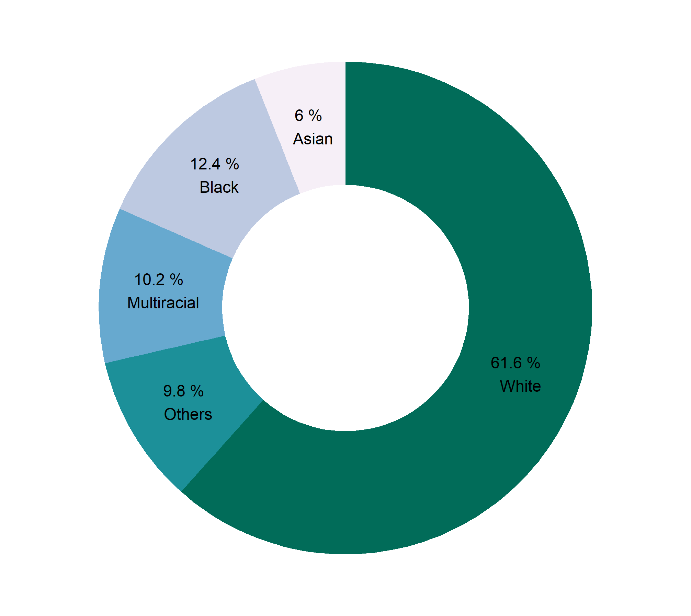

পত্রিকার পাতা খুললেই ইদানিং সুন্দর সুন্দর ডোনাট চার্ট দেখা যায়। এগুলোও আসলে পাই চার্টই। তবে মাখখানে থাকে একটি ছিদ্র। 

::: {.separator style="clear: both; text-align: center;"}

:::

কিছু দিন মনে করতাম, R মনে হয় এমন প্লট বানাতে পারে না। মজার ব্যাপার হলো, অন্য কেউ পারে R পারবে না এমনটা হতেই পারে না। হলে এমন হতে পারে যে R পারে কিন্তু অন্যরা (যেমন এক্সেল, SPSS পাইথন) পারে না। 

এই প্লটটাও R-এই বানিয়েছি।

এমনিতে R-এর ggplot2 প্যাকেজে পাই চার্ট বানানোর জন্যে কোনো ফাংশন নেই। তবে একটু ঘুরিয়ে চিন্তা করলেই বোঝা যায়, পাই চার্ট আসলে এক ধরনের বার চার্টই। তবে বারগুলো খাড়াভাবে না থেকে কৌণিকভাবে অবস্থান করছে। একটা যেখানে শেষ আরেকটা সেখানে শুরু। 

ওপরের ডোনাট চার্টটির দিকেই দেখুন। এরিয়াগুলোকে চাইলেই বার হিসেবে কল্পনা করতে পারেন। অতএব, ডোনাট চার্টের কায়দা কানুন বুঝতে হলে বার চার্ট বানানোর নিয়ম জানতে হবে। একদম চিন্তা নেই, অনেকগুলো পোস্টে সেটা আমরা ব্যাখ্যা করেছি। 

☛ [বার প্লট বানানোর কায়দা কানুন](2019-04-r-ggplot2-rcolorbrewer.html)

তাহলে বানিয়ে ফেলি। ও, আগে কিছু ডেটা বানিয়ে নেই। টেবিলটা [উইকিপিডিয়া](https://en.wikipedia.org/wiki/United_States) থেকে নেওয়া। 

```r
us_races <- tibble(
  Race = c("White", "Black", "Multiracial", "Asian", "Others"), 
  Percentage = c(61.6, 12.4, 10.2, 6, 9.8))
```

এখানে আমি ডেটাফ্রেইম তৈরি করার জন্যে *tidyverse* প্যাকেজমালার *tibble() *ফাংশন ব্যবহার করেছি। এভাবে করতে হলে আপনাকে *library(tidyverse)* কমান্ড দিয়ে এটা লোড করে নিতে হবে। চাইলে এটা লোড না করেও ডেটা বানাতে পারেন। সেক্ষেত্রে ফাংশনটা হবে *data.frame()*। তবে *tidyverse* লোড করলে সাথে সাথে *ggplot2ও* লোড হয়ে যায়। আলাদাভাবে ggplot2 লোড করতে রান করুন *library(ggplot2)*।  

এবার প্লট করে ফেললেই হলো। 

 

```r
us_races %>% ggplot(aes(2, Percentage, fill = Race))+
  geom_col(position = "stack", width = 1)+
  xlim(0.5, 2.5)+
  coord_polar("y")+
  theme_void()+
  geom_text(aes(label = paste0(Percentage, " % \n ", Race)), 
            position = position_stack(vjust = 0.5), size = 4)+
  scale_fill_brewer(palette = 10)+
  theme(legend.position="none")
```

বার প্লট বোঝার পরেও এটা না বুঝতে না পারলে কিছু ব্যাপার খেয়াল করুন:\`

-   এখানে পাই চার্ট বানানোর সুবিদার্থে আমরা geom\_bar এর বদলে geom\_col ব্যবহার করেছি। 
-   xlim দিয়ে ডোনাটের পুরুত্ব ঠিক করা হয়েছে। এর ওপর নির্ভর করে পাইয়ের ভেতরের ছিদ্র ছোট-বড় হবে।
-   মূলত coord\_polar দিয়ে বারগুলোকে কৌণিক রূপ দেওয়া হয়েছে।
-   theme\_void দিয়ে অপ্রয়োজনীয় ব্যাকগ্রাউন্ড রিমুভ করা হয়েছে। 
-   geom\_text সম্পর্কে আরও জানতে এই [লেখাটি দেখুন](2019-10-new-scatter.html)। 
-   বাকি জিনিসগুলো বিভিন্ন লেখায় আগেই বলেছি। দেখতে চাইলে [দেখে নিন](../tags.html#tag=plot)।
-   প্লট কালারিং করার [নানান উপায় দেখুন এখানে](2018-07-r-colors.html)।

আজ এ পর্যন্তই।
