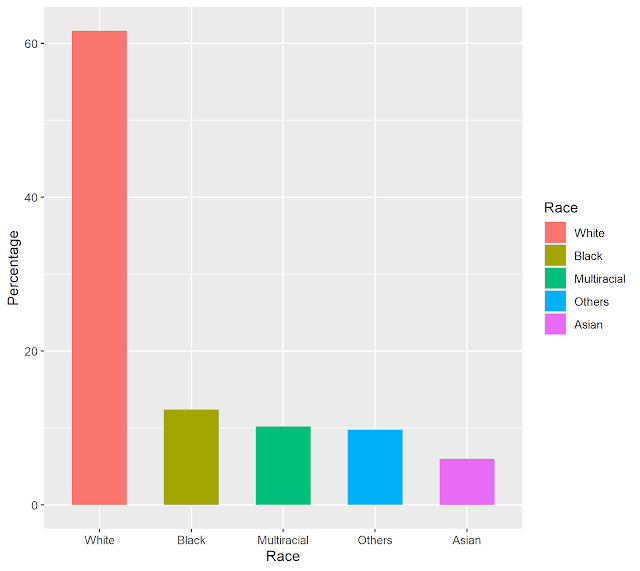
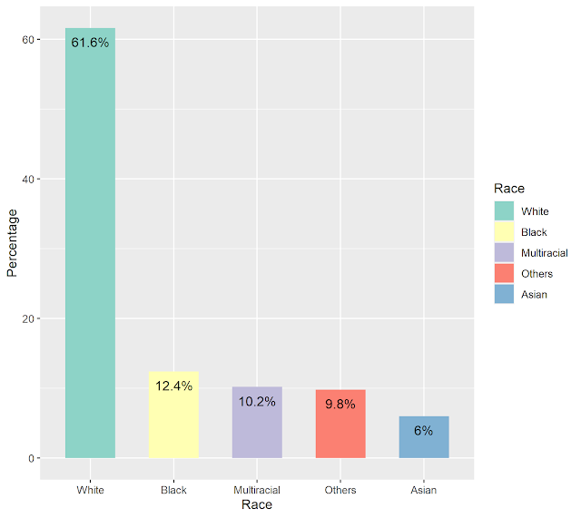
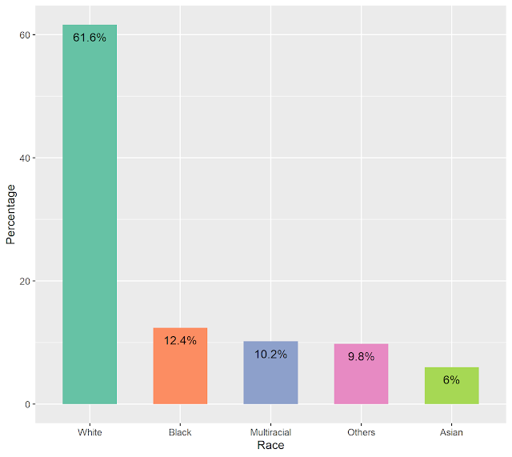
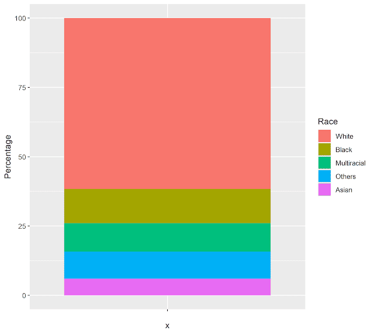
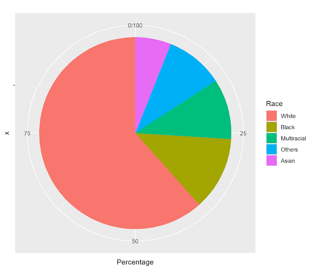
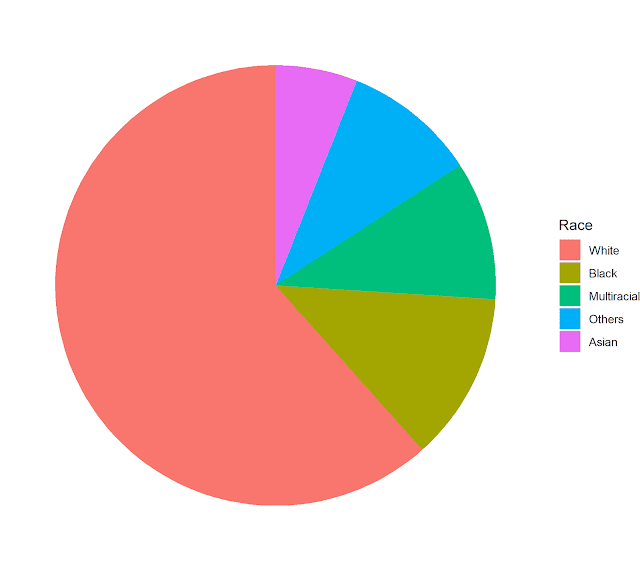
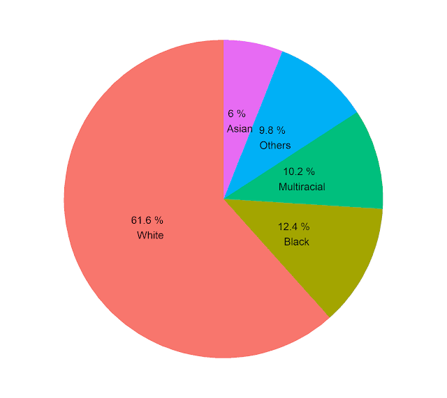
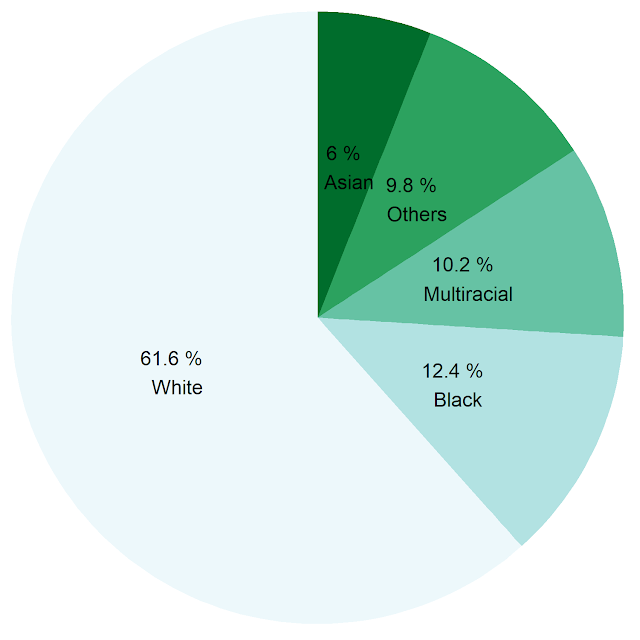
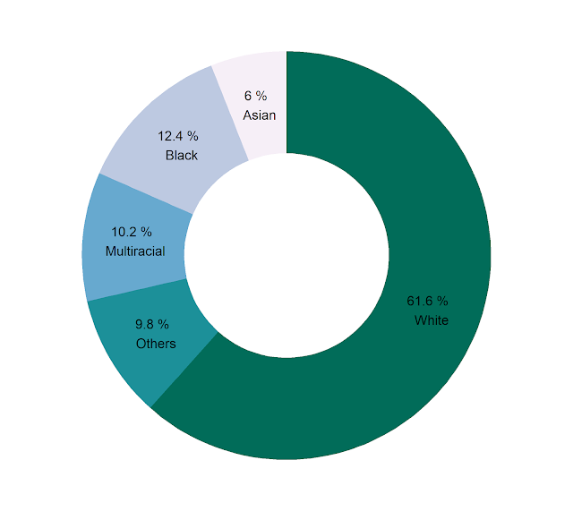

হ্যাঁ, *R* এর *ggplot2* প্যাকেজে পাই চার্টের মতো নান্দনিক চার্ট আঁকার সরাসরি কোনো উপায় নেই। আঁকতে হয় বার চার্ট থেকে ঘুরিয়ে। কিন্তু আসলেই কি চার্ট দুটো আলাদা? আসলে তো পাই চার্টও এক ধরনের বার চার্টই! যেখানে বারগুলো সোজা দাঁড়িয়ে না থেকে বৃত্তাকার পথে চলছে। উপরের দিকে না গিয়ে ঘুরছে। 

::: {.separator style="clear: both; text-align: center;"}

:::

এই যে চার্টটিই দেখুন। পাই চার্টের এরিয়াগুলোকে চাইলে আপনি কৌণিক পথ বেয়ে চলা বার বা স্তম্ভ মনে করতে পারেন। 

এখন আমরা ধাপে ধাপে দেখব, কীভাবে বার চার্টটিকে আপনি পাই চার্টে রূপান্তরিত করবেন। 

আমরা কাজ করব নিচের ডেটাটি দিয়ে। এটা হলো যুক্তরাষ্ট্রের বিভিন্ন জাতিগোষ্ঠীর মানুষের শতাংশ। 

```r
us_races <- data.frame(
  Race = c("White", "Black", "Multiracial", "Asian", "Others"), 
  Percentage = c(61.6, 12.4, 10.2, 6, 9.8))
```

এবার এখান থেকে বার চার্টটি আগে এঁকে ফেলি। বার চার্টের সংখ্যাগুলো একটি কলামে উপস্থিত থাকলে *geom\_bar()* এর ভেতরে *stat="identity"* দিতে হয়। আর যদি এভাবে থাকে: *true*, *false*, *false*, *true* ইত্যাদি, তাহলে *stat="identity"* দেওয়া লাগবে না। *width* না দিলেও হবে। সেক্ষেত্রে স্বয়ংক্রিয়ভাবে বারগুলো মোটা বা চিকন হবে। 

```r
us_races %>% ggplot(aes(Race, Percentage, fill = Race))+
  geom_bar(stat="identity", width = 0.6)
```

%\>% চিহ্নটির নাম পাইপ অপারেটর। এভাবে লেখা আর *ggplot(data=us\_races, aes...)* লেখা একই কথা। তবে এটা ব্যবহার করতে হলে *tidyverse* প্যাকেজ লোড করে নিলেই। একই সাথে পাইপের *magrittr*, *ggplot2*, *dplyr*সহ অনেকগুলো দরকারি প্যাকেজ লোড হয়ে যাবে। 

::: {.separator style="clear: both; text-align: center;"}

:::

এবারে *RColorBrewer* প্যাকেজ দিয়ে বারের কালারগুলো সাজিয়ে নেই। না করলেও ক্ষতি নেই। পাশাপাশি বারের মধ্যেই প্রতিটি বারের সাথে সংশ্লিষ্ট সংখ্যাগুলো দেখিয়ে দেই। 

☛ [RColorBrewer যেভাবে প্লটকে সুন্দর করে](2019-04-r-ggplot2-rcolorbrewer.html)

☛ [প্লট লেবেলিং করবেন যেভাবে](2019-10-new-scatter.html)

```r
us_races %>% ggplot(aes(Race, Percentage, fill = Race))+
  geom_bar(stat="identity", width = 0.6)+
  scale_fill_brewer(palette = "Set2")+
  geom_text(data = us_races, aes(Race, Percentage-2, 
                                 label=paste0(Percentage, "%")))
```

 

::: {.separator style="clear: both; text-align: center;"}

:::

খেয়াল করুন বারে ডান পাশে লিজেন্ড থাকার আসলে কোনো প্রয়োজন নেই। এটাকে ফেলেই দেওয়া যায়। 

```r
us_races %>% ggplot(aes(Race, Percentage, fill = Race))+
  geom_bar(stat="identity", width = 0.6)+
  scale_fill_brewer(palette = "Set2")+
  geom_text(data = us_races, aes(Race, Percentage-2, 
                                 label=paste0(Percentage, "%")))+
  theme(legend.position = "none")
```

::: {.separator style="clear: both; text-align: center;"}

:::

এবার পাই চার্ট বানানো শুরু করা যাক। প্রথম কাজ হলো, x অক্ষে Race রাখা যাবে না। পাই চার্টে যেহেতু এরিয়াগুলো একটা আরেকটার ওপরে থাকবে, তাই y অক্ষে সংখ্যাগুলো বসিয়ে Race দিয়ে কালার করে নিচ্ছি। 

```r
us_races %>% ggplot(aes(x="", y = Percentage, fill = Race))+
  geom_bar(stat="identity")
```

::: {.separator style="clear: both; text-align: center;"}

:::

এটাকে পাই চার্ট বলার সময় হয়নি এখনও। পাই চার্ট হবার জন্যে প্রস্তুত বলতে পারি। 

এখন সে কাজটাই করব। বারগুলোকে ঘুরিয়ে দিতে হবে। এটাই করবে *coord\_polar()* ফাংশনটা। 

```r
us_races %>% ggplot(aes(x="", y = Percentage, fill = Race))+
  geom_bar(stat="identity")+
  coord_polar("y")
```

::: {.separator style="clear: both; text-align: center;"}

:::

দেখতে পাই চার্টের মতোই হয়েছে। তবে x অক্ষ, y অক্ষ ও আরও নানান জায়গায় অপ্রয়োজনীয় জিনিসে ভর্তি। এগুলো সরিয়ে একটু ক্লিন করি। *theme\_void()* কাজটা করে দেবে। 

```r
us_races %>% ggplot(aes(x="", y = Percentage, fill = Race))+
  geom_bar(stat="identity")+
  coord_polar("y")+
  theme_void()
```

::: {.separator style="clear: both; text-align: center;"}

:::

এখন মোটামুটি কাজ চলার অবস্থায় আছে। এখনও অনেক কাজ করার সুযোগ আছে। লিজেন্ড না দিয়ে এরিয়ার ওপরই লেবেল দিয়ে দিলে ভাল হয়। এছাড়াও এরিয়ার মধ্যেই সংখ্যা বা পারসেন্টেজ দেখানো যায়। আমাদের ডেটায় অবশ্য সংখ্যাগুলোই পারসেন্টেজ। তাই দুটো একই কথা। 

```r
us_races %>% ggplot(aes(x="", y = Percentage, fill = Race))+
  geom_bar(stat="identity")+
  coord_polar("y")+
  theme_void()+
  theme(legend.position = "none")+
  geom_text(aes(label = paste0(Percentage, " % \n ", Race)), 
            position = position_stack(vjust = 0.5), 
            size = 4, color = "black")
```

::: {.separator style="clear: both; text-align: center;"}

:::

এবার কালার কম্বিনেশন আরেকটু ঠিক করে নেই। 

```r
us_races %>% ggplot(aes(x="", y = Percentage, fill = Race))+
  geom_bar(stat="identity")+
  coord_polar("y")+
  theme_void()+
  theme(legend.position = "none")+
  geom_text(aes(label = paste0(Percentage, " % \n ", Race)), 
            position = position_stack(vjust = 0.5), 
            size = 4, color = "black")+
  scale_fill_brewer(palette = 2)
```

::: {.separator style="clear: both; text-align: center;"}

:::

::: {.separator style="clear: both; text-align: center;"}

:::

চাইলে তো আরও কত কিছুই করা যায়। করার আগে চিন্তা করতে হবে সেটা কতটা অর্থবহ। 

পাই চার্ট ভাল না লাগলে যদি ডোনাট চার্ট আঁকতে চান, [সেটাও করতে পারেন](2021-08-donut.html)। 

::: {.separator style="clear: both; text-align: center;"}

:::
